# Representation Fragility Lab

> **Every representation of a signal is a lens with blind spots.**
> Look through many lenses at once, compare what they see, and the
> disagreements reveal what the signal really is.

Audio is the first medium, images the second. Full goal and roadmap: [docs/VISION.md](docs/VISION.md).

## The loop

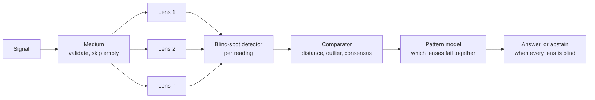

One medium-agnostic core ([`src/core`](src/core), [design note](docs/core_interfaces.md)). A medium only adds its lenses and a distance function.

| Medium | Quantity | Lenses |
|---|---|---|
| Audio | pitch (f0) | STFT, ACF, Cepstrum (+ CQT, wavelet) |
| Images | dominant orientation | structure tensor, HOG, FFT, Gabor, Radon |

## Headline results

### 1. Disagreement predicts when a lens is wrong

ROC AUC for predicting a gross error (0.5 = chance):

| | Own confidence | Disagreement |
|---|---|---|
| Audio, 3 lenses (Exp 042) | 0.81 – 0.88 | **0.95 – 0.99** |
| Images, 5 lenses (Exp 044) | 0.59 – 0.89 | **0.96 – 0.98** |

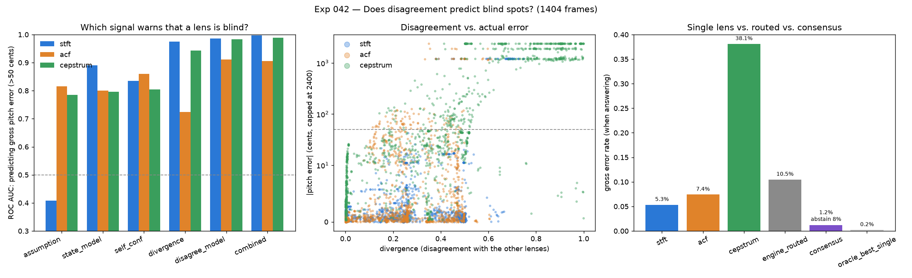

### 2. Comparing lenses gives better answers (audio)

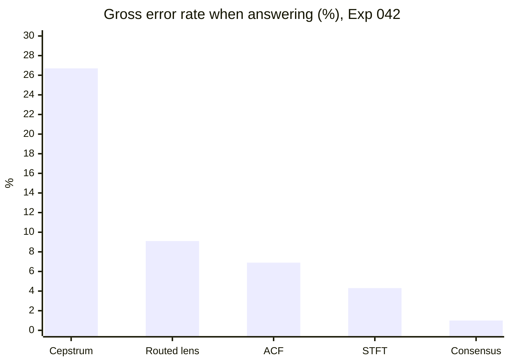

The consensus abstains on 5.6% of frames, almost all at −5 dB SNR where no lens is confident.

### 3. Lenses fail in families

| Pair (audio, Exp 043) | Fail together vs chance |
|---|---|
| ACF + Cepstrum | **2.1×**, both measure periodicity |
| STFT + ACF | 1.6× |
| STFT + Cepstrum | **0.08×**, the most complementary pair |

Disagreement patterns explain **2.5×** more of the true failure structure than the input-only state map (NMI 0.546 vs 0.223).

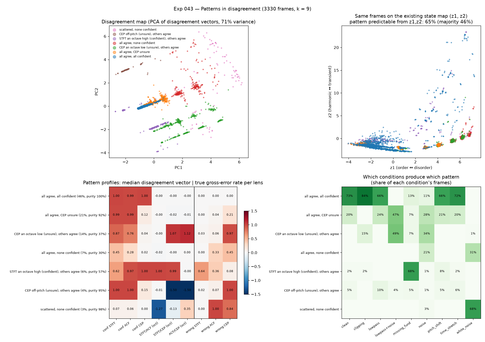

On images the same split appears between local (gradient) and global (spectral, projection) lenses, and correlated failures outvote the right lens: the consensus (9.8%) loses to the best single lens (Radon, 4.8%).

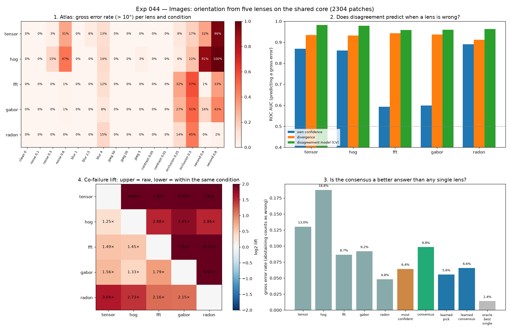

### 4. On real data (Exp 045)

The key claims re-run on vocadito (real singing), MDB-stem-synth (230 resynthesised performances) and BSDS500 (photos with human boundaries):

| Claim | Real data |
|---|---|
| Disagreement predicts when a lens is wrong | **Holds**: AUC 0.86–0.99 (audio), 0.87–0.92 (photos) |
| The consensus is a better answer (audio) | Holds on MDB-stem-synth (7.3% vs 9.9%); a tie on vocadito |
| ACF + Cepstrum share a blind spot | Holds (2.6–3.0×); STFT + Cepstrum are no longer complementary (0.7–0.85×) |
| The framework's pitch tracker beats fixed YIN | **Does not hold**: a loss, at best a tie once its delay is removed |
| No confident answer when there is no pitch | **Failed**: breaths and consonants fool single lenses (36–99% of unvoiced frames). Fixed by a quorum of two agreeing lenses (Exp 046): 0–7%, at the cost of more abstentions in heavy noise |

Full table with every dataset, metric and confidence interval: [Exp 045 in docs/EXPERIMENTS.md](docs/EXPERIMENTS.md#exp-045--do-the-claims-survive-real-recordings-and-photos).

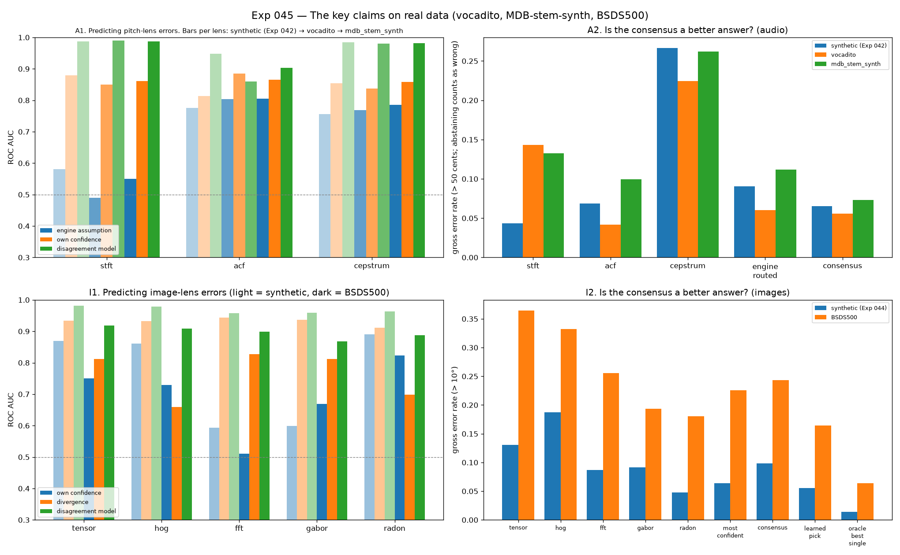

## How we got here

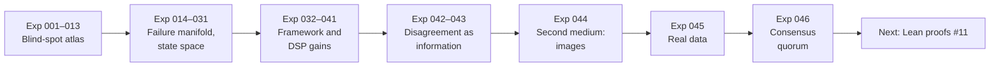

| | | | |
|---|---|---|---|
| 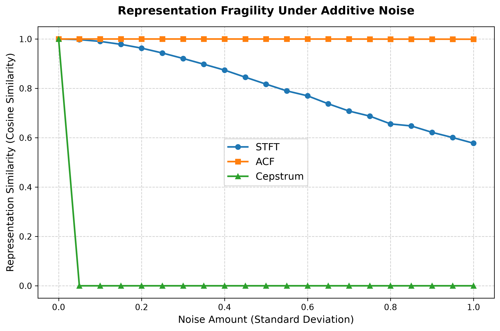 | 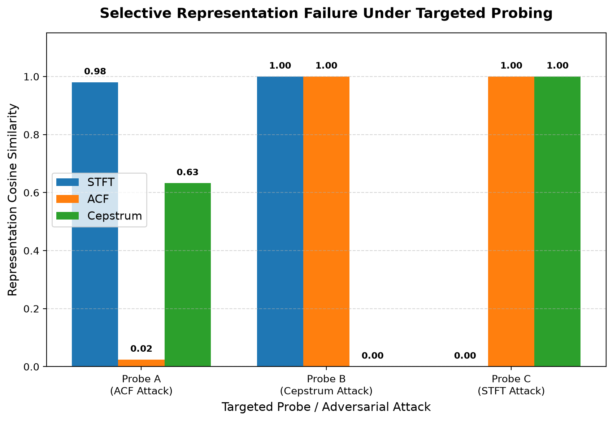 | 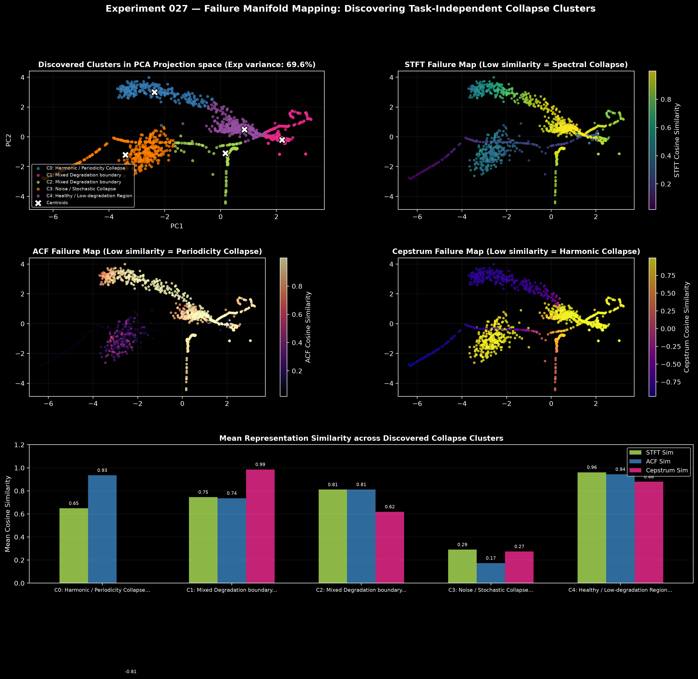 | 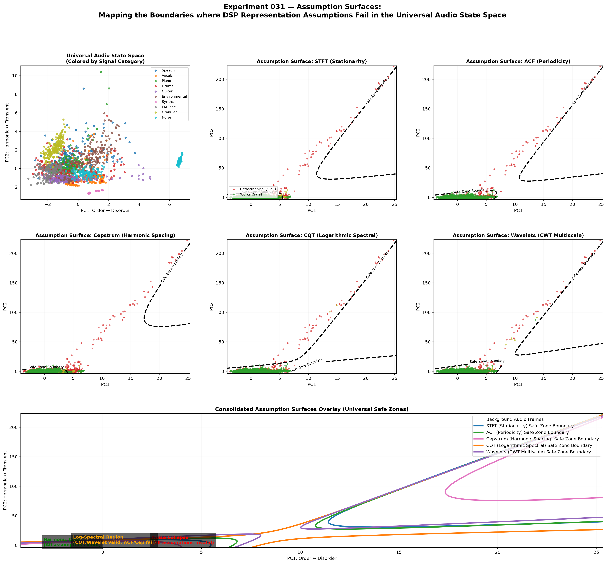 |
| Exp 004: three lenses, three failure signatures | Exp 012: probes that blind one lens | Exp 027: failures form a 2-D manifold | Exp 031: nested safe zones per lens |
| 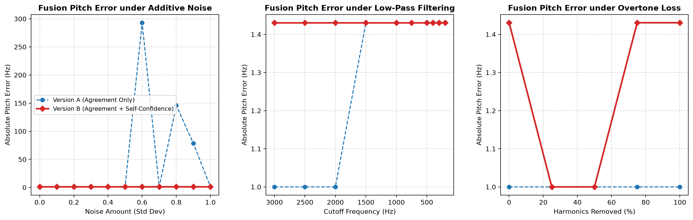 | 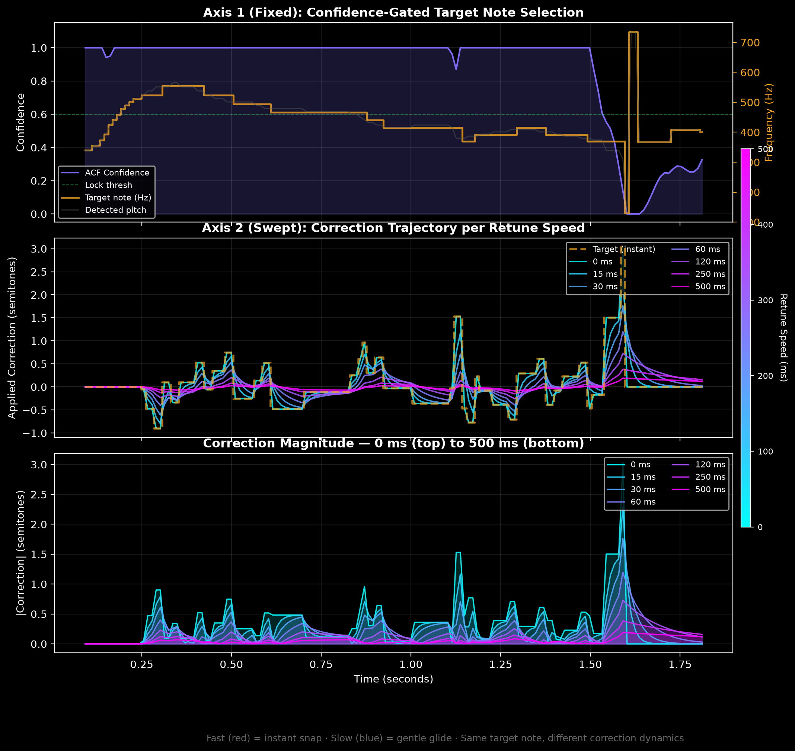 | 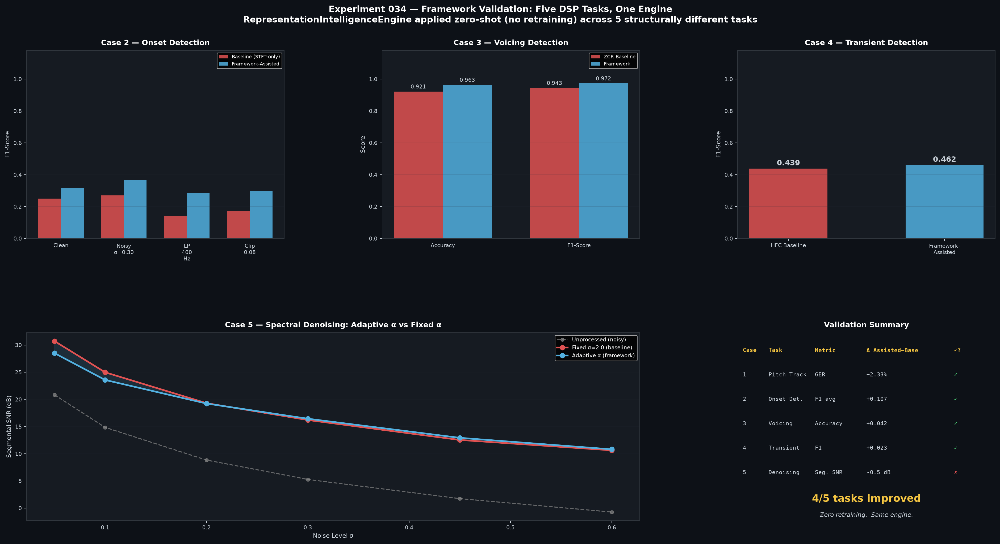 | 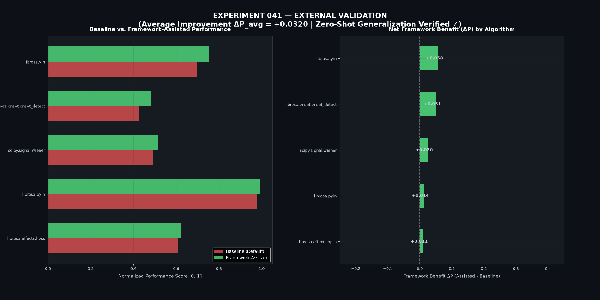 |
| Exp 015: confidence warns before failure | Exp 023: retune dynamics | Exp 034: one engine, five DSP tasks | Exp 041: gains on external algorithms |

Every experiment, with numbers and caveats: [docs/EXPERIMENTS.md](docs/EXPERIMENTS.md).

## Quick start

```bash
python3 -m venv .venv && source .venv/bin/activate
pip install -r requirements.txt && pip install -e .
python -m pytest tests
```

```python
from representation_intelligence import analyze_disagreement

report = analyze_disagreement(frame, sr=22050)   # frame: 1-D float array
report.consensus_f0                  # fused pitch, Hz
report.outlier                       # the lens most likely in a blind spot, or None
report.pair("acf", "cepstrum").cents # how far two lenses disagree
```

Library reference and examples: [docs/API.md](docs/API.md). Running each experiment: [docs/EXPERIMENTS.md](docs/EXPERIMENTS.md#running-the-experiments).

## Repository

```
src/core/            medium-agnostic interfaces and loop
src/framework/       audio: lenses, disagreement, state-space engine, plugins
src/image_medium/    images: five orientation lenses
src/experiments/     one script per experiment
data/                dataset setup (data/README.md); downloads are not committed
results/             plots and summaries
docs/                vision, experiments, API, design notes
tests/               pytest
```

## Known limits

- Most experiments use synthetic signals. Exp 045 re-tests the key claims on real data: the warning signal holds, the framework's pitch-tracker gain does not, and unpitched real frames fool the consensus.
- More lenses are not more independent votes: lenses that share a blind spot outvote the others.
- The framework's DSP gains are small and depend on the baseline (see Exp 035 and Exp 041 in [docs/EXPERIMENTS.md](docs/EXPERIMENTS.md)).
