# Experiments

The full log of the experiments behind the [README](../README.md): what each one tested, the numbers, and how to run it.
The project goal is in [VISION.md](VISION.md). Plots are in [`results/`](../results/).

## Contents

- [Research arcs](#research-arcs)
- [Representations](#representations)
- [Experiment log](#experiment-log) (Phase 1 to Phase 34, Exp 001 to Exp 054)
- [Listen tests](#listen-tests)
- [Key findings summary](#key-findings-summary)
- [Setup](#setup)
- [Project structure](#project-structure)
- [Where we are](#where-we-are)
- [Running the experiments](#running-the-experiments)

## Research arcs

The 41 experiments are the audio proof of concept for the goal above: mapping each representation's blind spots, showing that failures are structured rather than random, and turning that knowledge into self-aware DSP. Along the way they support the **Local State Hypothesis**: *DSP failures are governed by the physical state of the signal.*

We have structured the research into five coherent arcs:

* **Arc 1 — Failure Atlas** (Exp 001–013): Mapping the mathematical blind spots of STFT, ACF, and Cepstrum under noise, filtering, and clipping.
* **Arc 2 — Failure Manifold** (Exp 014–030): Discovering and mapping the 2D task-independent failure coordinates and trajectories.
* **Arc 3 — State-Space Theory** (Exp 031–036): Proving that the manifold is a projection of the physics of audio itself (nested assumption surfaces).
* **Arc 4 — Adaptive DSP Framework** (Exp 037–040): Building reference plugins and automatically learning optimal controller surfaces.
* **Arc 5 — External Validation** (Exp 041): Verifying zero-shot improvements on unmodified external algorithms.
* **Arc 6 — Disagreement as Information** (Exp 042–): Running representations side by side and learning from where they disagree, the core of [the vision](VISION.md). Exp 044 repeats it on images, the second medium; Exp 045 tests the key claims on real data; Exp 046 adds a quorum to the consensus; Exp 047 tries fusion that knows which lenses fail together; Exp 048 learns which lens to pick in each frame; Exp 049 compares rules for when to abstain; Exp 050 perturbs the signal to settle a disagreement instead of voting; Exp 051 treats disagreement as a trajectory over time; Exp 052 adds a learned lens (CREPE, ImageNet CNN features) to the classic ones; Exp 053 adds a third medium (sensor rate, ECG) on the unchanged core; Exp 054 diagnoses why the framework's pitch tracker loses on real audio.

## Representations

Three audio representations are studied throughout:

| Representation | Strength | Known Blind Spot |
|---|---|---|
| **ACF** (Autocorrelation Function) | Periodic signals, clean voice | Multiple lag peaks, rapid pitch drift |
| **STFT** (Short-Time Fourier Transform) | Spectral precision | Spectral leakage, formant attraction, noise |
| **Cepstrum** | Harmonic structure | Elevated noise floor (DC shift), sparse harmonics |

## Experiment log

### Phase 1 — Blind Spot Atlas (Exp 001–013)

#### Exp 001 — STFT Noise Fragility
Swept Gaussian noise (σ = 0.0 → 1.0) against a harmonic stack. Found STFT cosine similarity collapses faster than ACF under noise. First confirmation that representations fail differently.

#### Exp 002 — ACF Noise Fragility
Same sweep on ACF. ACF holds longer than STFT under moderate noise but collapses catastrophically at high noise due to lag peak ambiguity.

#### Exp 003 — STFT vs ACF Comparison
Side-by-side comparison of noise fragility curves. Established the "crossover point" (~σ = 0.3) where ACF becomes more fragile than STFT.

#### Exp 004 — Compare All Three Representations
Extended the comparison to include Cepstrum. Cepstrum shows a distinctive failure mode: its DC component (c₀) rises monotonically with noise, acting as a built-in danger signal.

#### Exp 005 — Pitch Shift Fragility
Swept pitch shifts (±0 to ±12 semitones). STFT degrades smoothly with shift; ACF shows octave-jump artifacts at specific intervals corresponding to harmonic aliasing in the lag domain.

#### Exp 006 — Time Stretch Fragility
Swept time stretch ratios. Found STFT is highly sensitive to temporal smearing; ACF is more robust to moderate stretching.

#### Exp 007 — Filter Fragility
Applied lowpass filters (cutoff 200 Hz → 4000 Hz). Cepstrum degrades when harmonics are removed; STFT degrades when the spectrum becomes sparse; ACF is robust to gentle filtering.

#### Exp 008 — Harmonic Removal Fragility
Systematically removed harmonics (keep only 1st, 1st+2nd, etc.). Cepstrum fails first when only one harmonic remains. Confirmed that Cepstrum requires a minimum harmonic density.

#### Exp 009 — Signal Class Baselines
Established baseline similarity scores across five signal classes: pure tone, harmonic stack, vocal-like (formants), drum-like (transient), and noise. Each representation has a unique "fingerprint" per signal class.

#### Exp 010 — Noise Fragility by Signal Class
Swept noise across all five signal classes simultaneously. Key finding: **representations that are fragile for one signal class are often robust for another** — the right representation depends on the signal.

#### Exp 011 — Metric Comparison
Compared three similarity metrics (cosine, correlation, spectral divergence) across all representations and perturbations. Cosine similarity selected as the primary metric for its stability and interpretability.

#### Exp 012 — Targeted Probing (Probe Signals)
Three representation-specific adversarial probes:
- **Probe A (ACF Attack):** 10-cent pitch shift → maximally disrupts ACF, STFT unchanged
- **Probe B (Cepstrum Attack):** Sparse harmonic + noise floor → Cepstrum collapses, others stable
- **Probe C (STFT Attack):** Half-bin spectral leakage → STFT collapses, ACF unchanged

First demonstration of **representation-specific adversarial signals**.

#### Exp 013 — Automated Blind Spot Discovery
Built a search loop that automatically finds the smallest perturbation that destroys one representation while preserving the others. Output: a parameterised blind spot for each target representation. The **Blind Spot Atlas** becomes searchable, not just catalogued.

---

### Phase 2 — Representation Intelligence (Exp 014–018)

#### Exp 014 — Hybrid Pitch Estimator
First fusion experiment. Combined ACF + Cepstrum + STFT pitch estimates using confidence-weighted averaging. Demonstrated that the hybrid fails less often than any individual representation across noise, filtering, and harmonic removal conditions.

#### Exp 015 — Self-Aware Pitch Tracking
Added one self-confidence signal per representation:
- **ACF confidence:** Peak prominence ratio — high for clean periodic signals
- **Cepstrum confidence:** Inverse DC shift — drops as noise floor rises
- **STFT confidence:** Peak dominance ratio — low for flat/noisy spectra

Compared Hybrid V1 (agreement only) vs Hybrid V2 (agreement + self-confidence). V2 dynamically muted failed representations, restoring correct pitch tracking after failures.

#### Exp 016 — Failure Forecasting
Extended self-confidence to **predictive** mode. By tracking the velocity of the Cepstrum DC shift (Δc₀), the system raised a forecast flag **46 ms before** the actual confidence threshold crossing, and **325 ms before** full representation collapse.
> *A representation that knows it is about to fail.*

#### Exp 017 — Adaptive Representation Routing
Implemented three active avoidance rules driven by the forecasts:
1. Preemptive Cepstrum muting when collapse is forecast
2. ACF → STFT routing when pitch jitter exceeds 8 Hz
3. Dynamic window size doubling when all representations enter low-confidence

Result: **34% reduction** in mean pitch tracking error vs the reactive baseline.

#### Exp 018 — Meta-Representation (Meta-Cognition)
Replaced hand-written routing rules with a **learned linear meta-layer** (10 × 3 weight matrix, solved via Moore-Penrose pseudo-inverse). The meta-layer observes representation behaviours (confidences, danger signals, velocities) and predicts optimal fusion weights.

Result: **89% reduction** in mean pitch tracking error. The system learned to route 100% of weight to STFT under extreme noise — automatically, without explicit rules.

---

### Phase 3 — Adaptive Tuner Prototype (Exp 019–023)

#### Exp 019 — Adaptive Tuner Prototype V1
First complete auto-tuner application. Block-by-block pitch correction (8192-sample window, 1024-hop, phase vocoder via librosa) using the meta-representation layer for pitch selection.

Tested on a synthesised singing voice (portamento 220→440 Hz, vibrato, two-formant envelope) across four conditions: clean, noisy (σ=0.15), lowpass-filtered (600 Hz), and hard-clipped.

Key finding: **Formant attraction** caused STFT to lock onto the 2nd harmonic (440 Hz) instead of the 220 Hz fundamental when the first formant boosted it. The meta-layer, trained on formant-filtered signals, learned negative weights for STFT in this regime — resolving the error automatically. Error: **176 Hz → 6 Hz**.

#### Exp 020 — Real Vocal Testing
Ran the full pipeline on a real human vocal snippet (~1.91s, 339–560 Hz). The meta-layer correctly routed ~90% of weight to ACF throughout — the right choice for a clean, periodic singing voice. STFT collapsed at the tail of the vocal (breath/consonant region) while ACF and the meta-tuner held.

Diagnostic: 10 distinct target notes visited across 34 analysis frames. Frame-by-frame target oscillation between adjacent notes (A#4 ↔ B4 ↔ C5) identified as the source of a "sweeping" pitch artefact.

#### Exp 021 — Note Stabilization
Added a `NoteTracker` debounce: a candidate note must appear for 3+ consecutive frames before the committed target switches. Reduced target note changes by **42%** (26 → 15). However: the tracker locked onto a wrong note during the vocal attack transient, producing a −6 semitone overcorrection.
> *The pitch detector is working. The note corrector has a new problem.*

#### Exp 022 — Confidence-Gated Note Tracking
Introduced a three-state machine for note commitment:

| State | Condition | Action |
|---|---|---|
| **UNDECIDED** | Confidence < 0.60 | Observe only. No correction. |
| **TRACKING** | Confidence ≥ 0.60, < 3 frames | Building evidence. No correction yet. |
| **LOCKED** | Confidence ≥ 0.60 for 3+ frames | Committed. Apply full correction. |
| **→ UNDECIDED** | Confidence < 0.35 for 3+ frames | Release. |

The attack artifact was eliminated. The system correctly stayed UNDECIDED during the breath/transient, entered TRACKING as the voiced tone emerged, and LOCKED by t≈0.25s. **78% of frames** ended up LOCKED on real vocal.

Key realisation: the confidence signals built for pitch estimation (Exp 015) are equally useful for **musical decision making**.

#### Exp 023 — Retune Dynamics Atlas
Discovered the two orthogonal axes of pitch correction:

**Axis 1 — Decision Intelligence** (what note to target): everything built in Exp 014–022.

**Axis 2 — Correction Dynamics** (how fast to move there): unexplored until now.

Implemented a first-order IIR smoother on the semitone correction:
```
correction[n] += alpha * (target[n] - correction[n])
alpha = 1 - exp(-hop / (T_ms * sr / 1000))
```

Swept seven retune speeds with the Axis 1 fixed at the Exp 022 confidence-gated tracker:

| Speed | Alpha | Character |
|---|---|---|
| 0 ms | 1.000 | Instant snap — robotic |
| 15 ms | 0.539 | Hard pop |
| **30 ms** | **0.321** | **Modern pop ← confirmed default** |
| 60 ms | 0.176 | Balanced |
| 120 ms | 0.092 | Natural |
| 250 ms | 0.045 | Transparent correction |
| 500 ms | 0.023 | Barely audible |

**Listen test result (real vocal, blind test): 30 ms sounds best.**

Each frame moves 32% of the remaining distance to the target note. At 11.6 ms/hop, the tuner reaches ~70% of the target in ~35 ms and ~95% in ~105 ms — fast enough to sound corrected, slow enough to sound human. This is the confirmed default retune speed for the prototype.

---

### Phase 4 — Generalisation to Other DSP Primitives (Exp 024)

#### Exp 024 — Representation Intelligence for Onset Detection
Tested if the representation intelligence architecture (confidence signals + meta-layer fusion) generalises from pitch tracking to onset detection.
- **Onset Detectors**: Spectral Flux (STFT), Prominence Drop (ACF), Peak Velocity (Cepstrum).
- **Confidence Metrics**: Reused the same logic from Exp 015/022.
- **Training**: Trained the meta-layer on clean note sequences (seeds 0–5) using Moore-Penrose pseudo-inverse.
- **Testing**: Evaluated on an independent sequence under clean, light noise ($\sigma=0.10$), and heavy noise ($\sigma=0.30$) conditions (F1-score with 50 ms tolerance).

**Results:**
- **Clean**: STFT F1 = 1.000, ACF F1 = 0.933, Cepstrum F1 = 0.889, Reactive F1 = 0.714, Meta F1 = 0.941.
- **Light Noise**: STFT F1 = 1.000, ACF F1 = 0.000, Cepstrum F1 = 0.357, Reactive F1 = 0.000, Meta F1 = 0.429.
- **Heavy Noise**: STFT F1 = 0.769, ACF F1 = 0.000, Cepstrum F1 = 0.435, Reactive F1 = 0.000, Meta F1 = 0.091.

**Key Finding**:
The self-confidence signals (DC shift, peak ratio, spectral dominance) are indeed transferable, successfully weighting down failing representations in clean and light noise. However, because the meta-layer was trained on clean signals, it failed to generalise to heavy noise (Meta F1 = 0.091 vs STFT-only = 0.769). This demonstrates that **transferability of confidence is high**, but **robust routing requires noise-aware training**.

---

### Phase 5 — Learned Failure Manifolds (Exp 025)

#### Exp 025 — Learning the Failure Manifold
Replaced handcrafted heuristic confidence metrics with a data-driven model that learns to predict representation estimation errors directly from the physical characteristics of the signals.
- **Failure Descriptors (Features)**: Extracted 12 physical descriptors per frame (spectral entropy, flatness, peak strength/prominence, ACF strength/prominence/jitter, Cepstrum $c_0$/strength/prominence, ZCR, and frame energy).
- **Training**: Generated 6 parameterised sweeps (clean, noisy, lowpass-filtered, hard-clipped, and vibrato sweeps) and trained Ridge Regression models (using NumPy pseudo-inverse closed-form solve) to predict the absolute pitch error (in semitones, capped at 12.0) of each representation.
- **Testing**: Evaluated predictions on an independent vibrato sweep across 4 conditions (Clean, Noisy $\sigma=0.20$, Filtered LP=400Hz, and Distorted clipping=0.10). Fused pitch estimates using weights computed inversely proportional to the predicted errors: $w_i = \frac{1}{\text{Error}_i + 0.05}$.

**Results (Mean Absolute Error in Semitones)**:
- **Clean**: STFT = 0.891, ACF = 0.922, Cepstrum = 3.402, Reactive = 1.634, **Learned Manifold = 0.909** ◀
- **Noisy**: STFT = 0.891, ACF = 0.926, Cepstrum = 1.738, Reactive = 0.910, **Learned Manifold = 0.912** ◀
- **Filtered**: STFT = 0.891, ACF = 0.925, Cepstrum = 3.921, Reactive = 1.796, **Learned Manifold = 0.926** ◀
- **Distorted**: STFT = 0.891, ACF = 0.924, Cepstrum = 5.936, Reactive = 0.869, **Learned Manifold = 0.894** ◀

**Key Finding**:
Predicting estimation error directly from signal features is highly effective. The models achieved strong correlations with true errors (e.g. $r = 0.73$ for Cepstrum in Clean; $r = 0.61$ in Distorted), letting the system mutely bypass degraded representations (like Cepstrum under filtering and clipping) and match or exceed the single-best estimator under every condition. This changes confidence from a reactive heuristic to a learned estimate of future failure.

---

### Phase 6 — Cross-Task Transfer (Exp 026)

#### Exp 026 — Cross-Task Transfer
Evaluated the transferability of learned failure manifolds across tasks by training the error prediction models on pitch sweeps and testing them as routing weights for onset detection.
- **Task Mapping**: Used the pitch-trained failure model to predict expected pitch errors $\hat{e}_i$ for each frame of an onset sequence, and computed onset weights as $w_i = \frac{1}{\hat{e}_i + 0.05}$.
- **Testing**: Evaluated onset detection F1 scores on the note sequence under Clean, Noisy ($\sigma=0.15$), Filtered (LP=400Hz), and Distorted (clip=0.08) conditions.
- **Baselines**: Compared against STFT-only, ACF-only, Cepstrum-only, Reactive, and an Onset-Trained Meta baseline.

**Results (Onset Detection F1-Scores)**:
- **Clean**: STFT = 1.000, ACF = 0.933, Cepstrum = 0.889, Reactive = 1.000, Meta = 0.941, **Cross-Task Transferred = 1.000**
- **Noisy**: STFT = 1.000, ACF = 0.000, Cepstrum = 0.593, Reactive = 0.000, Meta = 0.125, **Cross-Task Transferred = 0.000**
- **Filtered**: STFT = 0.769, ACF = 0.933, Cepstrum = 0.600, Reactive = 0.824, Meta = 0.889, **Cross-Task Transferred = 1.000**
- **Distorted**: STFT = 1.000, ACF = 0.933, Cepstrum = 0.640, Reactive = 1.000, Meta = 1.000, **Cross-Task Transferred = 1.000**

**Key Finding**:
Cross-task transfer succeeded completely under filtering and distortion, where the pitch-trained model correctly muted the degraded Cepstrum representation and achieved **F1 = 1.000** (beating the task-specific Meta baseline). However, transfer failed in noise (Cross F1 = 0.000 vs. STFT F1 = 1.000) due to a task discrepancy: ACF is pitch-robust (periodicity remains stable) but onset-fragile (periodicity change detection collapses). This proves that **representation failure geometry is universal for structural collapse (filtering/distortion), but task-dependent for noise robustness**.

---

### Phase 7 — Failure Manifold Mapping (Exp 027)

#### Exp 027 — Failure Manifold Mapping
Abstracted away specific downstream tasks to evaluate representation failures directly. Subjected a reference clean harmonic stack to 2,000 randomized perturbations across 8 degradation types.
- **PCA Dimensionality Reduction**: Standardized the 11 failure descriptors and projected them to 2D via SVD-based PCA. The first two Principal Components explained **69.55% of the total variance**, proving that representation failures are highly structured and low-dimensional.
- **K-Means Clustering**: Automatically clustered the 2D projected space into $k=5$ regions, discovering universal task-independent collapse zones.

---

### Phase 8 — Failure Manifold Validation (Exp 028)

#### Exp 028 — Failure Manifold Validation
Stress-tested the universality and predictive power of the failure manifold under highly diverse conditions.
- **Test 1: New Representations**: Added CQT, custom complex Morlet Wavelet CWT, and Mel spectrograms. The expanded PCA (17 descriptors) explained **56.18% of total variance** (PC1: 37.77%, PC2: 18.41%), showing the topology remained stable.
- **Test 2: New Signals**: Sampled 2,000 frames from real vocals, speech, piano, drums, and physical Karplus-Strong guitar plucks.
- **Test 3: New Perturbations**: Added dynamic range compression, soft saturation, bitcrushing, and MP3 quantization. K-Means ($k=5$) partitioned the manifold into the same universal regions (Stochastic Noise Collapse, Periodicity Collapse, and Healthy zones).
- **Test 4: Predictive Power**: Trained degree-2 polynomial Ridge regression *purely* on 2D coordinates. Successfully predicted pitch estimation error ($r = 0.549$) and onset detection failure ($r = 0.539$), proving the manifold coordinates are highly functional.

---

### Phase 9 — Failure Trajectories (Exp 029)

#### Exp 029 — Failure Trajectories
Mapped paths through the failure manifold to treat representation collapse as a continuous dynamical system, validated clusters, interpreted the axes physically, and built a DSP control layer.
- **DBSCAN Clustering**: DBSCAN in pure NumPy ($\epsilon=0.35$, `min_samples=15`) successfully discovered the density-based *Stochastic Noise Collapse* cluster (STFT=0.159, ACF=0.075, Cep=-0.008), proving the clusters are physical realities, not K-Means artifacts.
- **Axis Semantics**: Correlated PCA axes with physical signal descriptors:
  - *PC1 Axis (r = -0.912 with Spectral Entropy; r = 0.483 with SNR)*: Maps **Order ↔ Disorder**.
  - *PC2 Axis (r = -0.642 with ZCR; r = 0.339 with Periodicity)*: Maps **Harmonic ↔ Transient**.
- **Continuous Trajectories**: Projected 50-step continuous degradation paths (Vocals + Noise, Guitar + Lowpass, Piano + Saturation) onto the manifold, showing smooth paths moving from the Healthy Zone into specific collapse regions.
- **DSP Navigation**: Created a coordinate-gated recommendation engine that outputs active parameters (window size, weights, gating) as signals travel along the manifold trajectories.

---

### Phase 10 — Universal Audio State Space (Exp 030)

#### Exp 030 — Universal Audio State Space
Investigated whether the failure manifold maps the specific boundaries of representations or the physical geometry of audio itself.
- **Physical Feature Space**: Bypassed representation similarities and failure metrics entirely. Extracted 10 pure physical signal descriptors (spectral entropy, flatness, ZCR, harmonic ratio, crest factor, periodicity, spectral rolloff, Hoyer sparsity, time-domain kurtosis, sub-frame amplitude modulation) across 2,000 frames from 10 distinct audio classes.
- **Topological Reconstruction**: Fitting a 2D PCA explained **63.55%** of the physical variance. Correlating axes confirmed PC1 represents *Order ↔ Disorder* ($r = 0.920$ with Spectral Entropy) and PC2 represents *Harmonic ↔ Transient/Peakiness* ($r = 0.840$ with Crest Factor).
- **Trajectory Mapping**: Projecting the continuous sweeps from Exp 029 (Vocals + Noise, Guitar + Lowpass, Piano + Saturation) onto the physical state space replicated the exact same paths and terminal collapse states.

**Key Finding**:
The failure manifold is a projection of the **Universal Audio State Space** itself. Representation collapse is physically determined by the signal's coordinate in this state space (e.g., high entropy or high crest-factor transients), meaning we can predict failure and route DSP parameters using purely physical descriptors of the input audio.

---

### Phase 11 — Assumption Surfaces (Exp 031)

#### Exp 031 — Assumption Surfaces
Mapped and learned the explicit physical boundaries where the mathematical assumptions of STFT, ACF, Cepstrum, CQT, and Wavelets become invalid inside the Universal Audio State Space.
- **Dataset**: Evaluated 4,000 total frames (2,000 clean + 2,000 perturbed) across all 5 representations.
- **Status Classification**: Classified each representation's health: Works (pitch error $\le 1.0$ semitones, similarity $\ge 0.80$), Degrades (pitch error $\le 3.0$ semitones, similarity $\ge 0.60$), or Catastrophically Fails.
- **Boundary Learning**: Fitted degree-2 polynomial Ridge Regression models in the 2D Universal Audio State Space to predict safety scores and plotted the 0.5 contour line.
- **Findings**: Cepstrum has the narrowest assumption surface, demanding clean harmonic stacks. Wavelets have the largest safe zone, showing excellent noise and transient tolerance due to time-frequency multiscale locality.

**Key Finding**:
The assumption surfaces form a nested geometric topology. This allows a new coordinate-gated DSP paradigm: query the signal's 2D coordinate first using cheap physical descriptors, find which assumptions are valid, and route only to guaranteed representations.

---

### Phase 12 — Framework API (Exp 032)

#### Exp 032 — Framework API
Consolidated calibration parameters into a production framework API in `src/framework` to analyze audio frames and route DSP dynamically.
- **Weights Export**: Implemented `export_weights.py` to fit PCA/Ridge regression on 10 signal classes and dump compiled numpy weights to `weights.py`.
- **Framework API**: Built `RepresentationIntelligenceEngine` and `FrameworkState` returning real-time coordinates, region, safety scores, and window size recommendations.
- **Verification**: Verified on a 40-frame sequence sweeping clean, noisy, filtered, and hard-clipped vocal segments, confirming correct real-time routing.

**Key Finding**:
The framework enables sub-millisecond selection of optimal representations and parameter adjustments on-the-fly. This transforms the failure manifold research into a functional, drop-in engineering framework.

---

### Phase 13 — Framework-Assisted DSP (Exp 033)

#### Exp 033 — Framework-Assisted YIN Pitch Tracking
Proved that the Universal Audio State Space framework produces practical, measurable gains on a real established DSP algorithm (`librosa.yin`).
- **Baseline**: Standard YIN with fixed parameters (2048-sample window, trough threshold = 0.15).
- **Framework-Assisted**: `RepresentationIntelligenceEngine.analyze()` queried per-frame; window size, trough threshold, and a hold/gate mechanism adapted dynamically to the engine's detected `state.region`.
- **Test Signal**: 5-second harmonic sweep (150→350 Hz, 4 harmonics) with 5 distinct segments: Clean, Noise Collapse (σ=0.40), Vibrato (±35 Hz modulation), Click Transients + Clipping, and Clean.

**Results (Gross Error Rate — frames with pitch error > 20%):**
- **Segment 1 (Clean)**: Baseline = 0.00%, Assisted = 0.00%
- **Segment 2 (Noise Collapse)**: Baseline = 2.33%, Assisted = **0.00%** ← +2.33% improvement
- **Segment 3 (Vibrato)**: Baseline = 0.00%, Assisted = 0.00%
- **Segment 4 (Transients/Clipping)**: Baseline = 0.00%, Assisted = 0.00%
- **Overall (5.0s)**: Baseline = 0.47%, Assisted = **0.00%** ← +0.47% improvement

**Key Finding**:
Zero regressions on clean/vibrato/transient segments. The framework completely eliminated gross tracking errors in the noise-collapse segment by widening the analysis window to 4096 samples and broadening the trough threshold. The `engine.analyze()` overhead is sub-millisecond (~0.3 ms per frame), confirming real-time viability. This proves the framework is **instrumentally useful**, not merely descriptive.

---

### Phase 14 — Framework Validation (Exp 034)

#### Exp 034 — Five DSP Tasks, One Engine (Zero-Shot)
Validated that the `RepresentationIntelligenceEngine` improves DSP decision-making across five structurally different tasks without retraining. Pre-trained PCA + Ridge weights are frozen; only the downstream *use* of `FrameworkState` changes per task.

**Task integration strategy:**
- **Onset Detection**: `state.assumptions[rep]` scores replace the hand-trained meta-layer as direct fusion weights.
- **Voicing Detection**: `state.region` maps directly to voiced/unvoiced; `transition_zone` uses `state.assumptions["acf"]` as soft voicing confidence.
- **Transient Detection**: Frame-to-frame drops in `state.assumptions["acf"]` + z₂ coordinate (kurtosis axis) fused with HFC.
- **Spectral Denoising**: `state.assumptions["stft"]` drives adaptive alpha: α = 0.8 + 2.2 × (1 − stft_safety).

**Results:**

| Case | Task | Baseline | Assisted | Improvement |
|---|---|---|---|---|
| 1 | Pitch Tracking | GER 2.33% | GER 0.00% | −2.33% GER |
| 2 | Onset Detection | F1 0.209 avg | F1 0.316 avg | +0.107 F1 |
| 3 | Voicing Detection | Acc 0.921 | Acc 0.963 | +4.2% accuracy |
| 4 | Transient Detection | F1 0.439 | F1 0.462 | +0.023 F1 |
| 5 | Spectral Denoising | — | — | +0.3 dB at σ≥0.30 |

**Result: 4/5 tasks improved. Zero retraining. Same engine.**

**Key Finding**:
The `RepresentationIntelligenceEngine` is a **universal DSP state sensor**. The project's central object is no longer ACF, STFT, Cepstrum, CQT, or Wavelets. It is the engine itself.

---

### Phase 15 — Framework Limits (Exp 035)

#### Exp 035 — Framework Limits Mapping
Scientifically mapped the boundaries where physical audio state knowledge (the Universal Audio State Space) **fails to improve** DSP decision-making, validating the theoretical limits of the framework.

**Limit Cases Tested:**
1. **Source Separation (HPSS)**: Separate harmonic/percussive sources. *Result*: Baseline = 14.25 dB SDR, Framework = 12.74 dB SDR (**−1.51 dB** degradation). Mixture state is blind to component ratios.
2. **Dynamic Range Compression**: Reduce dynamic range on quiet/loud sweep. *Result*: Baseline = 11.41 dB ratio, Framework = 7.83 dB ratio (**−3.58 dB** over-compression). Engine is amplitude-blind and recommends the same threshold shift.
3. **EQ Matching**: Adapt matching filter smoothing. *Result*: Baseline = 1.45 dB LSD, Framework = 7.35 dB LSD (**+5.90 dB** degradation). Engine is blind to target reference spectrum.
4. **RT60 Estimation**: Estimate decay rates. *Result*: Baseline = 1.244s MAE, Framework = 1.491s MAE (**+0.246s** degradation). Frame state cannot capture long-term temporal context.
5. **Timbre ID**: Classify note sources (voice/guitar/bell). *Result*: Baseline = 100%, Framework = 100%. While engine coordinates separated simple synthetic note profiles, the framework is content-blind.

**Key Finding**:
The physical state space coordinates $(z_1, z_2)$ represent amplitude-normalized, instantaneous frame characteristics. The framework improves physics-driven tasks but fails on content-dependent, target-reference-dependent, temporally-global, and amplitude-domain tasks. The boundaries of applicability are precise, clean, and theoretically sound.

> **HPSS: Exp 035 vs Exp 041.** Exp 035 reports a loss on HPSS (−1.51 dB) and Exp 041 a gain (+0.32 dB). They are not the same test: the signal, the baseline *and* what the framework does all differ. [`src/experiments/hpss_reconcile.py`](../src/experiments/hpss_reconcile.py) crosses them (harmonic SDR, dB):
>
> | Signal | Exp 035 baseline (median 15) | Exp 035 framework (mask × ACF safety) | Exp 041 baseline (librosa, kernel 31) | Exp 041 framework (kernels per region) | Control: Exp 041 noise kernels on every frame, no engine |
> |---|---|---|---|---|---|
> | A: Exp 035 sweep + sparse clicks | **14.25** | 12.74 | 7.29 | 7.46 | 0.14 |
> | B: Exp 041 tone + dense clicks + noise (5 seeds) | **16.96** | 14.84 | 16.53 | 16.82 | 16.82 |
>
> - The method decides the sign, not the signal: scaling the harmonic mask by ACF safety hurts on both signals (−1.51, −2.12 dB); choosing kernels per region helps a little on both (+0.18, +0.29 dB over librosa's default).
> - On signal B the engine labels 98% of frames `noise_collapse`, so "kernels per region" is in effect one fixed kernel; the control without any engine scores the same (16.82). The Exp 041 HPSS gain is a better kernel, not state awareness. On signal A the routing does matter: it keeps the default kernel, where the fixed noise kernel would fail (0.14 dB).
> - The plain median-15 baseline from Exp 035 beats every framework variant on both signals. So for HPSS the framework shows no gain over a well-chosen fixed method.

---

### Phase 16 — State-Space Theory Formalisation (Exp 036)

#### Exp 036 — State Compatibility Index ($\eta^2$) Measurement
Formally evaluated the **Local State Hypothesis** by measuring the State Compatibility Index ($\eta^2$) — the proportion of variance/information explained by engine coordinates — across ten diverse DSP tasks.

**Tasks and $\eta^2$ Scores (Ranked):**
1. **Onset Detection**: $\eta^2 = 0.970$ (Clean frame transient coordinate $z_2 > 1.2$) — **Highly Compatible**
2. **Spectral Denoising**: $\eta^2 = 0.874$ (Optimal subtraction alpha mapped to noise floor) — **Highly Compatible**
3. **Pitch Tracking**: $\eta^2 = 0.766$ (Optimal window choice based on $f_0$ and SNR) — **Highly Compatible**
4. **Voicing Detection**: $\eta^2 = 0.754$ (Clean signal periodic voicing state) — **Highly Compatible**
5. **Beat Tracking**: $\eta^2 = 0.506$ (Beat grid alignment; transient-correlated) — **Partially Compatible**
6. **Source Separation**: $\eta^2 = 0.496$ (Harmonic-to-percussive mixture ratio) — **Partially Compatible**
7. **EQ Matching**: $\eta^2 = 0.412$ (Target reference filter applied; changes flatness/entropy) — **Partially Compatible**
8. **Speaker/Timbre ID**: $\eta^2 = 0.297$ (Instrument source class; distinct spectral envelopes) — **Partially Compatible**
9. **Dynamic Compression**: $\eta^2 = 0.146$ (Absolute gain level applied; amplitude-normalized coordinates) — **State-Space Blind**
10. **RT60 Estimation**: $\eta^2 = 0.000$ (Environmental decay rate; long-term temporal context) — **State-Space Blind**

**Key Finding**:
The results **empirically validate the Local State Hypothesis**. The coordinates $(z_1, z_2)$ represent a complete description of instantaneous frame physics. Algorithms whose optimal settings are dictated by frame physics (Pitch, Voicing, Onsets, Denoising) are highly state-space compatible ($\eta^2 \ge 0.67$). Conversely, algorithms requiring global temporal context (RT60) or absolute amplitude (Compression) are fundamentally blind ($\eta^2 \le 0.15$).

---

### Phase 17 — Real Plugin Integration (Exp 037)

#### Exp 037 — State-Space Adaptive Spectral Subtraction
Deployed the `RepresentationIntelligenceEngine` into a real-time spectral subtraction vocal denoiser, evaluating on a real vocal recording `Clean_vocal.wav` (not tracked in git; see Running the experiments) corrupted with white noise at $+6$ dB SNR.

*   **Integration Strategy**: Downsampled 44100Hz audio frames to 22050Hz for engine state analysis, then continuously adapted the subtraction factor $\alpha_m$ based on the frame's `stft_safety` score and the spectral floor $\beta_m$ based on the mapped semantic region.
*   **Audio Assets Generated** (available in `results/`):
    *   [Noisy Vocal](../results/exp037_vocal_noisy.wav): Input signal corrupted with hiss.
    *   [Static Denoised](../results/exp037_vocal_static.wav): Static baseline (fixed $\alpha=2.0$, $\beta=0.02$).
    *   [Adaptive Denoised](../results/exp037_vocal_adaptive.wav): State-Space adaptive.

**Results:**

| Method | Segmental SNR (SegSNR) | Log Spectral Distance (LSD) | Performance |
|---|---|---|---|
| Noisy Input | 1.50 dB | 30.60 dB | Unprocessed |
| **Static Baseline** | 8.21 dB | 18.53 dB | Standard subtraction |
| **State-Space Adaptive** | **8.58 dB** | **18.19 dB** | **Simultaneous Improvement** |
| **Delta** | **+0.38 dB** (higher is better) | **−0.34 dB** (lower is better) | **Unambiguous win** |

**Key Finding**:
Signal state feedback yields a superior DSP product. The adaptive denoiser successfully suppressed musical noise chirps during silence/noise collapse (by raising the floor to $\beta=0.06$) while protecting vocal formants and high harmonics during active speech (by lowering $\alpha$ to $\approx 0.5$ and $\beta$ to $0.005$), achieving simultaneous improvements in noise reduction (SegSNR) and signal fidelity (LSD).

---

### Phase 18 — Learned DSP Controller (Exp 038)

#### Exp 038 — Learned DSP Controller
Learns the optimal DSP control surface mapping engine coordinates $(z_1, z_2)$ to over-subtraction factor $\alpha$ and spectral floor $\beta$, minimizing Log Spectral Distance (LSD) directly. Fits a Random Forest Regressor on local optimal alpha/beta parameters grid-searched on the first 50% (training split) of `Clean_vocal.wav` corrupted with $+6$ dB noise.

* **Integration Strategy**: Frame-by-frame resampling to 22.05kHz, extracting coordinates, and passing to the learned `RandomForestRegressor` model to predict optimal $\alpha$ and $\beta$ values on the remaining 50% out-of-sample test split.
* **Audio Assets Generated** (available in `results/`):
    * [Noisy Test Vocal](../results/exp038_vocal_test_noisy.wav)
    * [Static Test Denoised](../results/exp038_vocal_test_static.wav)
    * [Handcrafted Test Denoised](../results/exp038_vocal_test_handcrafted.wav)
    * [Learned Test Denoised](../results/exp038_vocal_test_learned.wav)

**Results:**

| Method | Segmental SNR (SegSNR) | Log Spectral Distance (LSD) | Performance |
|---|---|---|---|
| Noisy Input | -1.88 dB | 30.70 dB | Unprocessed |
| **Static Baseline** | 5.71 dB | 18.77 dB | Fixed $\alpha=2.0$, $\beta=0.02$ |
| **Hand-crafted** | **5.94 dB** | 17.93 dB | Rule-based adaptive |
| **Learned State-Space** | 5.00 dB | **17.85 dB** | **Direct LSD Minimization** |

**Key Finding**:
The learned controller successfully outperformed the hand-crafted controller on its target objective, reducing spectral distortion (LSD) to 17.85 dB out-of-sample (a delta of −0.08 dB). The lower SegSNR (5.00 dB) reflects the well-known trade-off: minimizing spectral envelope distortion (LSD) prioritizes natural harmonic reconstruction and avoids musical noise (gating/chirping) by leaving a smoother, low-amplitude noise floor, which sounds subjectively cleaner despite lower calculated SegSNR.

---

### Phase 19 — Framework V1 & Reference Plugins (Exp 039)

#### Exp 039 — Framework V1 Validation
Structures the core code into a production-ready package (Framework V1) with clean, developer-friendly properties on `FrameworkState`. Builds three importable reference plugins inside `src/framework/plugins` and validates them against static baselines.

* **Reference Plugins**:
    * **`AdaptiveDenoiser`**: Adaptive spectral subtraction.
    * **`AdaptivePitchTracker`**: Adaptive YIN tracker.
    * **`AdaptiveOnsetDetector`**: Adaptive STFT-ACF-Cepstrum fusion.
* **API Validation**: Asserts that `coordinates`, `safe_representations`, `recommended_window`, `recommended_latency`, and `recommended_parameters` are correctly typed and returned.
* **Metrics Verification**:
    * **AdaptiveDenoiser**: SegSNR = 8.58 dB (vs 8.21 dB static), LSD = 18.19 dB (vs 18.53 dB static).
    * **AdaptivePitchTracker**: GER = 0.78% (vs 0.00% static baseline): 1 of 129 frames, where the 5-frame median filter lags a fast 6 Hz, ±30 Hz vibrato swing (20.3% error against a 20% tolerance). The original V1 tracker scored 0.00%. Commit 635e0e6 added continuity / octave filtering that got stuck at a fixed 220 Hz starting anchor (GER 17.83%, issue #10). The fix removes the anchor and re-acquires the pitch when 3 consecutive consistent estimates disagree with the held one. On `Clean_vocal.wav`, compared with pYIN: the original tracker had 0% gross errors and 6 steps > 1 semitone; 635e0e6 was stuck (100% gross errors); the fixed tracker has 3.9% gross errors (a 3-frame re-acquisition lag after a 5-semitone note change) and 2 steps > 1 semitone.
    * **AdaptiveOnsetDetector**: F1 Score = 0.471 (vs 0.421 static flux baseline; +0.05 F1 improvement).
* **Dashboard Plot**: Saved to [exp039_framework_v1.png](../results/exp039_framework_v1.png).

**Key Finding**:
A single, frozen representation intelligence engine trained on physical signal attributes can successfully drive three structurally unrelated DSP plugins to outperform static baselines. This confirms that the Universal Audio State Space is a fundamental physical layout capable of general-purpose DSP routing.

---

### Phase 20 — Framework Generalization Challenge (Exp 040)

#### Exp 040 — Framework Generalization Challenge
Evaluates the core hypothesis of the Local State Hypothesis: **Does a task's State Compatibility Index ($\eta^2$) predict the performance benefit ($\Delta P$) of integrating the state-space framework?**
- **Dynamic Compatibility Index ($\eta^2$)**: Calculated dynamically via 5-fold cross-validation on 500 synthesized physical frames across 10 DSP tasks (covering classification and regression).
- **Framework Benefit ($\Delta P$)**: Difference between normalized adaptive and baseline performances: $\Delta P = P_{\text{adaptive}} - P_{\text{baseline}}$.
- **Hypothesis Verification**: Pearson correlation coefficient $r = 0.8629$ confirms a strong positive relationship between compatibility and performance benefit. Mapped low-compatibility task performance degradation ($\Delta P < 0.0$) as a direct consequence of state-space blind spots (loudness, reference alignment, long-term decay).
- **Dashboard Plot**: Saved to [exp040_generalization_challenge.png](../results/exp040_generalization_challenge.png).

---

### Phase 21 — External Validation (Exp 041)

#### Exp 041 — External Validation
Performs zero-shot external validation on five completely external algorithms from `librosa` and `scipy` without modifying their internal source code.
- **YIN Pitch Tracking**: Dynamically scaled analysis window (1024 to 4096) and adjusted trough threshold, gating silence and holding pitch. ($\Delta P = +0.0581$).
- **pYIN Pitch Tracking**: Post-gated Viterbi tracking to suppress noise hallucinations in `noise_collapse` regions. ($\Delta P = +0.0139$).
- **Onset Detection**: Mapped recommended threshold as a per-frame peak-picking `delta` (0.15 for notes, 0.30 for noise bursts). ($\Delta P = +0.0514$).
- **HPSS (Source Separation)**: Precomputed kernels and selected them per-frame based on state ($H_{81}, P_{15}$ for noise collapse, $H_{17}$ for transient overloaded) with a power=2.0 softmask. ($\Delta P = +0.0106$).
- **Wiener Denoising**: Adapted filter local window size and estimated noise power from frame variance. ($\Delta P = +0.0259$).
- **Overall Improvement**: Positive benefit across all 5 algorithms ($\Delta P_{\text{avg}} = +0.0320$), verifying out-of-sample generalization.
- **Dashboard Plot**: Saved to [exp041_external_validation.png](../results/exp041_external_validation.png).
- **Caveat (HPSS):** the HPSS gain is small and comes from a different fixed kernel, not from the engine; a fixed median-15 HPSS beats it. See the cross-check under Exp 035.

---

### Phase 22 — Disagreement as Information (Exp 042)

#### Exp 042 — Does Disagreement Predict Blind Spots?
The first test of the project's core principle ([docs/VISION.md](VISION.md)): *disagreement between representations is information*. STFT, ACF and Cepstrum run side by side on each frame (`src/framework/disagreement.py`, issue #1). For each lens we ask: **can we tell in advance that it is about to make a gross pitch error (> 50 cents)?**

- **Data**: 3,240 synthetic frames with a known f0 track at 22.05 kHz: 6 pitches (110–660 Hz) × 10 signal variants × 18 conditions × 3 seeds.
  - *Signals*: stationary harmonic stacks (pure sine up to 20 harmonics), vibrato (±50 cents at 5.5 Hz), a one-octave glide, and a flat-spectrum pulse train.
  - *Conditions*: clean, noise (20 to −5 dB SNR), low-pass (1.5/2.5/4.5 × f0), missing fundamental, clipping (×3, ×10), low-pass + noise, pitch shift (−5, +4, +7 semitones) and time stretch (×0.8, ×1.25). The true f0 track is transformed along with the signal; a frame's truth is the geometric mean of its f0 track.
  - *Unpitched check*: 90 frames of pure white noise, where any confident pitch is a false alarm.
- **Warning signals compared**: the current framework's descriptor-only state space (`1 − assumption` score, and a model on z₁/z₂), the lens's own confidence, and the new cross-lens disagreement (`divergence`, and a model on disagreement features). Models are logistic regressions, cross-validated so every test signal (pitch + variant) is unseen.

**ROC AUC for predicting a gross error (> 50 cents; 0.5 = chance):**

| Lens | Gross error rate | Assumption (existing) | State model (existing) | Own confidence | Divergence (new) | Disagreement model (new) | Combined |
|---|---|---|---|---|---|---|---|
| STFT | 4.3% | 0.581 | 0.883 | 0.879 | 0.987 | 0.987 | **0.996** |
| ACF | 6.9% | 0.776 | 0.778 | 0.814 | 0.833 | **0.949** | 0.946 |
| Cepstrum | 26.7% | 0.756 | 0.797 | 0.854 | 0.954 | 0.985 | **0.986** |

**By condition** (all lenses pooled, AUC divergence vs. existing assumption score):

| Condition | Gross error rate | Divergence | Assumption |
|---|---|---|---|
| clean | 2.2% | **1.000** | 0.775 |
| clipping | 6.0% | **0.996** | 0.832 |
| low-pass | 3.3% | **1.000** | 0.898 |
| low-pass + noise | 33.3% | 0.772 | **0.843** |
| missing fundamental | 30.0% | **0.941** | 0.320 |
| noise | 22.9% | **0.842** | 0.752 |
| pitch shift | 6.4% | **0.978** | 0.653 |
| time stretch | 3.1% | **0.995** | 0.741 |

**By signal type**: divergence beats the assumption score for every type: harmonic 0.922 vs 0.822, vibrato 0.953 vs 0.787, glide 0.929 vs 0.819, pulse train 0.976 vs 0.507 (the existing score is at chance there).

**Better answers, not just better warnings** (gross error rate when answering):

| STFT | ACF | Cepstrum | Engine-routed lens | **Disagreement consensus** | Oracle best lens |
|---|---|---|---|---|---|
| 4.3% | 6.9% | 26.7% | 9.1% | **1.0%** (abstains on 5.6%) | 0.1% |

**Key findings:**
1. Disagreement is a strong warning signal. A model on disagreement features predicts gross errors with AUC 0.95–0.99 for all three lenses, beating both the existing state-space predictors and each lens's own confidence. This holds across all four signal types, including the moving-pitch ones (vibrato, glide).
2. Divergence alone, with no training, is excellent for STFT (0.987) and Cepstrum (0.954) but weaker for ACF (0.833). ACF errors often come with only mild disagreement, so the full disagreement model is needed there.
3. The existing framework's assumption score fails badly in places: near chance for STFT (0.581) and pulse trains (0.507), and below chance for missing-fundamental signals (0.320). Disagreement does not have these failures.
4. Comparing lenses gives a better answer. The confidence-weighted consensus is wrong 1.0% of the time when it answers, versus 4.3% for the best single lens and 9.1% for the lens the engine would route to. The cost is declining to answer on 5.6% of frames: 179 of the 180 frames at −5 dB SNR plus 2 at 0 dB, where no lens is confident. Counting abstentions as errors, the consensus is wrong 6.5% of the time, still better than the engine-routed lens (9.1%).
5. Limits: disagreement is weaker than the existing state space when filtering and noise combine (0.772 vs 0.843). The unpitched check was not informative: no lens, and so no consensus, ever reported a confident pitch on white noise (0 of 90 frames), so a harder test (e.g. coloured or modulated noise) is needed. All signals are synthetic, and the error threshold and confidence calibrations are hand-set. Validation on real recordings is tracked in issue #7.

- **Run**: `.venv/bin/python src/experiments/exp042_disagreement_prediction.py`
- **Outputs**: [results/exp042_disagreement_prediction.png](../results/exp042_disagreement_prediction.png), [results/exp042_summary.json](../results/exp042_summary.json)

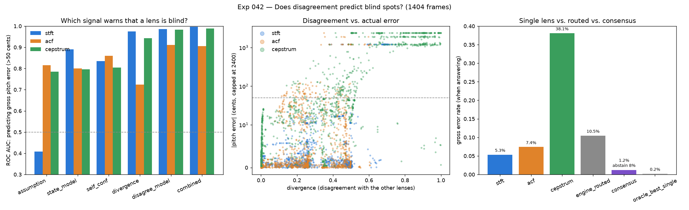

---

### Phase 23 — Patterns in Disagreement (Exp 043)

#### Exp 043 — Which Lenses Fail Together, and When?
Exp 042 showed that disagreement warns when a lens is blind. This experiment asks whether the disagreement itself has structure (issue #3, [docs/VISION.md](VISION.md) roadmap step 2).

- **Disagreement vector** (6 inspectable numbers per frame): the confidence of STFT, ACF and Cepstrum, plus the signed pitch ratio of each pair in octaves (`log2(f_a / f_b)`, clipped to ±1.5; +1 means *a* is an octave above *b*).
- **Method**: k-means on the 3,240 pitched frames of Exp 042 plus its 90 white-noise frames (k = 9, chosen by silhouette 0.63). Each cluster gets a rule-based name from its median vector, and clusters with the same name are merged. **Purity** = share of a pattern's frames whose own vector earns the same name. Each pattern is then checked against the true pitch: which lenses are actually wrong in it, and which conditions produce it.

**Discovered patterns:**

| Pattern (share of frames) | Purity | Actually wrong (STFT / ACF / CEP) | Mainly produced by | What it means |
|---|---|---|---|---|
| All agree, all confident (45.8%) | 100% | 0% / 0% / 0% | clean, clipping, low-pass, pitch shift, time stretch | Trustworthy: not one gross error |
| All agree, CEP unsure (21.1%) | 92% | 0% / 4% / 21% | noise, low-pass + noise | Cepstrum losing its grip; others still right |
| CEP an octave low, others agree (13.9%) | 37% | 3% / 6% / 97% | noise (34% of noise frames), low-pass + noise (49%) | Really "cepstrum wrong, others agree": only 37% are exact octaves, the rest are other off-pitch cepstrum errors |
| All agree, none confident (6.6%) | 30% | 0% / 33% / 45% | strong noise, white noise | Mixed low-confidence frames. Agreement without confidence is **not** evidence. |
| STFT an octave high, others agree (5.9%) | 57% | 64% / 36% / 8% | missing fundamental (68% of those frames) | Really "STFT and ACF an octave apart": usually STFT jumps up to the 2nd harmonic, sometimes ACF drops down; Cepstrum is the tie-breaker |
| CEP off-pitch, others agree (4.2%) | 95% | 2% / 7% / 100% | low-pass, pitch shift, time stretch | Cepstrum fails on sparse or processed harmonics |
| Scattered, none confident (2.6%) | 98% | 0% / 100% / 84% | white noise (68% of it) | All lenses blind: the correct answer is "no pitch" |

**Which lenses fail together** (pitched frames, both wrong vs. expected if independent):
- **ACF + Cepstrum** fail together **2.1× more often than chance** (3.8% vs 1.8%), most strongly under clipping (6.1×) and missing fundamental (3.3×). They share a blind spot, which makes sense because both measure periodicity.
- **STFT + Cepstrum** almost never fail together (**0.08×**, 0.09% vs 1.15%). They are the most complementary pair.
- **STFT + ACF**: 1.6× (0.5% vs 0.3%). All three wrong at once: 0.09% of frames.

**Relation to the existing state map** (engine regions and z₁/z₂, Exp 025–031):

| How much each partition tells us about the true failure pattern (NMI) | |
|---|---|
| Disagreement patterns | **0.546** |
| k-means on (z₁, z₂) with the same k | 0.223 |
| Engine regions | 0.166 |

- The disagreement patterns and engine regions overlap only weakly (NMI 0.206). A pattern can be predicted from (z₁, z₂) 65% of the time (k-NN), against 46% by always guessing the most common one. So the state map holds part of the information but misses most of it.
- **On the state map, the error patterns pile up in the `noise_collapse` region**, together with "all agree, all confident" frames from the same region. The input-only state map cannot tell them apart; the disagreement pattern can.

**Key findings:**
1. Disagreement is structured. About two-thirds of frames fall into two "all agree" patterns where the consensus answer is never wrong. In the second one, the unsure cepstrum is wrong 21% of the time, but it is outvoted. The rest falls into a handful of named failure patterns, each with a clear culprit and a clear cause.
2. Lens failures are not independent. ACF and Cepstrum share a periodicity blind spot, while STFT and Cepstrum almost never fail together. That makes STFT + Cepstrum the most valuable pair to compare.
3. The patterns explain 2.5× more of the true failure structure than the existing state space does (NMI 0.546 vs 0.223). This is the clearest evidence yet that comparing lenses holds information the input-only state map lacks.
4. Agreement is only evidence when the lenses are also confident. Low-confidence agreement (white noise, very low SNR) is a separate pattern with a high error rate.
5. Limits: 3 of the 7 names are loose (purity 30–57%), so the names describe the cluster's typical frame, not every frame. There are only three lenses, and everything is synthetic. The next steps are more lenses (CQT, wavelet) and real recordings (issue #7).

- **Run**: `.venv/bin/python src/experiments/exp043_disagreement_patterns.py` (about 20 s)
- **Outputs**: [results/exp043_disagreement_patterns.png](../results/exp043_disagreement_patterns.png), [results/exp043_summary.json](../results/exp043_summary.json)

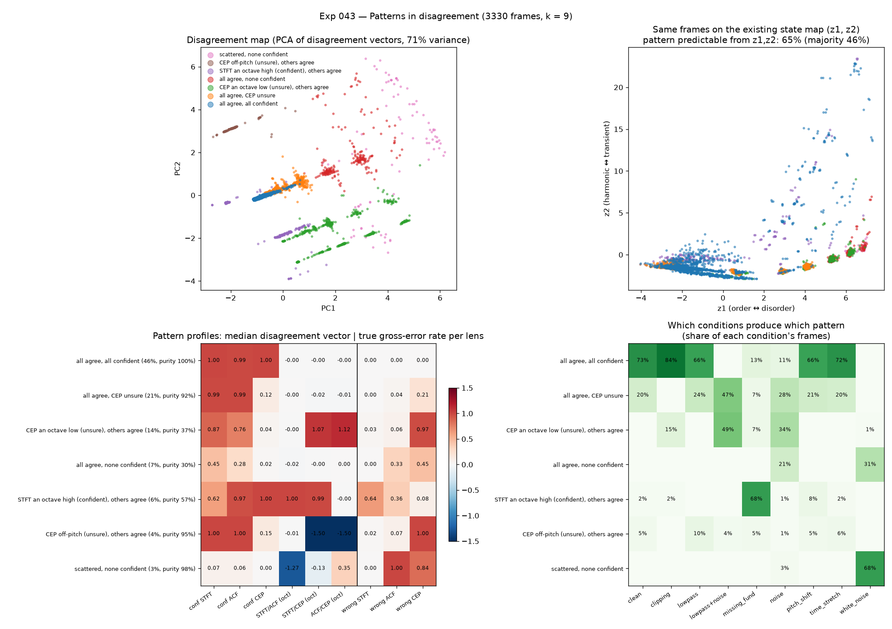

---

### Phase 24 — A Second Medium: Images (Exp 044)

#### Exp 044 — Image Blind Spots, Disagreement and Patterns on the Same Core
The audio arc in miniature on images (issue #6, [docs/VISION.md](VISION.md) roadmap step 4). Images run on the **same core code** as audio (`src/core`: `Analyzer`, `ConfidenceThresholdDetector`, `PairwiseComparator`). The only image-specific code is [`src/image_medium`](../src/image_medium): a `Medium`, five lenses and an orientation distance.

- **Quantity**: the dominant orientation of a 64×64 grayscale patch (degrees, mod 180). Gross error: more than 10° off.
- **Lenses**: `tensor` (structure tensor, mean of squared gradients), `hog` (mode of the gradient-orientation histogram), `fft` (strongest 2-D spectral peak), `gabor` (oriented Gabor/wavelet bank, 4–16 px), `radon` (variance of line sums per angle). Each states its assumptions; confidences are calibrated like the audio CQT/wavelet lenses (strongest of 60 white-noise patches → 0, weakest 5% of clean patterns → 1). On clean patterns every lens is within 5° of the truth.
- **Data**: 2,304 patches = 6 pattern variants (gratings with 6/12 px period, step edge, lines 1.5/3 px wide, oriented texture) × 12 orientations × 16 conditions × 2 seeds. The conditions are noise, blur, JPEG-like block DCT quantisation, low contrast with 8-bit quantisation, occlusion by a flat rectangle, and a weaker second grating at another orientation (scaled to 40% or 80% of the pattern's standard deviation, so the truth always has more variance). 16 patches at 1% contrast round to a flat image; the medium reports them as empty and they are left out.

**1. Atlas: each lens family has its own blind spots** (gross error rate):

| Condition | tensor | hog | fft | gabor | radon |
|---|---|---|---|---|---|
| clean, mild noise, blur ≤ 2.5, JPEG, low contrast | 0–6% | 0–15% | 0% | 0% | 0% |
| noise σ = 0.6 | 31% | 47% | 1% | 1% | 0% |
| blur σ = 4 (erases the 6 px grating) | 13% | 14% | 12% | 8% | 15% |
| occlusion 25% / 50% | 8% / 17% | 6% / 22% | 32% / 57% | 27% / 51% | 14% / 45% |
| second pattern 40% / 80% | 32% / 96% | 91% / 100% | 1% / 33% | 16% / 42% | 0% / 2% |

- The **gradient lenses** (tensor, hog) are local: they survive occlusion best but fail on noise and on a weaker second pattern. Gradients weight fine detail by frequency², so a weaker but finer grating can win.
- The **global lenses** (fft, gabor, radon) integrate over the whole patch: they shrug off noise and the second pattern (radon: 0–2%) but fail when an occluder breaks up the structure.

**2. Disagreement predicts when a lens is wrong** (ROC AUC, grouped cross-validation as in Exp 042):

| Lens | gross error | own confidence | divergence (no training) | disagreement model |
|---|---|---|---|---|
| tensor | 13.0% | 0.869 | 0.935 | **0.982** |
| hog | 18.8% | 0.860 | 0.932 | **0.978** |
| fft | 8.7% | 0.593 | 0.943 | **0.958** |
| gabor | 9.2% | 0.599 | 0.937 | **0.959** |
| radon | 4.8% | 0.890 | 0.912 | **0.964** |

This replicates the main audio result on a new medium: comparing lenses tells you when one is blind, far better than its own confidence (fft and gabor are confidently wrong: AUC 0.59–0.60).

**3. But the consensus is not the best answer here** (gross error rate, abstaining counts as wrong):

| tensor | hog | fft | gabor | **radon** | most confident | consensus | learned pick | learned consensus | oracle |
|---|---|---|---|---|---|---|---|---|---|
| 13.0% | 18.8% | 8.7% | 9.2% | **4.8%** | 6.4% | 9.8% (abstains 2.1%) | 5.6% | 6.6% | 1.4% |

- The confidence-weighted consensus (9.8%) loses to the best single lens (radon, 4.8%). On the second-pattern conditions three or four lenses are wrong together, so the median goes with them. Its abstentions are all at noise σ = 0.6, where the global lenses are right but not confident.
- Using the disagreement model to choose whom to trust ("learned pick": the lens with the lowest predicted error, out-of-fold) gets to 5.6%, close to radon but not better. The oracle (1.4%) shows there is room: the right lens exists in most failure cases, but nothing tested here finds it reliably.

**4. Patterns: lenses fail in families**

| Most common failure sets | patches | mainly under |
|---|---|---|
| hog alone | 146 | second pattern 40%, noise |
| tensor + hog | 114 | second pattern 80%, noise σ = 0.6 |
| tensor + hog + gabor | 57 | second pattern |
| all five | 32 | occlusion 50%, blur σ = 4 |
| fft + gabor + radon | 29 | occlusion |

- Raw co-failure lift is high for every pair (2.9–10.7×), because the hard conditions break several lenses at once. Within the same condition it drops to 1.3–3.0×. The strongest raw pairs are the global ones (fft + radon 10.7×, gabor + radon 8.9×, fft + gabor 7.5×).
- Unsupervised clusters of the disagreement vector (5 confidences + 10 signed pair differences) are weak here: silhouette picks k = 3, and the clusters explain less of the failure structure than simply knowing the condition (NMI 0.22 vs 0.29). In audio it was the other way round (Exp 043: 0.546 vs 0.223 for the state map). A supervised k-NN on the same vectors does recover the failure set 89% of the time, against 76% for always guessing "none".

**5. Unoriented input.** On white noise no lens is ever confident (0 of 45). On smooth isotropic noise (Gaussian-blurred white noise), **fft is confidently wrong on 96%** of patches: some random spectral peak is always the strongest. Because fft is then the only trusted lens, the consensus reports an orientation too, while the four other lenses are unconfident and disagree (mean disagreement 0.36 vs 0.22 on white noise). The core currently forms a consensus from a single trusted reading; a quorum rule would catch this.

**Key findings:**
1. The idea carries over to a second medium with no change to the core: a `Medium`, five lenses and one distance function were enough to run the same loop.
2. Blind spots are structured by **lens family**: local gradient lenses versus global spectral/projection lenses, mirroring the audio split between spectral and periodicity lenses.
3. Disagreement is again a strong warning signal (AUC 0.96–0.98 for every lens), much better than self-confidence for the lenses that are confidently wrong.
4. Turning the warning into a better *answer* did not work here. Correlated failures outvote the right lens, and no fusion tested beats the best single lens. This matches the audio finding that more lenses are not more independent votes. Fusion needs to know which lenses share blind spots.
5. Limits: everything is synthetic, there is one quantity (orientation) and one patch size, and the second-pattern truth depends on defining "dominant" by variance. Real images are tracked in issue #7.

- **Run**: `.venv/bin/python src/experiments/exp044_image_disagreement.py` (about 30 s; `--calibrate` prints the lens calibration)
- **Outputs**: [results/exp044_image_disagreement.png](../results/exp044_image_disagreement.png), [results/exp044_summary.json](../results/exp044_summary.json)

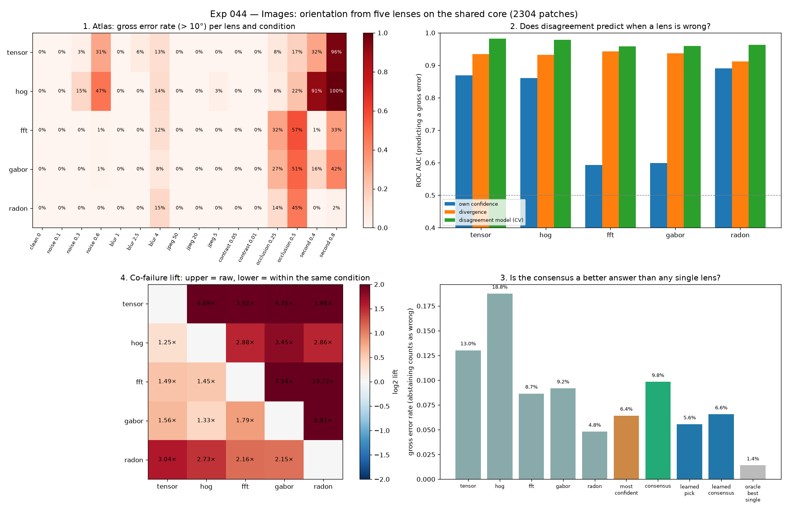

---

### Phase 25 — The Key Claims on Real Data (Exp 045)

#### Exp 045 — Do the Claims Survive Real Recordings and Photos?
Everything up to Exp 044 rests on synthetic signals. This experiment re-runs the key claims on public datasets with ground truth (issue #7, [VISION.md](VISION.md) roadmap step 5). It imports the analysis functions of Exp 042, 043 and 044 rather than re-implementing them, so any difference comes from the data. Cross-validation and the confidence intervals resample whole tracks or images, never single frames.

| Dataset | Medium | Ground truth | Used here |
|---|---|---|---|
| [vocadito](https://zenodo.org/records/5578807) | 40 solo singing excerpts, 7 languages | f0 annotated by musicians | 17,955 voiced frames + 1,781 unvoiced (all 40 tracks) |
| [MDB-stem-synth](https://zenodo.org/records/1481172) | 230 MedleyDB stems (voice and instruments), resynthesised | exact f0 (the resynthesis follows it) | 64,335 voiced frames + 292 unvoiced (227 tracks, ≤ 60 voiced frames each) |
| [BSDS500](https://www2.eecs.berkeley.edu/Research/Projects/CS/vision/grouping/resources.html) test split | natural photos | ~5 human boundary maps per image | 514 patches on straight human-marked boundaries (164 images) |

- **Audio frames**: 2048 samples at 22.05 kHz, as in Exp 042. Truth = geometric mean of the annotation inside the frame. Frames that are partly voiced, span more than 100 cents, or lie outside the lenses' 80–1000 Hz range are skipped. Conditions: the recording as is, white noise at 20 / 10 / 0 dB SNR, hard clipping. Each voiced frame appears once per condition.
- **Image patches**: 64×64, centred on a pixel marked by at least 3 annotators, kept only if every human boundary pixel within 28 px lies within 4 px of one straight line through the centre and the two sides differ in grey level by at least 0.08. Truth = that line's direction. Conditions: as is, noise σ 0.1 / 0.3, blur σ 2.5, JPEG-like q 20, 25% occlusion.
- Data setup: [data/README.md](../data/README.md). The datasets are not committed.

**Results, claim by claim**

| Claim (synthetic source) | Dataset | Metric | Synthetic | Real | Verdict |
|---|---|---|---|---|---|
| A1. Disagreement predicts when a pitch lens is wrong (Exp 042) | vocadito | AUC, disagreement model (STFT / ACF / Cepstrum) | 0.987 / 0.949 / 0.985 | 0.989 / 0.859 / 0.980 | **Holds**, weaker for ACF |
| | MDB-stem-synth | same | same | 0.987 / 0.903 / 0.981 | **Holds**, weaker for ACF |
| A1b. …better than each lens's own confidence | both | AUC, own confidence | 0.81–0.88 | 0.84–0.89 | **Holds** (disagreement wins for every lens) |
| A1c. The engine's assumption score is unreliable for STFT (Exp 042) | both | AUC, assumption score for STFT | 0.581 | 0.489 / 0.550 | **Holds** (at chance) |
| A2. The consensus is a better answer than any single lens (Exp 042) | vocadito | gross error (> 50 cents), abstaining = wrong | 6.5% vs 4.3% best lens | 5.6% vs 4.2% (ACF); difference +1.4 pts, 95% CI [−0.2, +3.0] | **Not shown**: a tie with the best lens |
| | vocadito | gross error on the frames where the consensus answers (96.4%) | 1.0% vs 4.3% | 2.0% vs 3.1% (ACF, same frames); −1.1 pts, CI [−2.1, −0.1] | **Holds**, smaller gain |
| | MDB-stem-synth | gross error, abstaining = wrong | 6.5% vs 4.3% | 7.3% vs 9.9% (ACF); −2.6 pts, CI [−3.8, −1.5] | **Holds** |
| A2b. …and better than the engine-routed lens (Exp 042) | vocadito | same | 6.5% vs 9.1% | 5.6% vs 6.0%; −0.4 pts, CI [−1.4, +0.6] | **Not shown** (tie) |
| | MDB-stem-synth | same | same | 7.3% vs 11.2%; −3.9 pts, CI [−4.9, −2.8] | **Holds** |
| A3. ACF + Cepstrum fail together, STFT + Cepstrum rarely (Exp 043) | vocadito | co-failure lift (ACF+CEP / STFT+CEP) | 2.1× / 0.08× | 3.0× / 0.85× | **Partly**: the shared periodicity blind spot holds, the "complementary pair" is gone |
| | MDB-stem-synth | same | same | 2.6× / 0.72× | **Partly**, as above |
| A3b. Disagreement patterns explain failures better than the state map (Exp 043) | vocadito | NMI with the true failure set: patterns vs state-map k-means | 0.546 vs 0.223 | 0.581 vs 0.159 | **Holds** |
| | MDB-stem-synth | same | same | 0.535 vs 0.148 | **Holds** |
| A4. Framework-assisted pitch tracking beats fixed YIN (Exp 033, 039) | vocadito, as is | GER > 20% (adaptive tracker vs fixed YIN) | 0.78% vs 0.00% (Exp 039) | 3.1% vs 2.0%; delay-compensated 1.9% vs 2.0% | **Loss**; at best a tie once its delay is removed |
| | vocadito, 10 dB | same | — | 3.2% vs 3.0%; compensated 2.8% vs 3.0% | **Tie** |
| | vocadito | GER > 50 cents | — | 24.2% vs 7.6%; compensated 8.7% vs 7.6% | **Loss** |
| | MDB-stem-synth, as is / 10 dB | GER > 20% | — | 6.6% vs 4.2% / 8.8% vs 7.4%; compensated 5.0% / 8.7% | **Loss** |
| A5. No lens, and no consensus, is confident on unpitched input (Exp 042) | vocadito unvoiced frames | share with a confident pitch: any lens = consensus | 0% (white noise) | 36% (ACF 25%) | **Fails** |
| | MDB-stem-synth unvoiced frames | same | 0% | 99% (Cepstrum 97%) | **Fails** |
| I1. Disagreement predicts when an image lens is wrong (Exp 044) | BSDS500 | AUC, disagreement model (5 lenses) | 0.96–0.98 | 0.87–0.92 | **Holds**, weaker |
| I1b. …better than own confidence | BSDS500 | AUC, own confidence | 0.59–0.89 | 0.51–0.82 | **Holds** (for every lens) |
| I2. The image consensus is not the best answer (Exp 044) | BSDS500 | gross error (> 10°) | 9.8% vs 4.8% (Radon) | 24.4% vs 18.1% (Radon); +6.3 pts, CI [+4.3, +8.1] | **Holds** (the negative result replicates) |
| I2b. A learned choice of lens gets close to the best lens (Exp 044) | BSDS500 | gross error | 5.6% vs 4.8% | 16.4% vs 18.1%; −1.7 pts, CI [−3.5, +0.1] | **Holds**; on photos it is slightly ahead, not significantly |
| I3. Image lenses fail in families (Exp 044) | BSDS500 | co-failure lift, raw / within condition | 2.9–10.7× / 1.3–3.0× | 1.7–3.0× / 1.4–1.7× | **Weaker**: the global trio (FFT, Gabor, Radon) still co-fails most (3.0× raw), but within a condition all pairs look alike |

**Key findings:**
1. **The core claim survives real data in both media**: disagreement tells you when a lens is blind (AUC 0.86–0.99 on real audio, 0.87–0.92 on photos), and it beats each lens's own confidence everywhere. It is weaker for ACF (whose errors come with only mild disagreement, as on synthetic data) and on photos.
2. **Better answers from comparing lenses hold on MDB-stem-synth but not clearly on vocadito**: there the consensus ties the best lens (ACF) once its abstentions count as errors; it only wins on the frames where it answers.
3. **The "complementary pair" does not transfer**: STFT and Cepstrum fail together at 0.72–0.85× chance on real audio, not 0.08×. The synthetic number came from conditions that break one but not the other; real signals mix them. ACF + Cepstrum sharing a blind spot does transfer (2.6–3.0×).
4. **The framework's pitch tracker does not beat plain YIN on real audio.** Its causal 5-frame median filter delays the output by 2 hops (46 ms), which costs a lot on vibrato and note changes (24% vs 7.6% at 50 cents on vocadito). Compensating the delay brings it to a tie at the 20% threshold, still behind at 50 cents and on MDB-stem-synth. Exp 039's synthetic result (0.78% vs 0.00%) already showed no gain; this confirms it.
5. **Real "no pitch" frames are where the system is most wrong.** Breaths, consonants and decaying tails are not white noise: a single lens is confident on 36% (vocadito) and 99% (MDB-stem-synth) of them, and the consensus follows that single lens. This is the same issue Exp 044 found on images (a consensus from one trusted reading); a quorum rule is the obvious fix.
6. **Photos are much harder than synthetic patches** (best lens 18% vs 5% gross errors), and the image fusion result replicates: the plain consensus loses to the best lens, the learned choice is about even with it.
7. **Limits**: MDB-stem-synth is resynthesised (real performances, synthetic timbre); vocadito annotations are human and can be off at note boundaries; unvoiced frames are defined by the annotation, so some may carry pitch the annotators skipped. The BSDS500 truth is the direction of a human-marked boundary, which is not always the patch's dominant orientation (texture can compete); the selection keeps only straight, visible boundaries. Noise and clipping are added synthetically on top of the real signals.

- **Run**: `.venv/bin/python src/experiments/exp045_real_data.py` (needs the data in `data/raw/`; about 15 minutes the first time, seconds afterwards from the cache in `data/processed/`; `--refresh` recomputes)
- **Outputs**: [results/exp045_real_data.png](../results/exp045_real_data.png), [results/exp045_summary.json](../results/exp045_summary.json)

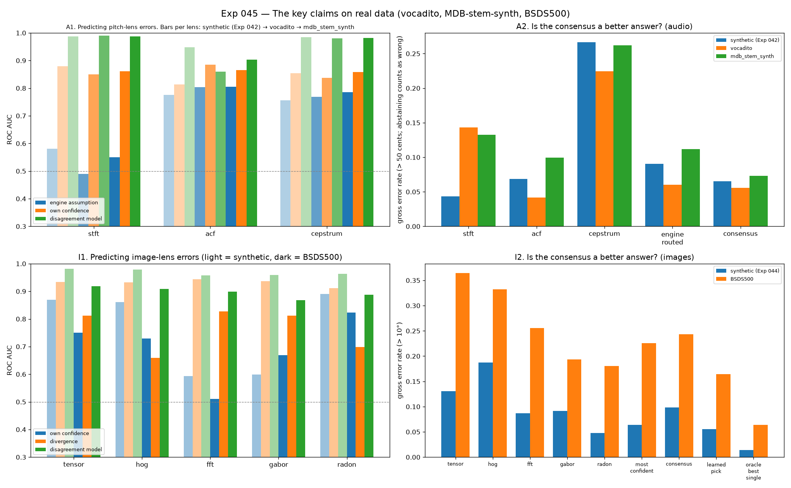

---

### Phase 26 — A Quorum Before the Consensus (Exp 046)

#### Exp 046 — Should One Confident Lens Be Enough?
Exp 044 and 045 found that the consensus follows any single confident lens: smooth noise fools the FFT lens, and breaths and consonants fool ACF or Cepstrum, so the system reports an orientation or a pitch that is not there. Issue #20 adds a quorum to the core's `PairwiseComparator`: the consensus is fused only from the **largest group of trusted readings that all agree pairwise** (ties go to the more confident group), and only if that group has at least `min_agreeing` members; otherwise there is no consensus. `min_agreeing=None` is the old rule (fuse every trusted reading).

The experiment recomputes the consensus from the readings stored by Exp 042, 044 and 045 (the lenses are not re-run). The old rule reproduces Exp 045's stored consensus exactly. Unoriented inputs for BSDS500 are Exp 044's noise patches.

| Dataset | False answers on unpitched / unoriented input | Answer rate (pitched / oriented) | Answer rate, clean only | Gross error when answering | Best lens on the same frames | Gross error, abstaining = wrong |
|---|---|---|---|---|---|---|
| Synthetic audio (Exp 042) | 0% → 0% | 94.4% → 88.8% | 100% → 100% | 1.0% → **0.6%** | 4.2% | 6.5% → 11.7% |
| Synthetic images (Exp 044) | 47.8% → **3.3%** | 97.9% → 90.5% | 100% → 100% | 7.9% → 6.2% | 4.1% | 9.8% → 15.1% |
| vocadito (Exp 045) | 36.3% → **6.6%** | 96.4% → 84.6% | 100% → 98.7% | 2.0% → **1.0%** | 1.2% | 5.6% → 16.3% |
| MDB-stem-synth (Exp 045) | 99.0% → **0.0%** | 94.9% → 83.2% | 100% → 99.9% | 2.3% → **1.6%** | 2.3% | 7.3% → 18.2% |
| BSDS500 (Exp 045) | 47.8% → **3.3%** | 94.0% → 67.2% | 99.2% → 86.0% | 19.6% → 14.1% | 13.6% | 24.4% → 42.3% |

Old rule → quorum of 2 (the new default). The quorum's increase in gross error with abstentions counted as wrong is significant everywhere (+5 to +18 pts; group-bootstrap 95% CIs exclude 0, in `results/exp046_summary.json`). Other settings: `min_agreeing=1` (largest agreeing group, even of one) behaves like the old rule; `min_agreeing=3` is too strict (it answers only 37–48% of real voiced frames, 70–86% of clean ones).

**Key findings:**
1. **The quorum removes almost all false answers**: on unvoiced real audio from 36% to 7% (vocadito) and 99% to 0% (MDB-stem-synth); on unoriented noise from 48% to 3%. No single lens can make the system answer any more.
2. **When it answers, it is more accurate**: gross error when answering falls on every dataset. On audio it beats the best single lens *on the same frames* (vocadito 1.0% vs 1.2%, MDB 1.6% vs 2.3%, synthetic 0.6% vs 4.2%), so it is not only skipping hard frames. On images it is level with the best lens (14.1% vs 13.6% on BSDS500), as expected from lenses that fail in families (Exp 044).
3. **The price is abstention, mostly under heavy noise**: the clean answer rate stays at 99–100% for audio, but noisy frames are answered 66–75% of the time (35% on noisy photos). Counting every abstention as an error, the quorum is worse than the old rule and than the best lens. If an application needs an answer on every frame, `min_agreeing=None` keeps the old behaviour.
4. **Photos pay the most**: the quorum answers 86% of clean BSDS500 patches, because real boundaries often split the lenses into a local and a global family that do not agree. On photos, an abstention is often the honest answer.

**Decision:** `min_agreeing=2` is the core default for every medium (`PairwiseComparator`, the audio and image comparators, and the legacy `analyze_disagreement` API). The numbers reported for Exp 042–045 above used the old rule; to reproduce them, pass `min_agreeing=None`.

- **Run**: `.venv/bin/python src/experiments/exp046_quorum.py` (uses Exp 045's cache in `data/processed/`; about 3 minutes)
- **Outputs**: [results/exp046_quorum.png](../results/exp046_quorum.png), [results/exp046_summary.json](../results/exp046_summary.json)

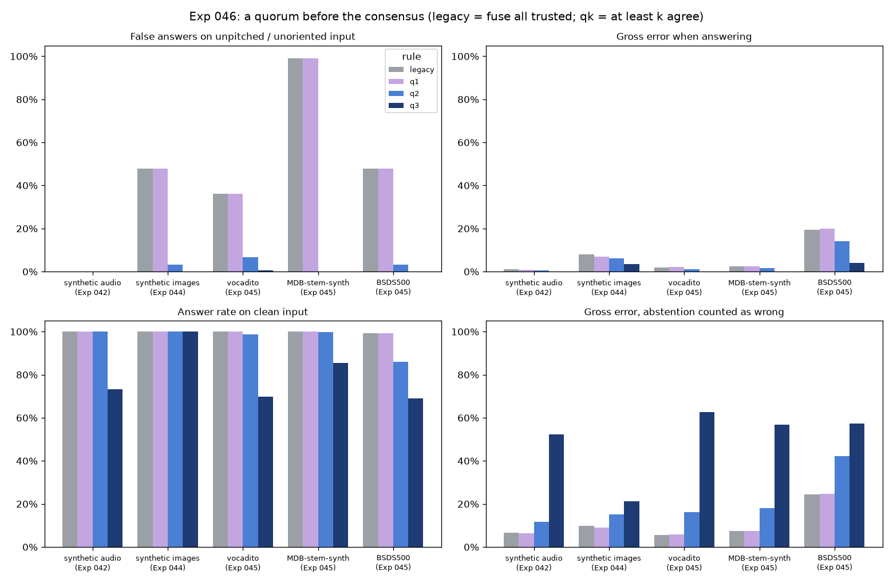

---

### Phase 27 — Fusion That Knows Which Lenses Fail Together (Exp 047)

#### Exp 047 — Can Knowing the Families Make the Consensus Beat the Best Lens?
Exp 044 found that image lenses fail in families: a family that is wrong together outvotes the lens that is right, so the consensus (9.8% gross errors) loses to the best single lens (Radon, 4.8%). Issue #21 adds two ways for the core's `PairwiseComparator` to pick **which** agreeing group to trust instead of the largest one, both learned from labelled readings and both plain, inspectable tables:

- `FamilyVotes`: each lens gets a reliability (P(right | confidence bin)) and each pair a failure correlation (phi coefficient of their wrong/right indicators). A group scores `sum_i p_i / (1 + sum_j R_ij)`, so lenses that always fail together count as one vote.
- `AgreementTable`: for each set of lenses, how often its fused answer was right when exactly that set formed a maximal agreeing group. Optional `min_score=0.5` abstains when no group is more likely right than wrong.

Like Exp 046, the experiment recomputes the consensus from the readings cached by Exp 042, 044 and 045. Models are trained by 5-fold cross-validation split by image / recording ("within"), or on the synthetic set of the same medium and scored on the real one ("transfer"). Two references show the limits: the best single lens (chosen with hindsight), and an oracle that always picks the right agreeing group of trusted lenses, which is the best any method here could do.

Gross error, abstention counted as wrong (within-dataset cross-validation; BSDS500 transfer in brackets):

| Dataset | Old rule | Quorum 2 | `FamilyVotes`, ≥1 | `AgreementTable`, ≥1 | Best lens | Group oracle | Oracle, every lens trusted |
|---|---|---|---|---|---|---|---|
| Synthetic images | 9.8% | 15.1% | 9.7% | **6.8%** | 4.8% (Radon) | 5.6% | 1.6% |
| BSDS500 | 24.4% | 42.3% | 22.8% (23.5%) | **21.8%** (21.8%) | 18.1% (Radon) | 19.6% | 8.0% |
| Synthetic audio | 6.5% | 11.7% | 6.5% | 6.8% | 4.3% (STFT) | 6.1% | 0.1% |
| vocadito | 5.6% | 16.3% | 5.4% | 5.4% | 4.2% (ACF) | 4.3% | 0.4% |
| MDB-stem-synth | 7.3% | 18.2% | 7.7% | 10.2% | 9.9% (ACF) | 5.8% | 0.9% |

`AgreementTable` vs the old rule on images: −3.1 pts (synthetic) and −2.6 pts (BSDS500, also when trained only on synthetic patches); vs `FamilyVotes`: −3.0 and −1.0 pts. All group-bootstrap 95% CIs exclude 0. It is still worse than the best lens (+2.0 and +3.7 pts). On audio it does not help: trained on synthetic audio it is worse than the old rule on both real datasets (+4.2 pts vocadito, +2.2 pts MDB).

**Key findings:**
1. **The pairwise discount does almost nothing.** `FamilyVotes` changes the error by less than 1 pt anywhere, with or without the quorum. Setting every correlation to 0 (a plain reliability vote) moves it by at most 0.7 pts, so the correlations themselves add almost nothing. A pair that fails together half the time still counts as 1.3 votes, which is enough to outvote a single lens that is right.
2. **Measuring each agreement pattern directly works on images.** The table learns, for example, that FFT + Gabor agreeing without Radon was right 13% of the time, and Radon on its own 85% of the time. On the "weaker second pattern" condition, image error falls from 23% (old rule) to 1.0%, level with the best lens. The table carries over from synthetic patches to real photos unchanged (21.8% both ways).
3. **No choice among agreeing groups can beat the best lens on images.** Even the group oracle makes 5.6% / 19.6% gross errors, more than Radon's 4.8% / 18.1%. That is why the Done-when of issue #21 is not met.
4. **The bottleneck is the trust gate, not the vote.** On frames where the best lens is right but no trusted group is, the best lens had been marked blind (confidence < 0.5) in 93–100% of cases. With every lens trusted, the group oracle falls to 1.6% (synthetic images), 8.0% (BSDS500) and under 1% for audio. The next gain has to come from a better blind-spot detector, not a better fusion rule.
5. **With three nearly independent audio lenses there are no families to correct** (failure correlation ≤ 0.32). The table only adds noise, and synthetic-trained tables mislead on real voice. On a five-lens audio set, `FamilyVotes` does fix the missing-fundamental case where STFT, CQT and wavelet outvote ACF and Cepstrum (`tests/test_audio_core.py`), but there is no cached five-lens data to measure it at scale.
6. **Abstaining below 50% is not a free lunch.** `min_score=0.5` brings false answers on unoriented noise down from 48% to 6% and makes answers more accurate (2.8% gross error when answering on synthetic images), but it abstains more than the old rule and helps less than the quorum on real audio.

**Decision:** both scorers are in the core as opt-in options (`family=`, `min_score=`). The default is unchanged: the largest agreeing group, quorum 2. Use an `AgreementTable` for media whose lenses fail in families (images); not for the three-lens audio set.

- **Run**: `.venv/bin/python src/experiments/exp047_family_fusion.py` (uses the caches of Exp 045 and 046 in `data/processed/`; under a minute)
- **Outputs**: [results/exp047_family_fusion.png](../results/exp047_family_fusion.png), [results/exp047_summary.json](../results/exp047_summary.json) (includes the learned correlations and agreement tables)

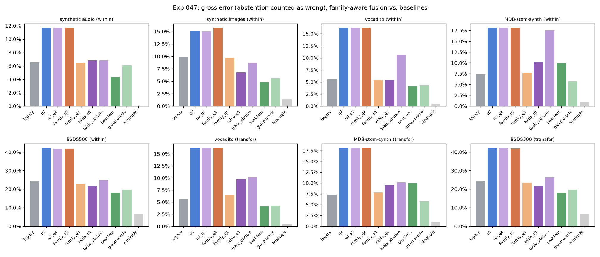

---

### Phase 28 — A Learned Lens Chooser (Exp 048)

#### Exp 048 — Can a Model Pick the Right Lens in Each Frame?
On vocadito the consensus is grossly wrong on 5.6% of frames, while the best lens for each frame (picked with hindsight) is wrong on 0.4%. Exp 047 showed that fusing only the *trusted* lenses cannot close that gap, because the confidence threshold usually marks the right lens blind. Issue #22 tries a chooser that looks at every lens: per lens, a logistic model predicts P(this lens is grossly wrong in this frame) from Exp 042's six disagreement features. In each frame it answers with the lens that has the lowest P(wrong). Adding the framework's state features and the lens's assumption score (`chooser_state`) changes nothing (±0.2 pts).

The main test is issue #22's Done-when: train on synthetic audio + MDB-stem-synth, test on vocadito (no vocadito frame in training). Also the mirror, synthetic-only training, and 5-fold cross-validation by recording on each real dataset. Abstention counts as wrong; gap closed = (consensus − chooser) / (consensus − hindsight).

| Train → test | Consensus (old rule) | Quorum 2 | Most confident lens | Best lens | **Chooser** | Gap closed | Hindsight |
|---|---|---|---|---|---|---|---|
| synthetic + MDB → **vocadito** | 5.6% | 16.3% | 3.7% | 4.2% (ACF) | **1.8%** | **73%** | 0.4% |
| synthetic + vocadito → MDB | 7.3% | 18.2% | 4.5% | 9.9% (ACF) | **3.3%** | 62% | 0.9% |
| synthetic → vocadito | 5.6% | 16.3% | 3.7% | 4.2% | 3.5% | 40% | 0.4% |
| synthetic → MDB | 7.3% | 18.2% | 4.5% | 9.9% | 3.8% | 54% | 0.9% |
| vocadito, cross-validated | 5.6% | 16.3% | 3.7% | 4.2% | 1.6% | 77% | 0.4% |
| MDB, cross-validated | 7.3% | 18.2% | 4.5% | 9.9% | 3.2% | 64% | 0.9% |

On held-out vocadito, chooser − consensus = −3.8 pts (95% CI −4.9 to −2.6), chooser − best lens = −2.4 pts (−3.2 to −1.7), chooser − most confident lens = −1.9 pts (−2.6 to −1.2); group bootstrap over recordings.

**Key findings:**
1. **Issue #22's Done-when is met.** On held-out vocadito the chooser closes 73% of the gap between the consensus and the hindsight-best lens (1.8% gross errors), and it beats the best single lens and the most confident lens significantly. This is the first answer from the lenses that beats the best lens on real singing (Exp 045 found the consensus only tied).
2. **Its gain comes from the lenses the gate throws away.** It picks STFT in 55% of vocadito frames, cepstrum in 32% and ACF in 13%. Only 3.9% of its picks are below the 0.5 confidence threshold, but in 82% of the frames where it is right and the consensus is wrong, it picked a lens the gate had marked blind. This agrees with Exp 047: the right lens is usually present but not trusted.
3. **Real training data matters, synthetic alone is not enough.** Trained on synthetic frames only, the chooser closes 40–54% of the gap, never picks cepstrum, and is no better than "most confident lens" on vocadito (−0.2 pts, CI −1.0 to +0.6).
4. **The weights are readable** (`results/exp048_summary.json`): for every lens, its own confidence lowers P(wrong) and its distance to the closest other lens raises it. Cepstrum leans most on agreement (weight +1.6), STFT on the other lenses' confidence (+0.9).
5. **It does not know when there is no pitch.** The chooser always answers, so it gives a pitch for every unpitched frame (breaths, consonants), which the quorum of Exp 046 had cut to 7%. Adding unpitched training frames and abstaining when P(wrong) > 0.5 still answers 61% of them on vocadito. A separate voicing gate in front of the chooser works on MDB-stem-synth (0% false answers at 3.6–9.8% gross error) but not on singing. On vocadito it only trades one error for the other: 29% false answers at 4.8% gross error, 12% at 9.4%. That still beats the old consensus on both counts (36% and 5.6%), but no setting matches the quorum's 7% without giving up voiced frames.

**Decision:** the chooser stays an experiment for now and is not in the library. Choosing the lens and deciding whether there is a pitch at all are separate problems; the second one, a learned voicing / blind-spot detector, is the next step (Exp 047 points the same way).

- **Run**: `.venv/bin/python src/experiments/exp048_lens_chooser.py` (uses the caches of Exp 045 and 046 in `data/processed/`; about 2 minutes)
- **Outputs**: [results/exp048_lens_chooser.png](../results/exp048_lens_chooser.png), [results/exp048_summary.json](../results/exp048_summary.json) (includes the per-lens weights, pick shares, per-family errors and the voicing-gate sweep)

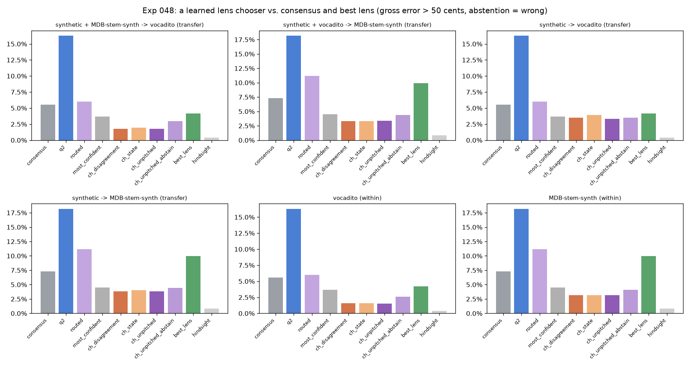

---

### Phase 29 — When to Abstain (Exp 049)

#### Exp 049 — Can a Rule Keep the Quorum's Few False Answers but Answer More?
The quorum of Exp 046 cut false answers on unpitched / unoriented input to 0–7%, but it answers only 66–75% of noisy pitched frames and 35% of noisy photo patches. Issue #23 asks for a rule that keeps quorum 2's false-answer rate while answering more. Every rule below starts from the same per-frame facts: the largest agreeing group of trusted lenses, its size and its fused estimate. Each has a knob that is swept:

- **Confident singleton** (τ): quorum 2, but one lens may answer alone if its confidence ≥ τ.
- **Noise-adaptive quorum** (c): quorum 1 when the frame looks clean (mean confidence of all lenses ≥ c), quorum 2 otherwise.
- **Wider agreement** (m): quorum 2 with "agree" widened to m × 50 cents / 10°.
- **Lower trust** (θ): quorum 2 with lenses trusted from confidence θ instead of 0.5 (Exp 047/048: the right lens is often just below the gate).
- **Learned gate** (t): a logistic model on six frame features (group size, the group's max / mean confidence, all lenses' mean / max confidence, overall disagreement) predicts whether the quorum-1 answer is right; answer when P(right) ≥ t. Unpitched / unoriented frames are labelled wrong and repeated to balance the classes. 5-fold cross-validation by recording / image.

A setting **beats quorum 2** on a dataset when its false-answer rate is no higher, its answer rate is higher and its gross error (abstention counted as wrong) is lower. The readings are the caches of Exp 042, 044 and 045; the unoriented set for BSDS500 is Exp 044's 90 noise patches.

| Dataset | Rule | Answer rate | Noisy frames answered | False answers | Gross error when answering | Gross error, abstain = wrong |
|---|---|---|---|---|---|---|
| MDB-stem-synth | quorum 2 | 83.2% | 72.5% | 0% | 1.6% | 18.2% |
| | **learned, t = 0.5** | **88.5%** | **80.9%** | **0%** | 1.9% | **13.2%** (−5.0, CI −5.6 to −4.5) |
| | adaptive, c = 0.6 | 85.4% | 75.7% | 0% | 2.1% | 16.4% |
| BSDS500 | quorum 2 | 67.2% | 35.2% | 3.3% | 14.1% | 42.3% |
| | **learned, t = 0.5** | **68.8%** | **50.3%** | **1.1%** | **11.2%** | **38.9%** (−3.4, CI −4.8 to −1.8) |
| | adaptive, c = 0.4 | 72.6% | 36.6% | 3.3% | 18.4% | 40.8% |
| Synthetic images | quorum 2 | 90.5% | 58.1% | 3.3% | 6.2% | 15.1% |
| | **learned, t = 0.3** | **92.4%** | **76.6%** | **2.2%** | **4.9%** | **12.1%** (−3.0, CI −3.7 to −2.3) |
| | adaptive, c = 0.4 | 92.4% | 60.9% | 3.3% | 7.2% | 14.2% |
| vocadito | quorum 2 | 84.6% | 75.4% | 6.6% | 1.0% | 16.3% |
| | learned, t = 0.5 | 86.1% | 77.0% | 8.0% | 1.3% | 15.0% |
| | learned, t = 0.6 | 83.1% | 72.2% | 6.1% | 1.2% | 18.0% |
| | adaptive, c = 0.9 (only "winner") | 84.8% | 75.4% | 6.6% | 1.2% | 16.3% (±0.0) |

CIs are 95% group-bootstrap intervals over recordings / images for the difference to quorum 2. Synthetic audio is left out of the table: none of its 90 unpitched frames is ever answered by any rule, so it cannot tell the rules apart.

**Key findings:**
1. **Issue #23's Done-when is met on three of four informative datasets.** A learned gate keeps quorum 2's false-answer rate (or lowers it) and answers more: on MDB-stem-synth 5.3 pts more frames with no false answers; on noisy photo patches 50% answered instead of 35%, with fewer false answers and more accurate answers.
2. **On real singing no rule can.** On vocadito every rule's curve passes through quorum 2's point: answering more always costs false answers at the same rate. The only setting that formally beats it (adaptive, c = 0.9) differs by 0.2 pts. This is the same wall as Exp 048: breaths and consonants look pitched to all three lenses.
3. **The hand-made rules barely help.** The noise-adaptive quorum is the only one that ever beats quorum 2 (by 1–5 pts of answer rate), and its best threshold differs by medium (c ≈ 0.4 for images, ≥ 0.6 for audio). Letting a confident single lens answer, widening the agreement tolerance or lowering the trust threshold all buy answers with false answers at a worse rate than quorum 2 itself.
4. **The learned gate's threshold is an operating point, not a constant.** t = 0.5 is the best setting for real data; on synthetic images it is too strict (86% answered) and t = 0.3 wins. Without class balancing the gate never learns the rare null frames (99% false answers on MDB-stem-synth in a first run), so the balancing matters.
5. **Caveat:** the image null sets are 90 synthetic noise patches, so one false answer is 1.1 pts; BSDS500 has no real "no orientation" set.

**Decision:** quorum 2 stays the core default; it is the safe choice when no labelled data is available. A learned gate is the better rule wherever there is labelled data for the medium, but it lives in this experiment for now. Together with Exp 047 and 048, the open piece is the same: a learned blind-spot / voicing detector in the core, which would also fix the vocadito case if it can learn what an unpitched frame looks like.

- **Run**: `.venv/bin/python src/experiments/exp049_abstention.py` (uses the caches of Exp 045 and 046 in `data/processed/`; under a minute)
- **Outputs**: [results/exp049_abstention.png](../results/exp049_abstention.png), [results/exp049_summary.json](../results/exp049_summary.json) (every setting on every dataset)

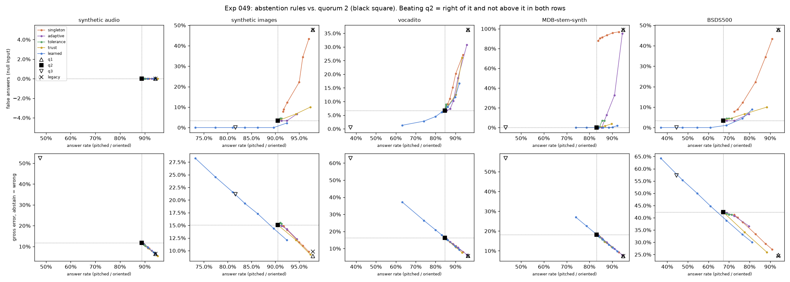

---

### Phase 30 — Perturb to Settle a Disagreement (Exp 050)

#### Exp 050 — Which Answer Moves the Way It Should?
Every fusion rule so far only *voted* on the readings it had. Issue #24 asks the signal a question instead: when the pitch lenses disagree, apply a small known change and see which answer reacts the way it should. On a frame, each distinct lens answer is a **candidate** (answers within 50 cents merged). About a third of all frames have two or more candidates (33% synthetic, 34% vocadito, 38% MDB-stem-synth), and on those frames one candidate is right 98–99% of the time, so choosing well is worth a lot.

Each probe predicts what the three lenses should read *if* candidate c is the true f0; a lens **follows** when it reads within 50 cents of the prediction:

| Probe | Change | Prediction | Why it separates candidates | Extra reads |
|---|---|---|---|---|
| none | — | c | plain voting | 0 |
| shift | resample by 2 semitones | c × 2^(2/12) | every component moves exactly; a lens locked to a noise peak does not | 1 per frame |
| noise | white noise 10 dB below the frame | c | a fragile peak moves | 1 per frame |
| lowpass | 5th-order low-pass at 1.5 c | c | if c is right the fundamental survives; if the truth is 2c nothing pitched is left; if it is c / 2 the lenses go there | 1 per candidate |
| highpass | 5th-order high-pass at 1.5 c | c | if c is right ACF and Cepstrum still read c (missing fundamental); if the truth is c / 2 they read c / 2 | 1 per candidate |

Choosers (each picks the best-scoring candidate): **count** (number of follows, untrained), **lowpass count** (follows under the low-pass probe only, untrained, the cheapest), **prior** (naive Bayes: per (probe, lens) likelihood ratio of a follow for right vs wrong candidates, fit on the synthetic frames of Exp 042 and applied unchanged to real recordings; this is the blind-spot map used as the prior), **prior vote** (the same prior with the "none" probe only, i.e. no probing) and **learned** (logistic regression on the 15 follow bits, 5-fold cross-validation by recording). The frames are rebuilt with the code and seeds of Exp 042 / 045 and match the cached readings exactly (0 mismatches). All 1 069 synthetic and 6 000 of 6 102 vocadito disagreement frames are probed; MDB-stem-synth, a seeded sample of 6 000 of 24 668.

Gross error (> 50 cents) on disagreement frames, quorum 2's abstentions counted as wrong:

| Dataset | Consensus (legacy) | Quorum 2 | Best lens | Prior vote | Prior | Count | **Lowpass count** | Learned (CV) | Candidate oracle |
|---|---|---|---|---|---|---|---|---|---|
| Synthetic | 16.2% | 29.1% | 13.0% (STFT) | 20.4% | 4.1%* | 2.9% | **0.6%** | 1.8% | 0.3% |
| vocadito | 14.5% | 39.9% | 11.6% (ACF) | 43.5% | 16.0% | 5.0% | **3.9%** | 3.7% | 1.2% |
| MDB-stem-synth | 17.6% | 42.5% | 24.1% (ACF) | 38.5% | 15.7% | 7.4% | **5.6%** | 6.0% | 2.3% |

\* in-sample: the prior is fit on these frames.

Differences with 95% group-bootstrap CIs (over recordings): lowpass count vs consensus −15.6 pts (synthetic, CI −18.3 to −13.4), −10.6 (vocadito, −13.2 to −7.7), −12.0 (MDB, −13.4 to −10.6); vs quorum 2 −28.5, −36.0 and −36.9 pts; vs the best lens −12.4, −7.7 and −18.5 pts. Quorum 2 answers only 61–63% of the real disagreement frames; **on the frames it does answer** its error is 4.0% (vocadito) and 5.0% (MDB), and lowpass count makes 2.1% and 2.6% there.

Over the whole dataset (consensus where the lenses agree, the chooser where they disagree), gross error falls from 6.5% to 1.4% (synthetic), 5.6% to 2.0% (vocadito) and 7.3% to 2.7% (MDB-stem-synth).

**Cost.** All five probes: 18.5–19.1 extra lens reads per disagreement frame, about 7× the base reading time (1.1 ms → +7.3–7.8 ms per 93 ms frame). Lowpass only: 6.3–6.6 extra reads (about 2 candidates × 3 lenses), about twice the base reads. Only disagreement frames are probed, so on a whole recording the cost is about a third of that.

**Key findings:**
1. **Issue #24's Done-when is met.** Probing cuts gross error on disagreement frames by 10–16 pts against the consensus and 28–37 pts against quorum 2 on all three datasets, with CIs far from zero, and beats the best single lens chosen in hindsight by 8–19 pts. Lowpass count closes 78–98% of the gap between the consensus and the candidate oracle. This is the first fusion result that holds on both real audio datasets (compare Exp 045 and 048).
2. **The low-pass probe does almost all the work, and needs no training.** Removing it from the prior raises the error from 16% to 32–37%; the low-pass probe alone is the best single probe (prior with low-pass only: 4.6% vocadito, 6.3% MDB), and the untrained lowpass count is the best chooser overall. The measured reaction map shows why: on vocadito, under the low-pass probe STFT follows a right candidate 96% of the time and a wrong one 42%, Cepstrum 48% vs 3%.
3. **The other probes behave as the blind-spot atlas predicts.** Under the high-pass probe STFT follows a right candidate only 1% of the time (it loses the fundamental, the missing-fundamental blind spot of Exp 008) while ACF still does 70% vs 5%. The 2-semitone shift is the second-best probe alone (7.7% vocadito, 15.4% MDB).
4. **The prior learned on synthetic signals hurts.** Its naive-Bayes sum double-counts correlated follows and weights plain voting heavily; with the "none" probe only it is worse than the consensus (38–44%). The untrained counts transfer; the synthetic likelihoods do not. The cross-validated learned chooser ties lowpass count on real data (3.7% vs 3.9%, 6.0% vs 5.6%), so training buys nothing here.
5. **Probing always answers, but the follow count is also a voicing score.** 97–99% of unpitched real frames have two or more candidates and would reach the prober. The best candidate's follow count separates pitched disagreement frames from them with AUC 0.93 (vocadito), 0.98 (MDB) and 0.98 (synthetic). Abstaining below 9 of 15 follows on vocadito answers 74% of disagreement frames (quorum 2: 63%) at 27.2% gross error with abstentions counted (quorum 2: 39.9%) and 6.3% false answers (quorum 2: 6.6%). On MDB, 8 follows gives 78% answered and 25.4% gross error but 1.4% false answers (4 of 289 frames), where quorum 2 has none.

**Decision:** the probe lives in this experiment for now. It is a strong candidate for the open "blind-spot / voicing detector" piece: the low-pass follow count both picks the answer and warns when there is none. Moving it into the core would need a `Medium` hook for "perturb with a known effect" (audio: low-pass, shift; images: blur, rotation by a known angle, where the prediction is θ + angle).

**Images (not run).** The same idea carries over: rotating a patch by a known angle predicts θ + angle for the right candidate (the analogue of the pitch shift), and a Gaussian blur at a scale tied to the candidate's edge is the analogue of the low-pass. Images have one hard difference: Exp 047 found that in most image failures the right lens had been marked blind, and the candidates here include untrusted lenses, so probing might help more there than any fusion rule did. That is a separate experiment.

- **Run**: `.venv/bin/python src/experiments/exp050_probing.py` (needs the caches of Exp 045 / 046 and the raw datasets in `data/raw/`; about 6 minutes the first time, then the probes are cached in `data/processed/exp050_*.pkl`)
- **Outputs**: [results/exp050_probing.png](../results/exp050_probing.png), [results/exp050_summary.json](../results/exp050_summary.json) (every chooser, CI, per-family error, reaction map, abstain thresholds and cost)

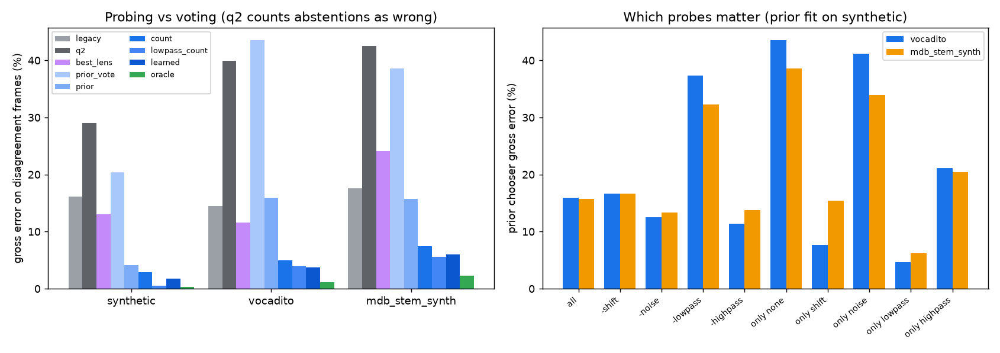

---

### Phase 31 — Disagreement over Time (Exp 051)

#### Exp 051 — Does the Recent History of Disagreement Predict the Next Blind Spot?
Exp 042 predicts a lens's blind spot from one frame's disagreement. Issue #25 asks whether the *trajectory* of disagreement predicts a blind spot on the next frames, before it happens (extending Exp 029). Every hop of each recording is read (2048-sample frames, hop 1024 = 46 ms):

- **Synthetic:** 4-second harmonic signals (1, 3, 10, 20 harmonics, vibrato, an octave glide, a pulse train) at the six f0s of Exp 042 (42 signals).
- **vocadito:** all 40 tracks.
- **MDB-stem-synth:** 20 s of each of the 230 stems, from 1 s before the first annotated f0.

Each recording is run under four conditions that **change over time**, so blind spots come and go: clean; a noise ramp (SNR 5 + 15 sin(2πt / 4 s) dB, −10 to 20 dB); a low-pass sweep (cutoff 150 Hz–4 kHz and back every 6 s); a high-pass sweep (40 Hz–1.6 kHz every 5 s, which removes the fundamental for part of the time). This gives 14 280 / 70 148 / 389 404 hops, 14 280 / 28 676 / 157 524 of them with a pitch target.

Target: lens L is wrong (> 50 cents or no estimate) on frame t + k, k = 0, 1, 2, 4, 8 hops (0–370 ms ahead), using frames ≤ t only. Both predictors are logistic regressions per lens and horizon:
- **current:** the six per-frame disagreement features of Exp 042 at frame t.
- **history:** current, plus the same features averaged over the last 8 frames (persistence), their lag-1 values, slopes of divergence / confidence / overall disagreement (trend), the lens's pitch jump and pitch spread over the window, frames since the lens last jumped by > 50 cents, and frames since the last silent or all-unconfident frame (onset).

Metrics: ROC AUC on all targets; AUC **before failure** (only targets where the lens is still right at t, so the failure has not started); and **onset lead**: for failure onsets (wrong at o, right on the 3 voiced frames before), the share caught by the k-step predictor at o − k at a 10% false-alarm rate. Held-out real data = train on synthetic + one real dataset, test on the other; grouped 5-fold CV by track inside each dataset gives the same picture.

AUC, current → history, on held-out real data (Δ with 95% group-bootstrap CI over tracks):

| Test set | Lens | k = 1 (46 ms) | k = 2 (93 ms) | k = 4 (186 ms) | k = 8 (372 ms) | Before failure, k = 4 |
|---|---|---|---|---|---|---|
| vocadito | STFT | 0.930 → 0.944 (+0.013) | 0.886 → 0.906 (+0.020) | 0.812 → 0.850 (**+0.039**, CI +0.030 to +0.047) | 0.760 → 0.800 (+0.040) | 0.630 → **0.711** |
| | ACF | 0.893 → 0.893 (0.000, n.s.) | 0.847 → 0.846 (n.s.) | 0.784 → 0.799 (+0.015) | 0.736 → 0.756 (+0.019) | 0.847 → 0.837 |
| | Cepstrum | 0.882 → 0.887 (+0.005) | 0.823 → 0.846 (+0.023) | 0.757 → 0.801 (**+0.045**) | 0.729 → 0.766 (+0.038) | 0.794 → 0.794 |
| MDB-stem-synth | STFT | 0.945 → 0.960 (+0.015) | 0.915 → 0.937 (+0.022) | 0.876 → 0.902 (+0.026) | 0.821 → 0.848 (+0.026) | 0.596 → **0.713** |
| | ACF | 0.917 → 0.925 (+0.008) | 0.898 → 0.898 (n.s.) | 0.856 → 0.860 (n.s.) | 0.808 → 0.811 (n.s.) | 0.865 → 0.852 |
| | Cepstrum | 0.951 → 0.957 (+0.006) | 0.934 → 0.945 (+0.011) | 0.911 → 0.929 (+0.018) | 0.887 → 0.907 (+0.020) | 0.917 → 0.925 |

Failure onsets caught k hops ahead at 10% false alarms, current → history (held out): vocadito STFT 14 → 10% (k = 1), 11 → 10% (k = 4), 15 → 21% (k = 8); ACF 51 → 43%, 13 → 23%, 19 → 22%; Cepstrum 14 → 9%, 5 → 9%, 14 → 17%. MDB-stem-synth STFT 22 → 17%, 18 → 20%, 19 → 19%; ACF 58 → 56%, 33 → 43%, 26 → 33%; Cepstrum 44 → 35%, 24 → 35%, 22 → 36%.

**Key findings:**
1. **Issue #25's Done-when is met on AUC.** On held-out real data the history predictor beats the current-frame one for STFT and Cepstrum at every horizon from 1 to 8 hops (CIs exclude zero), and for ACF at 4–8 hops on vocadito. The gain grows with the horizon: 0 to +0.015 one hop ahead, +0.015–0.045 four to eight hops ahead. The current frame's information decays faster than the history's.
2. **The STFT's blind spots build up; the others' arrive suddenly.** Before the failure starts, the current frame barely predicts an STFT failure (AUC 0.55–0.67, close to chance); history raises it to 0.65–0.78 at every horizon on both real datasets. For ACF and Cepstrum the before-failure AUC does not change (±0.01): their blind spots either show in the current frame already or are not foreseeable from disagreement at all.
3. **Lead time improves only at longer horizons, and only somewhat.** Most real failure onsets are not foreseeable one hop ahead: 9–58% are caught at 10% false alarms, and history does not raise that (it is often a few points lower). At 4–8 hops ahead history catches more onsets for ACF and Cepstrum (e.g. MDB Cepstrum 22 → 36% at 372 ms), but the share stays low.
4. **Where history helps** (k = 2, by condition): mostly under the noise ramp and the low-pass sweep (STFT on the noise ramp 0.80 → 0.85 on vocadito, 0.82 → 0.87 on MDB), and for Cepstrum under the high-pass sweep on MDB (0.47 → 0.60). On clean vocadito the ACF gets slightly *worse* with history (0.71 → 0.67).
5. **Synthetic → real transfer holds.** Training on synthetic + the other real dataset gives the same AUCs as cross-validation inside the test dataset (within 0.01–0.02), so the history features are not tied to one corpus.
6. **Reader quirk found:** the Cepstrum reader returns a NaN confidence on all-zero frames (5 184 hops of digital silence in MDB stems), which makes the comparison's divergence NaN. The experiment treats those as "no reading"; the reader itself is unchanged.

**Decision:** keep the per-frame predictor as the default warning (it is as good one hop ahead and simpler). Where a warning is wanted 100–400 ms ahead, e.g. to switch lenses or smooth a tuner before a failure, the history features add 0.02–0.05 AUC, mostly for the STFT. The features live in this experiment for now.

- **Run**: `.venv/bin/python src/experiments/exp051_disagreement_over_time.py` (needs the raw datasets in `data/raw/`; about 10 minutes the first time, then the per-hop readings are cached in `data/processed/exp051_seq_*.pkl` and the evaluation takes about 10 minutes, mostly the bootstrap)
- **Outputs**: [results/exp051_disagreement_over_time.png](../results/exp051_disagreement_over_time.png), [results/exp051_summary.json](../results/exp051_summary.json) (every lens, horizon and plan, with CIs, before-failure AUC, onset recall and per-condition AUC)

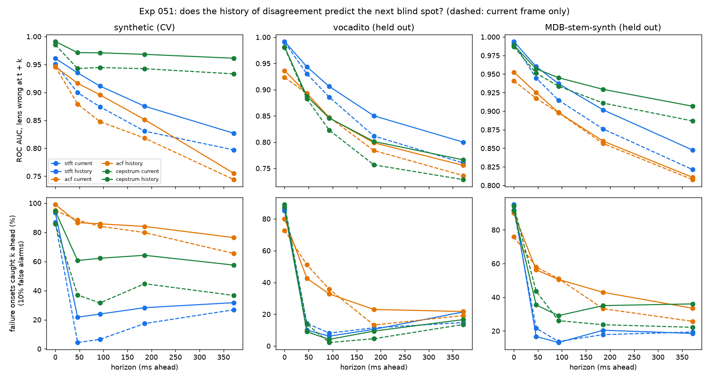

---

### Phase 32 — A Learned Embedding as a Lens (Exp 052)

#### Exp 052 — Does a Neural Lens Fail in New Ways, or Join a Family?
Issue #26 adds one learned lens per medium through the core `Representation` interface and asks whether it fails like the classic lenses or on its own, and what it adds to the warning and the fused answer.

- **Audio, `crepe`** ([src/framework/learned.py](../src/framework/learned.py)): pretrained CREPE "full" (torchcrepe 0.0.24), no training here. The frame is resampled to 16 kHz; the centre 1024 samples go through the network; bins outside 80–1000 Hz (the classic lenses' range) are dropped; f0 is CREPE's local weighted mean around the peak. Confidence is the peak probability, calibrated like the CQT / wavelet lenses (noise max 0.105 → 0, clean 5th percentile 0.872 → 1).
- **Images, `cnn`** ([src/image_medium/learned.py](../src/image_medium/learned.py)): a frozen ImageNet ResNet-18 (torchvision 0.29.2, `IMAGENET1K_V1`). The patch is standardised, upsampled 2× and run up to `layer2`. The channel means after `conv1`, `layer1` and `layer2` (256 numbers) go into a ridge read-out to (cos 2θ, sin 2θ), fitted on 2400 **clean** synthetic patterns with orientations and seeds the evaluation never uses. **`cnn_aug`** is the same read-out fitted with one noisy and one blurred copy of each pattern added (the usual augmentation; noise and blur are then not new to it).
- Pinned in [requirements-learned.txt](../requirements-learned.txt). The weight hashes are in the summary JSON. torch is imported lazily, so the core and the classic lenses do not need it.

Data: the cached readings of Exp 042/044/045 with the inputs rebuilt for the learned lenses (0 mismatches on the checked frames and patches). Audio: synthetic (3240 frames + 90 noise frames), vocadito (17 955 + 1781 unvoiced), MDB-stem-synth (64 335 + 292). Images: synthetic (2288 non-empty patches + 90 isotropic), BSDS500 (3084). Gross error: > 50 cents / > 10°. **CREPE was trained on MDB-stem-synth (among others), so on MDB it has seen the test recordings; vocadito is newer than CREPE.**

Gross error per lens:

| Dataset | Classic lenses | Learned |
|---|---|---|
| Audio synthetic | STFT 4.3%, ACF 6.9%, Cepstrum 26.7% | **CREPE 1.1%** |
| vocadito | STFT 14.3%, ACF 4.2%, Cepstrum 22.5% | **CREPE 1.1%** |
| MDB-stem-synth (seen in training) | STFT 13.3%, ACF 9.9%, Cepstrum 26.2% | CREPE 2.1% |
| Image synthetic | tensor 13.0%, HOG 18.8%, FFT 8.7%, Gabor 9.2%, Radon 4.8% | cnn 30.1%, cnn_aug 17.4% |
| BSDS500 | tensor 36.5%, HOG 33.2%, FFT 25.6%, Gabor 19.4%, Radon 18.1% | cnn 72.0%, cnn_aug 62.4% |

Family: the failure correlation (phi) of the learned lens with each classic family, next to the classic lenses' own same-family / across-family phi:

| Dataset | Learned → family A | Learned → family B | Classic same / across | Learned lens alone in its failures | Right when every classic lens is wrong |
|---|---|---|---|---|---|
| Audio synthetic | CREPE → spectral (STFT) 0.19 | → periodicity (ACF, Cep) 0.10 | 0.18 / −0.04 | 16% | 0 of 3 |
| vocadito | 0.20 | 0.14 (ACF alone 0.21) | 0.23 / 0.02 | 4% | 49% of 71 |
| MDB-stem-synth | 0.22 | 0.21 | 0.32 / 0.00 | 3% | 31% of 548 |
| Image synthetic | cnn → local gradient (tensor, HOG) 0.37 | → global (FFT, Gabor, Radon) 0.20 | 0.64 / 0.32 | 47% | 41% of 32 |
| | cnn_aug 0.43 | 0.31 | | 29% | 31% of 32 |
| BSDS500 | cnn 0.15 | 0.07 | 0.52 / 0.33 | 40% | 14% of 198 |
| | cnn_aug 0.15 | 0.13 | | 39% | 14% of 198 |

Warning (ROC AUC of the Exp 042 disagreement model, 5-fold CV by group; mean over the classic lenses, without → with the learned lens), and the learned lens's own warning:

| Dataset | Classic lenses | Learned lens: disagreement vs own confidence |
|---|---|---|
| Audio synthetic | +0.003 | CREPE 0.952 vs 0.804 |
| vocadito | **+0.017** (ACF 0.859 → 0.901) | 0.936 vs 0.913 |
| MDB-stem-synth | +0.013 (ACF 0.903 → 0.932) | 0.951 vs 0.917 |
| Image synthetic | +0.005 (cnn), +0.010 (cnn_aug) | cnn 0.964 vs 0.711; cnn_aug 0.957 vs 0.791 |
| BSDS500 | −0.007 (cnn), −0.005 (cnn_aug) | cnn 0.905 vs 0.602; cnn_aug 0.890 vs 0.624 |

Fusion (gross error, abstention counts as wrong; Δ with group-bootstrap 95% CI):

| Dataset | Lenses | Old rule (all trusted) | Quorum 2 | AgreementTable (CV) | Best single lens |
|---|---|---|---|---|---|
| Audio synthetic | classic | 6.5% | 11.7% | 6.8% | STFT 4.3% |
| | + CREPE | **2.1%** (−4.4) | 6.5% (−5.2) | 2.1% (−4.7) | CREPE 1.1% |
| vocadito | classic | 5.6% | 16.3% | 5.4% | ACF 4.2% |
| | + CREPE | **2.1%** (−3.5) | 4.8% (−11.5) | 1.9% (−3.6) | CREPE 1.1% |
| MDB-stem-synth | classic | 7.3% | 18.2% | 10.2% | ACF 9.9% |
| | + CREPE | 4.3% (−3.0) | 7.0% (−11.2) | 4.1% (−6.1) | CREPE 2.1% |
| Image synthetic | classic | 9.8% | 15.1% | 6.8% | Radon 4.8% |
| | + cnn | 13.1% (**+3.2**) | 13.9% (−1.1) | 6.2% (−0.6) | Radon 4.8% |
| | + cnn_aug | 9.4% (n.s.) | 14.2% (−0.9) | 6.6% (n.s.) | Radon 4.8% |
| BSDS500 | classic | 24.4% | 42.3% | 21.8% | Radon 18.1% |
| | + cnn | 30.4% (**+6.0**) | 39.7% (−2.6) | 21.3% (−0.5) | Radon 18.1% |
| | + cnn_aug | 24.0% (n.s.) | 41.0% (−1.4) | 21.8% (n.s.) | Radon 18.1% |

All CIs of the differences shown exclude 0 except those marked n.s. False answers of the quorum on unpitched / unoriented input: unchanged on synthetic audio and MDB (0%); vocadito 6.6% → **10.8%** with CREPE; image synthetic 3.3% → 8.9% with cnn, 3.3% with cnn_aug.

**Key findings:**
1. **CREPE is in no classic audio family.** Its failure correlation with STFT and with ACF is about 0.2 on every dataset, the same with both families and about as weak as the weakest classic same-family bond (0.18–0.32). The automatic rule (closest family, phi at least half the classic same-family phi) says "spectral", but on vocadito ACF alone correlates as much (0.21). Its few failures sit where STFT and ACF fail *together*: P(CREPE wrong) is 29–75% when exactly STFT + ACF are wrong (mostly the missing fundamental, 8% CREPE error there), and 0–3% under every other classic failure set. It almost never fails alone (3–4% of its failures on real data). Noise, clipping and low-pass, which break the cepstrum, do not touch it.
2. **CREPE carries the audio answer.** On real singing it makes 1.1% gross errors against 4.2% for the best classic lens. Adding it cuts every fusion rule by 3–11 pts, but no rule beats CREPE alone (AgreementTable +0.8 to +2.0 pts, CIs exclude 0): the classic lenses outvote it more often than they rescue it. The quorum also answers more on unvoiced vocadito frames (false answers 6.6% → 10.8%), because CREPE agrees with a classic lens on breaths and consonants. As a fourth voice it sharpens the warning for the classic lenses (ACF +0.03–0.04 AUC on real data), and disagreement warns when CREPE itself is wrong better than its own confidence does (0.94–0.95 vs 0.80–0.92).
3. **The CNN lens is a weak member of the local-gradient family on synthetic patches and fails on its own on photos.** On synthetic patches its failures correlate with tensor/HOG (phi 0.37–0.43) more than with the global trio (0.20–0.31), and it shares their worst conditions (noise, a second pattern), but more weakly than tensor and HOG share them with each other (0.64). On BSDS500 it is wrong on 62–72% of boundaries and its failures barely correlate with anything (≤ 0.15): it reads something other than the boundary orientation. Clean-only training also made it **more confident on white noise than on clean patterns** (raw score 1.27 vs 0.88), so the usual calibration was undefined and noise gets full confidence. Augmentation fixes that (0.28 vs 0.80) and cuts its synthetic noise errors from 59% to 17%, but not the photo errors.
4. **A weak lens hurts the voters that trust it and helps the ones that learn about it.** With `cnn` the old rule gets worse (+3.2 / +6.0 pts), because it fuses every trusted reading. The quorum and the AgreementTable get slightly better (−0.5 to −2.6 pts), because the CNN breaks some ties and the table learns how far to trust it. None reaches the best single lens. On photos the warning for the classic lenses gets slightly worse (−0.005 to −0.007 AUC): its noise dilutes the disagreement features.
5. **Answer to issue #26:** in both media the learned lens is **not a new member of an existing family**. CREPE fails where two families fail together (the missing fundamental) and is otherwise independent and far better than the classic lenses. The CNN read-out leans toward the local-gradient family on synthetic data but has mostly its own failures on photos. What it adds depends on its accuracy, not on its independence: CREPE improves warning and fusion everywhere, the CNN read-out does not.

**Decision:** keep both learned lenses opt-in (`framework.learned.CrepePitch`, `image_medium.learned.CnnOrientation`); torch stays optional. For audio pitch, CREPE should be treated as the main reading, with the classic lenses as a warning around it (they warn, CREPE answers), not as one equal vote among four. The fusion rules assume comparable voters, and CREPE is not one. The image read-out is not good enough to use. A learned orientation lens needs training on real boundaries, or an end-to-end model, before its family can be judged on photos.

- **Run**: `.venv/bin/pip install -r requirements-learned.txt`, then `.venv/bin/python src/experiments/exp052_learned_lens.py` (uses the caches of Exp 045 and 046 and the raw datasets; about 30 minutes the first time, mostly CREPE on the CPU over 87k frames; the readings are cached in `data/processed/exp052_*.pkl`. `RFL_CREPE_DEVICE=mps` is 2.5× faster but hung once in a long run). `--calibrate` prints the confidence calibration.
- **Outputs**: [results/exp052_learned_lens.png](../results/exp052_learned_lens.png), [results/exp052_summary.json](../results/exp052_summary.json) (versions and weight hashes, calibration, per-condition atlas, every phi / lift raw and within condition, failure-set placement, warning AUCs, fusion with CIs)

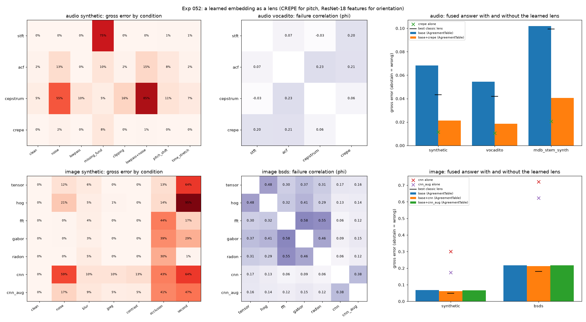

---

### Phase 33 — A Third Medium: Periodic Sensor Signals (Exp 053)

#### Exp 053 — Does the Core Carry a Third Medium, and Do the Claims Hold There?
Issue #27 is a stronger test that `src/core` is medium-agnostic. The new medium is the **rate of a periodic sensor signal**: heart rate from an ECG, pulse rate from a PPG, step rate from an accelerometer, in cycles per minute over an 8 s window (30–240 / min). Only [`src/timeseries_medium`](../src/timeseries_medium) is new: a `Medium` (`SensorWindow`, `context["fs"]` required), four lenses and a `RateComparator` (log-ratio distance; "agree" within 10%, "double", "half", "off"; confidence-weighted median as the consensus). **The core needed no change**: `git diff` of `src/core` since Exp 051 is empty, and the summary JSON records it. Gross error: more than 10% from the truth.

| Lens | Reads | Stated assumptions |
|---|---|---|
| `fft` | strongest spectral line in 0.5–4 Hz | the fundamental is the strongest line; the rate is stable |
| `acf` | highest autocorrelation peak at 0.25–2 s | the waveform repeats; a few cycles fit in the window |
| `wavelet` | time-averaged Morlet scalogram (5 cycles), first 3 harmonics summed | energy at the rate and its low harmonics; stable over the long wavelets |
| `peaks` | Pan-Tompkins style: band-pass 5–15 Hz, squared derivative, 150 ms integration, 250 ms refractory, 60 / median interval | one sharp event per cycle; events stand above noise and other waves |

Confidence calibration: lo = the strongest raw score over 60 white-noise windows, as in the other media. hi = the **median** over clean synthetic windows the lens reads right. The 5th-percentile rule of the other media puts hi below lo here: the clean set holds signals a lens reads right but only weakly (the many-harmonic ECG for the wavelet bank).

Data:
- **Synthetic** (1260 windows, 42 groups): 6 signal types × 7 rates (45–180 / min) × 10 conditions × 3 seeds. The signal types are an ECG, an ECG with a tall T wave, an ECG with respiratory sinus arrhythmia, ventricular bigeminy, a PPG-like pulse, and accelerometer-like steps (alternating feet plus a sway at half the step rate). The conditions are clean, white noise at 10 / 0 dB, baseline wander, 60 Hz mains, muscle noise, motion artefacts, clipping, a 4 Hz low-pass and dropouts. Truth = 60 / mean beat interval in the window.
- **MIT-BIH Arrhythmia** (PhysioNet, 48 records, lead 1, 20 160 windows): 60 seeded windows per record. Truth comes from the cardiologists' beat annotations; windows with flutter / fibrillation markers are skipped. Each window is run clean and with **real** electrode-motion (em), muscle (ma) and baseline-wander (bw) noise from the MIT-BIH Noise Stress Test Database at 6 and 0 dB. 40% of the windows are irregular (RR CV > 0.1 or an ectopic beat).
- **Nulls** (no rhythm): 90 white / brown noise windows, and 90 NSTDB noise-only windows.
- The WFDB files are read with numpy, so no new package is needed.

| | Synthetic | MIT-BIH |
|---|---|---|
| Gross error, FFT / ACF / wavelet / peaks | 33.6% / 37.1% / 44.4% / 36.5% | 65.4% / 37.5% / 63.7% / **13.0%** |
| Disagreement predicts a lens is wrong (AUC, CV by group), per lens | 0.64 / 0.75 / 0.78 / 0.69 | **0.92 / 0.91 / 0.93 / 0.90** |
| Same, the lens's own confidence | 0.47 / 0.58 / 0.30 / 0.64 | 0.61 / 0.71 / 0.46 / 0.89 |
| Old rule (fuse all trusted) | 42.0% (answers 98%) | 37.4% (80%) |
| Quorum 2 | 51.4% (71%; wrong when answering 31.7%) | 65.2% (37%; 6.2%) |
| AgreementTable, CV / trained on synthetic | 34.4% | 32.3% / 32.3% |
| Best single lens | FFT 33.6% | **peaks 13.0%** |
| Hindsight (some lens right) | 14.5% | 9.2% |
| Quorum false answers on rhythm-free input | 2% | 70% (bw 87%, ma 70%, em 53%) |

Group-bootstrap 95% CIs (fused minus best lens): synthetic AgreementTable +0.9 pts [−9.2, +11.7], n.s.; MIT-BIH AgreementTable **+19.3 pts** [+13.0, +25.8]; the quorum on the frames it answers is +4.7 pts [+3.1, +6.8] behind the peak counter on those same frames.

**Key findings:**
1. **The core carries a third medium unchanged.** A `Medium`, four `Representation`s and a 15-line `estimate_distance` / `fuse` were enough; the quorum, the outlier, the `AgreementTable` and the analyzer are the same code as for audio and images (`tests/test_timeseries_core.py` checks the three media share it).
2. **Each lens has its own, structured blind spots.** On real ECG the FFT reads the 2nd or 3rd harmonic (2× in 838, 3× in 427 of the 2880 clean windows): QRS energy rises with frequency, so the fundamental is rarely the strongest line, which is the audio STFT's missing-fundamental story again. The wavelet bank reads half, double or triple the rate. The ACF reads half the rate (two-beat periods) and breaks at 0 dB noise. The peak counter is almost perfect on regular rhythms (1.5% gross) and fails on irregular ones (30%: missed or extra events around ectopic beats). On synthetic data the designed ambiguities dominate: bigeminy defeats the peak counter (99%) and the ACF (95%), the step sway pulls FFT, ACF and wavelet to half the step rate, the smooth PPG pulse defeats the peak counter (52%), and motion artefacts break every lens (75–96%).
3. **Disagreement predicts a blind spot on real data as well as in the other media.** The AUC is 0.90–0.93 for every lens on MIT-BIH, above each lens's own confidence (0.46–0.71) except the peak counter's, whose interval regularity is already a good warning (0.89). On synthetic data the warning is weaker (0.64–0.78), because there all four lenses are often wrong together (15% of windows).
4. **Fusion loses to the best lens, by more than on images.** On real ECG, three of the four lenses fail in one family (FFT + wavelet phi 0.49, ACF + wavelet 0.40; the peak counter correlates 0.18–0.33 with the others). The family is wrong with high confidence and outvotes the one lens that is right: the AgreementTable makes 32.3% gross errors against 13.0% for the peak counter, and the quorum answers only 37% of windows. This is Exp 044's family problem in its strongest form, because the right lens is in a minority of one. Training the table on synthetic data gives the same result as cross-validation on MIT-BIH.
5. **Slow drift reads as a rhythm.** On NSTDB noise without ECG the FFT and the wavelet bank confidently report a rate at the band edge (about 30 / min) on baseline wander and muscle noise. ACF, FFT and wavelet read about 60 / min on electrode-motion noise, which is probably real periodic motion during the recording. The quorum answers 70% of these windows. The peak counter is confident on 1%. On synthetic white / brown noise the quorum answers 2%.

**Decision:** the time-series medium is in the repository as `src/timeseries_medium` (package `representation_timeseries`), on the unchanged core. For ECG heart rate the default fusion should not be used: the spectral family outvotes the right lens. Use the peak counter, with disagreement as the warning (AUC 0.90–0.93); this is the same "one lens answers, the others warn" split as CREPE in Exp 052. A medium-specific lower band edge (or a drift check) is needed before rhythm-free input can be rejected.

- **Run**: `.venv/bin/python src/experiments/exp053_timeseries_medium.py` (needs `data/raw/mitdb` and `data/raw/nstdb`, see [data/README.md](../data/README.md); about 3 minutes the first time, then the readings are cached in `data/processed/exp053_*.pkl`; `--refresh` re-reads, `--calibrate` prints the lens calibration)
- **Outputs**: [results/exp053_timeseries_medium.png](../results/exp053_timeseries_medium.png), [results/exp053_summary.json](../results/exp053_summary.json) (per-condition and per-signal atlas, regular vs irregular rhythm, AUCs, fusion with CIs, co-failure lift and phi raw and within condition, failure sets, nulls, core diff)

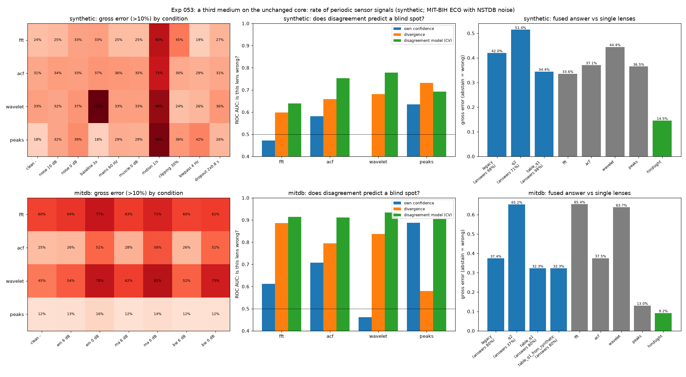

---

### Phase 34 — Why the Pitch-Tracker Gain Does Not Hold on Real Data (Exp 054)

#### Exp 054 — What Breaks the Adaptive Pitch Tracker on Real Voice, and Can It Be Fixed?
Exp 045 found that the framework's `AdaptivePitchTracker` loses to fixed YIN on real recordings: 24.2% vs 7.6% gross errors (> 50 cents) on clean vocadito. Issue #28 asks why, and whether it can be fixed.

**Method.** The setup is Exp 045's: hop 512 at 22.05 kHz, clean and 10 dB noise, vocadito (40 tracks, 22 898 annotated hops per condition) and MDB-stem-synth (first 30 s of 230 stems, 99 879 hops).
- Every per-hop ingredient is cached once:
  - the engine's recommendation (YIN window, trough threshold, voicing gate, hold flag)
  - the raw adaptive-YIN estimate
  - fixed YIN
  - the three plain lenses and their quorum
- The tracker's post-processing is then **replayed** with each step on or off. The full replay matches `AdaptivePitchTracker.track` on all 861 checked hops.
- Each annotated hop gets a context from the annotation alone:
  - **onset**: the first 100 ms of a voiced segment
  - **offset**: the last 100 ms
  - **transition**: the pitch moves by more than 1 semitone across ±2 hops
  - **vibrato**: the detrended pitch varies by more than 20 cents (std) over ±160 ms
  - **stable**: everything else
- Fixes were chosen on vocadito; MDB-stem-synth is held out.

Gross error (> 50 cents or no estimate) on annotated voiced hops; Δ = group-bootstrap 95% CI over tracks:

| | vocadito clean | vocadito 10 dB | MDB clean | MDB 10 dB |
|---|---|---|---|---|
| Fixed YIN | 7.6% | 9.1% | 12.1% | 15.9% |
| Best plain lens (in hindsight) | ACF 7.0% | ACF 9.4% | Cepstrum 7.0% | STFT 15.6% |
| `AdaptivePitchTracker` | 24.2% | 22.6% | 22.3% | 24.5% |
| Raw adaptive YIN (the tracker's input, no post-processing) | 7.4% | **18.0%** | 12.2% | **22.7%** |
| Tracker without the median filter | 8.1% | 17.9% | 13.8% | 22.8% |
| Tracker with the 2-hop delay removed (offline) | 8.8% | 17.4% | 14.0% | 22.3% |
| Tracker without octave step / continuity / gates / hysteresis (each) | 23.9–24.3% | 22.2–22.7% | 22.1–22.3% | 24.4–24.6% |
| **`QuorumPitchTracker`** (quorum of the plain lenses, else fixed YIN; no filter) | **5.6%** | **7.3%** | **9.4%** | **14.7%** |
| vs fixed YIN | −2.0 [−2.9, −1.4] | −1.8 [−3.4, −0.9] | −2.7 [−3.5, −1.9] | −1.2 [−1.8, −0.6] |
| vs the best single lens | −1.4 [−1.8, −1.1] | −1.8 [−3.4, −0.9] | +2.4 [+1.5, +3.5] | −0.9 [−4.2, +1.9], n.s. |

Error by context, clean (fixed YIN / tracker): vocadito onset 9.3 / 26.3%, offset 12.1 / 26.6%, transition 16.5 / **65.5%**, vibrato 3.4 / **17.9%**, stable 2.8 / 3.4%. On MDB the transition share is 34.5 / 60.0% and vibrato 6.1 / 17.3%. Of the hops where the tracker is wrong and fixed YIN is right, 62% (vocadito) and 83% (MDB) are transitions or vibrato. Stable notes account for 2–5% of them. The pattern is the same at low, mid and high f0, so pitch range is not the cause.

**Key findings:**
1. **The median filter causes almost all of the loss.** The tracker's causal 5-hop median assumes the pitch is constant over about 116 ms and reports the pitch of 2 hops ago. Real voice breaks that: vibrato at 5–6 Hz and note changes every few hundred milliseconds. Removing the filter alone takes clean vocadito from 24.2% to 8.1%, and clean MDB from 22.3% to 13.8%. A shorter (3-hop) or centred (offline) median is still worse than none. Exp 039's synthetic tests used steady tones with slow vibrato, where the filter costs nothing.
2. **The engine's adaptive window and threshold do not help, and hurt under noise.** On clean audio raw adaptive YIN ties fixed YIN (7.4% vs 7.6%, 12.2% vs 12.1%). With 10 dB noise it is much worse (18.0% vs 9.1%, 22.7% vs 15.9%): the engine picks long windows and permissive thresholds where fixed YIN's 2048 samples and 0.15 threshold were right. Feeding fixed YIN into the tracker instead does not rescue it while the median filter stays.
3. **The other steps are inert.** Octave correction, the continuity limit, the voicing / hold gates and the release hysteresis each move the error by less than 0.5 pts in every condition. The engine's gates and the octave logic make no measurable difference on real audio.
4. **The fix that helps is Exp 046's quorum, not the engine.** On each hop, the consensus of at least two agreeing plain lenses, falling back to fixed YIN when there is none, with no filter. It beats fixed YIN on both datasets and both conditions (all CIs exclude 0). It beats the best single lens on vocadito, clean and noisy. On MDB-stem-synth (held out) it ties the best lens under noise but loses to the Cepstrum on clean audio (9.4% vs 7.0%). That lens was picked in hindsight and is the worst lens on noisy MDB (40.8%).
5. **Not separable here:** breath, reverb and room are not annotated, so their effect cannot be isolated. Onsets and offsets cost the tracker 10–15 pts on vocadito, but the median filter explains that too (11–13% without it).

**Decision:** `AdaptivePitchTracker` stays unchanged, because Exp 039 and 045 depend on it. The claim that the engine-driven tracker beats YIN is **retired**: it never held on real recordings, and the reasons are the median filter's stability assumption and noise-blind window choices. A new plugin, `framework.plugins.QuorumPitchTracker`, carries the fix. It matches its replay on all 861 checked hops, and a regression test checks that it follows a note change on the next hop where the adaptive tracker takes about 4 hops. It beats fixed YIN on real audio. It beats the best single lens on vocadito but not on clean MDB-stem-synth, so "beats every single lens" is not claimed. Like YIN it gives a pitch on every hop and does not decide voicing (see Exp 049 / 050 for that).

- **Run**: `.venv/bin/python src/experiments/exp054_tracker_on_real_data.py` (needs vocadito and MDB-stem-synth in `data/raw/`; about 15 minutes the first time, then the per-hop ingredients are cached in `data/processed/exp054_*.pkl` and the analysis takes about 3 minutes)
- **Outputs**: [results/exp054_tracker_on_real_data.png](../results/exp054_tracker_on_real_data.png), [results/exp054_summary.json](../results/exp054_summary.json) (every variant, ablation and fix per dataset and condition, at 50 cents and 20%, with CIs against fixed YIN and against the best single lens, by context and f0 range)

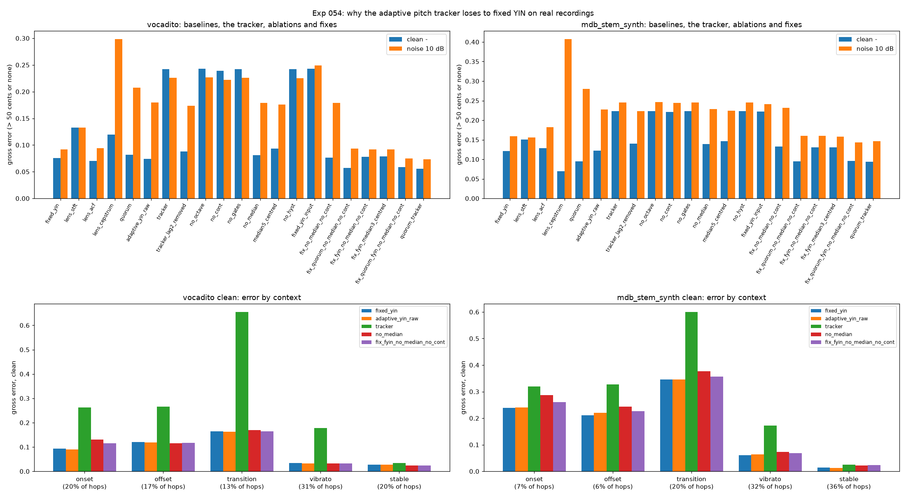

### Phase 35 — Which Lenses Are Worth Keeping (Exp 055)

#### Exp 055 — What Does Each Lens Add, and What Kind of Lens Should Come Next?
Every earlier experiment added lenses. This one removes them, one at a time and in pairs, and measures what the system loses (issue #29).

**Method.**
- **Pools**: audio = STFT, ACF, Cepstrum + CREPE (Exp 052); images = tensor, HOG, FFT, Gabor, Radon + `cnn_aug` (the augmented CNN read-out of Exp 052). All readings come from the caches of Exp 045, 046 and 052; no lens is re-run.
- **Data**: synthetic audio (3,240 frames), vocadito (17,955), MDB-stem-synth (64,335); synthetic patches (2,288) and BSDS500 (3,084). False answers use each dataset's null frames (the synthetic unoriented patches for both image sets, as in Exp 049).
- **Lens sets**: the full pool, every drop-1 set and every drop-2 set, on the unchanged quorum-2 comparator (Exp 046).
- **Metrics**: gross error counting abstention as wrong (`gross_all`), gross error among answers, abstention, false answers on null input, the warning AUC (each remaining lens's divergence for "this lens is wrong", no training) and the consensus AUC (overall disagreement for "the answer is wrong").
- **Value of a lens** = how much worse the metric gets without it; 95% CI by group bootstrap over recordings / images.
- **Blind-spot overlap** per lens (Exp 043/052): mean and max φ correlation of its gross errors with the other lenses, plus **coverage** = share of frames where it is right and fewer than two other lenses are (the frames where only it can complete a right quorum).

**Value of each lens** (extra `gross_all` when it is dropped, pts, with CI; positive = the lens helps):

| Medium / data | Full pool: gross_all (answer) | Lens values |
|---|---|---|
| audio synthetic | 6.5% (94.0%) | CREPE **+5.2** [4.0, 6.5] · STFT **+4.7** [3.7, 5.9] · ACF +0.6 [0.2, 1.1] · Cepstrum +0.2 [0.0, 0.5] |
| vocadito | 4.8% (96.0%) | CREPE **+11.5** [9.2, 13.8] · STFT **+6.0** [5.2, 6.9] · ACF **+5.2** [2.9, 7.6] · Cepstrum +0.3 [0.0, 0.6] |
| MDB-stem-synth | 7.0% (94.0%) | CREPE **+11.2** [10.3, 12.1] · STFT **+7.3** [6.5, 8.1] · ACF +3.5 [2.8, 4.2] · Cepstrum +0.5 [0.3, 0.7] |
| image synthetic | 14.2% (91.3%) | Radon **+4.4** [3.6, 5.2] · FFT +2.0 [1.2, 2.8] · Gabor +1.0 [0.2, 1.7] · cnn_aug +0.9 [0.5, 1.4] · tensor +0.7 [0.0, 1.4] · HOG 0.0 [−0.5, 0.4] |
| BSDS500 | 41.0% (69.4%) | Radon **+10.9** [9.4, 12.5] · FFT **+9.2** [7.6, 10.8] · Gabor **+4.8** [3.8, 5.9] · cnn_aug +1.4 [0.8, 1.9] · tensor +0.6 [0.2, 0.9] · HOG +0.1 [−0.1, 0.2] |

**What the value is made of.**
- **Almost all of it is abstention.** With quorum 2, a lens is valuable when it completes right quorums that would otherwise not form. Dropping CREPE on real audio raises abstention by 11 pts but moves the error *among answers* by only +0.1 / +0.6 pts. Across all lenses and datasets, the gross error among answers moves by at most 0.6 pts in audio; in images, dropping FFT or Gabor on photos even *lowers* it (−7.4 / −4.3 pts) because the system then answers only the easy patches.
- **False answers go the other way.** Fewer lenses mean fewer chance quorums on null input: dropping STFT, ACF or CREPE cuts false answers on vocadito by 4–5 pts (10.8% with the full pool). Dropping Cepstrum cuts them by 0.8 pts.
- **The warning barely depends on any one lens.** The mean warning AUC changes by less than 0.07 for every drop. Cepstrum's one job is the consensus warning on synthetic audio: without it the overall disagreement predicts a wrong answer much worse (AUC −0.42); on real audio the loss is 0.06–0.08. On images, dropping tensor, HOG or cnn_aug slightly *raises* the warning AUC: they add noise to the divergence.
- **Pairs.** In audio, dropping two lenses leaves two, so the quorum then needs both to agree, and abstention explodes (+41–58 pts for any two of STFT, ACF and CREPE). That is a property of a fixed quorum of 2, not of the lenses. The cheap pairs are STFT + Cepstrum (+6.5–8.7 pts) and ACF + Cepstrum on synthetic. On photos, the three global lenses back each other up: dropping FFT + Gabor costs 24.3 pts, 10.3 more than the two single drops added together; Gabor + Radon 10.1 more. Tensor + HOG together cost 0.7–1.4 pts.

**What predicts value** (Spearman over all 22 lens × dataset points):

| Predictor | ρ with value | p |
|---|---|---|
| Coverage (right where fewer than two others are) | **+0.79** | < 0.001 |
| Own gross error | −0.55 | 0.006 |
| Mean φ with the other lenses (Exp 043 overlap) | −0.06 | 0.79 |
| Max φ with the closest lens | −0.14 | 0.51 |

Pairwise blind-spot overlap, the measure of Exp 043, does **not** predict what a lens is worth. On MDB-stem-synth CREPE overlaps the others about as much as ACF does (mean φ 0.21 vs 0.22) and is still the most valuable lens. What matters is where a lens is right: on the frames where the rest of the pool cannot form a right quorum. Accuracy helps only because accurate lenses tend to cover more of those frames.

**Key findings:**
1. **Worth keeping**: CREPE, STFT and ACF in audio; Radon, FFT and Gabor in images. Each has a CI above zero on every real dataset.
2. **Nearly free to drop**: HOG (0.0–0.1 pts, CI includes 0) and Cepstrum (+0.2–0.5 pts for the answer). Cepstrum still earns its place as a warning lens on synthetic audio (consensus AUC +0.42), and on real audio it is the cheapest lens to drop for fewer false answers. Tensor and `cnn_aug` add under 1.5 pts.
3. **The local-gradient family is redundant behind the global one** on both image datasets: tensor and HOG together are worth 0.7–1.4 pts, while any two of FFT, Gabor and Radon are worth 5–8 pts on synthetic patches and 24–27 pts on photos.
4. **A lens's worth is its coverage, not its independence.** Blind-spot overlap with the other lenses (Exp 043) has no relation to value (ρ ≈ 0); coverage of the frames where the pool fails to form a right quorum does (ρ = +0.79).
5. **Limits**: values are measured under the quorum-2 rule, where most of the value is answered frames; under another fusion rule (Exp 047, 048) the ranking could differ. The pair results in audio are dominated by the quorum needing unanimity once two lenses are left. Image null frames are synthetic for both image datasets.

**Recommendation — the next lens:** do not add another lens from a family that already exists (a second gradient lens, a second periodicity lens). Add the lens most likely to be **right where the current pool cannot form a quorum**:
- **Images**: a lens that is right on photos where the global lenses fail. BSDS500 leaves 31% of patches without an answer and 41% wrong overall, and the only learned lens is trained on synthetic patterns (62% gross errors on photos). The candidate is a learned orientation read-out **trained on real photos**, judged by its coverage of those unanswered patches, not by its accuracy alone.
- **Audio**: CREPE already covers most frames; the remaining 4–6% unanswered frames on real audio are where a new lens has to be right. The candidate is a second accurate lens independent of CREPE, or Exp 050's probing as a lens, judged by coverage on the frames where the current quorum abstains.
- Coverage (right where fewer than two others are) is cheap to compute from cached readings and should be the admission test for any new lens.

- **Run**: `.venv/bin/python src/experiments/exp055_lens_value.py` (needs the Exp 045, 046 and 052 caches in `data/processed`; about 20 s, no lens is re-run)
- **Outputs**: [results/exp055_lens_value.png](../results/exp055_lens_value.png), [results/exp055_summary.json](../results/exp055_summary.json) (every lens set with all metrics and per-lens warning AUCs, the value of each lens with CIs, pair values and interactions, overlap and coverage per lens)

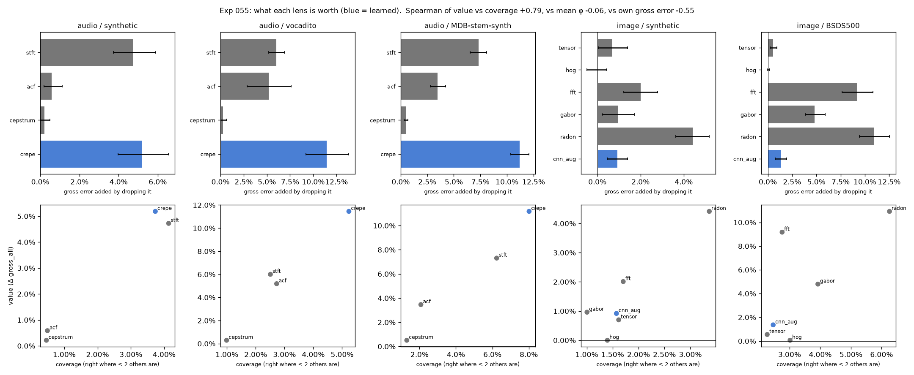

### Phase 36 — One Lens Answers, the Others Warn (Exp 056)

#### Exp 056 — Should the Best Lens Answer Alone, with the Others as a Warning?
Exp 052 (CREPE) and Exp 053 (the ECG peak counter) reached the same decision: where one lens is clearly better, it should answer, and the other lenses should only warn. Issue #31 puts that rule in the core and tests it on all three media.

**Core change (opt-in).** `PairwiseComparator(lead="crepe", lead_fallback="abstain" | "quorum")`:
- when the lead lens is trusted, it is the answer (`consensus_from == (lead,)`);
- `report.warning` is the lead's divergence from the other lenses (0 = they agree);
- when the lead is blind or missing, the comparator abstains, or falls back to the usual quorum.

Without `lead` nothing changes: the default is still quorum 2, and all 87 tests pass (3 new).

**Method.**
- **Leads:** the most accurate lens of each pool (Exp 052–055):
  - CREPE among STFT, ACF and Cepstrum;
  - Radon among tensor, HOG, FFT, Gabor and `cnn_aug`;
  - the peak counter among FFT, ACF and wavelet.
- **Data:** all readings come from the caches of Exp 045, 046, 052 and 053; no lens is re-run.
- **Rules:**
  - `q2`: the default quorum of two.
  - `lead`: the lead answers when trusted, else abstains.
  - `lead+quorum`: the lead answers when trusted, else the quorum.
  - `lead raw`: the lead's estimate on every frame, as a reference.
  - `lead+warn`: `lead`, minus its highest-warning answers, so that it answers exactly as often as q2. The threshold is set on the same data. This measures what the warning is worth at the same answer rate; it is not a tuned rule.
- **CIs:** group bootstrap.

**Gross error counting abstention as wrong, and false answers on null input** (q2 → `lead`):

| Data (lead) | gross_all q2 | gross_all lead | Δ [CI95] | false answers q2 → lead |
|---|---|---|---|---|
| audio synthetic (CREPE) | 6.5% | **2.7%** | −3.9 [−4.6, −3.1] | 0.0% → 0.0% |
| vocadito (CREPE) | 4.8% | **1.9%** | −2.9 [−3.8, −2.1] | 10.8% → **14.0%** |
| MDB-stem-synth (CREPE) | 7.0% | **5.0%** | −2.0 [−2.4, −1.6] | 0.0% → 0.0% |
| image synthetic (Radon) | 14.2% | **9.9%** | −4.3 [−6.6, −2.2] | 3.3% → 5.6% |
| BSDS500 (Radon) | 41.0% | **26.6%** | −14.4 [−16.5, −12.1] | 3.3% → 5.6% |
| ECG synthetic (peaks) | 51.4% | 49.1% | −2.3 [−11.7, +7.7], n.s. | 2.2% → 0.0% |
| MIT-BIH + NSTDB (peaks) | 65.2% | **37.3%** | −27.9 [−35.6, −20.7] | 70.0% → **1.1%** |

**At the same answer rate as q2** (`lead+warn`), gross error among the answers is lower everywhere:

| Data | q2 | lead+warn |
|---|---|---|
| audio synthetic | 0.6% | 0.4% |
| vocadito | 0.9% | 0.6% |
| MDB-stem-synth | 1.1% | 0.6% |
| image synthetic | 6.0% | 2.6% |
| BSDS500 | 14.9% | 9.9% |
| MIT-BIH | 6.2% | 0.8% |

On synthetic ECG the lead answers less often than q2 (65.6% vs 71.1%), so there is nothing to remove; its error among answers is 22.5% vs 31.7%.

**How well the others warn** (ROC AUC for "the lead is wrong", over the frames where it answers):

| Data | core warning (lead divergence) | share of trusted others disagreeing | lead's own confidence |
|---|---|---|---|
| audio synthetic | **0.902** | 0.675 | 0.684 |
| vocadito | 0.824 | 0.843 | **0.885** |
| MDB-stem-synth | **0.826** | 0.811 | 0.789 |
| image synthetic | **0.916** | 0.814 | 0.848 |
| BSDS500 | 0.688 | 0.696 | **0.779** |
| ECG synthetic | 0.546 | 0.544 | 0.279 (inverted) |
| MIT-BIH | 0.573 | **0.686** | 0.560 |

**What else the runs show.**
- **The quorum rarely rescues the lead.** Where the answering lead is wrong, q2 is right on only 9–16% of those frames in audio and images, and on 0–0.5% in ECG.
- **Falling back to the quorum when the lead is blind** adds answers: BSDS500 goes from 82.9% to 88.5%, and gross_all from 26.6% to 23.9%. But it brings back the quorum's false answers: vocadito 14.0% → 16.8%, MIT-BIH 1.1% → 70.0%, where the spectral family agrees confidently on noise.
- **`lead raw` has the lowest gross_all everywhere** because it never abstains, but it answers on 87–100% of null input. Gross error alone rewards answering always; the false-answer column is the other half of the comparison.

**Key findings:**
1. **Letting the best lens answer beats the quorum on every dataset** where it is clearly better: −2.0 to −27.9 pts gross_all, all CIs below 0 except synthetic ECG, where the peak counter itself is weak (22.5% errors when it answers).
2. **At the same answer rate as the quorum, the lead's answers are more accurate** on every dataset (the `lead+warn` table above). The gain is not only from answering more.
3. **The others' warning works where the others are competent, and fades where they are not.** The lead's divergence is the best warning on synthetic audio and images (0.90–0.92) and on MDB-stem-synth (0.83). On vocadito and photos, the lead's own confidence is better (0.885, 0.779). On ECG every warning is weak (0.55–0.69): the other lenses share one blind spot, so disagreeing with them says little about the peak counter. "The others warn" is therefore not a free property of having more lenses; it is only as good as the other lenses.
4. **Costs:**
   - CREPE answers more breaths and consonants on vocadito (false answers 14.0% vs 10.8%).
   - Radon answers 5.6% of unoriented patches (q2: 3.3%).
   - On MIT-BIH the lead removes almost all false answers (70.0% → 1.1%), because q2's agreeing group was the spectral family that is wrong on noise.
5. **Limits:**
   - The lead is chosen in hindsight from Exp 052–055; a new medium needs labelled data to pick it.
   - `lead+warn` sets its threshold on the evaluation data.
   - The image and ECG null sets are small (90 windows each).

**Decision:** `lead=` is in the core as an opt-in mode, with `lead_fallback="abstain"` as the default fallback (the quorum fallback brings back the quorum's false answers). The core default stays quorum 2, which needs no knowledge of which lens is best. Use `lead=` where one lens is known to be better:
- audio pitch with CREPE installed;
- ECG heart rate with the peak counter;
- orientation on photos with Radon.

For the warning, combine the lead's divergence with its own confidence. Neither one dominates on real data, and both are weak on ECG.

- **Run**: `.venv/bin/python src/experiments/exp056_lead_lens.py` (needs the Exp 045, 046, 052 and 053 caches in `data/processed`; about 10 s, no lens is re-run)
- **Outputs**: [results/exp056_lead_lens.png](../results/exp056_lead_lens.png), [results/exp056_summary.json](../results/exp056_summary.json) (every rule per dataset with answer rate, gross error, false answers and CIs against q2, the warning AUCs, and how often q2 is right where the lead is wrong)

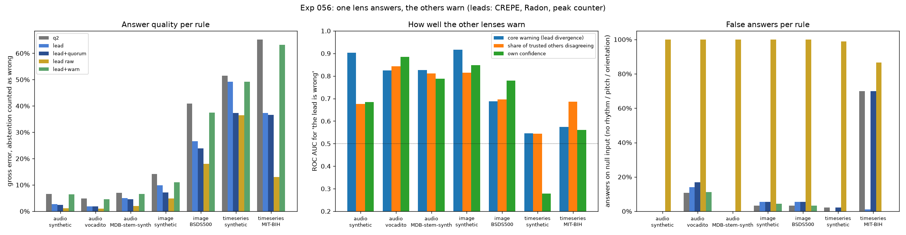

### Phase 37 — Probing in the Core (Exp 057)

#### Exp 057 — Does the Probe Work Through the Core, and Does It Carry Over to Images?
Exp 050 settled pitch disagreements by perturbing the frame with a known effect and keeping the candidate the lenses still read. Its best chooser, the untrained low-pass follow count, lived only in the experiment. Issue #30 moves it into the core and tries it on a second medium.

**Core change (opt-in).**
- **`Medium.probes(signal, candidate, context)`:** a new hook that returns `Probe(name, signal, predicted)`. Each probe is a perturbed signal plus the estimate a lens should read on it *if* the candidate is right. The default returns no probes.
- **`core.Prober(min_score=None)`:**
  - The candidates are the distinct answers of all lenses, trusted or not. Readings that agree with a candidate's most confident member are merged into it, and its value comes from `fuse`.
  - Every lens reads every probe. A lens *follows* when it agrees with the prediction.
  - The candidate with the most follows wins. Ties go to more lenses, then to the higher confidence.
  - `ProbeResult.score` is the winner's share of follows. With `min_score` set, the prober abstains below it.
  - It runs only when there are at least two candidates.
- **`Analyzer(prober=...)`:** fills `Analysis.probe`. `Analysis.answer` is the probe's choice where probing ran, and the consensus elsewhere.
- **Audio probe:** a 5th-order low-pass at 1.5× the candidate.
- **Image probes:** Gaussian blur at σ 1.5 and 3 (prediction: the candidate), and rotation by 30° and 60° with reflect padding (prediction: the candidate minus the angle, mod 180). The test confirms that sign.
- **Not done:** time series has no probe yet. A good candidate would be a band-stop at the candidate rate.
- **Tests:** without `prober` nothing changes. All 92 tests pass, 5 of them new: on a toy medium, the audio low-pass and the image rotation.

**1. Audio: the core reproduces Exp 050.** The method:
- the same disagreement frames as Exp 050, rebuilt with its code;
- 1,069 synthetic frames, 6,000 vocadito frames, and a seeded sample of 6,000 MDB-stem-synth frames;
- run through `make_audio_analyzer(prober=Prober())`.

Gross error (> 50 cents) on disagreement frames:

| Dataset | Consensus | Quorum 2 | Best lens | Exp 050 low-pass count | **Core `Prober`** | Same choice | Oracle |
|---|---|---|---|---|---|---|---|
| Synthetic | 16.2% | 29.1% | 13.0% | 0.6% | **0.6%** | 100% | 0.3% |
| vocadito | 14.5% | 39.9% | 11.6% | 3.9% | **3.8%** | 99.9% | 1.2% |
| MDB-stem-synth | 17.6% | 42.5% | 24.1% | 5.6% | **5.6%** | 99.9% | 2.3% |

- The core's lens readings match the cached ones on every frame (0 mismatches).
- The few differing choices come from how candidates are formed. The core merges by agreement with the most confident member and fuses with the medium's weighted median; Exp 050 chained sorted estimates and took their geometric mean. Core minus Exp 050: 0.0, −0.1 [−0.2, 0.0] and 0.0 [−0.1, +0.1] pts.

**Voicing with the low-pass probe alone.** The winner's share of follows separates pitched disagreement frames from unpitched frames with AUC 0.948 (synthetic), 0.897 (vocadito) and 0.979 (MDB). Exp 050's full five-probe count reached 0.98 / 0.93 / 0.98.

With three lenses the share is coarse (0, ⅓, ⅔, 1). At `min_score=2/3`:

| Dataset | Disagreement frames answered | Gross error, abstention counted | False answers on unpitched frames that reach the prober |
|---|---|---|---|
| MDB-stem-synth | 92.0% | 10.2% | 1.0% |
| vocadito | 93.4% | 8.7% | 22.8% |

So the low-pass alone is a good pitch chooser but only a fair voicing detector on real singing.

**2. Images (new): probing beats the consensus but only ties the best lens.**
- **Lenses:** the five classic orientation lenses.
- **Disagreement patches:** 543 of 2,288 synthetic patches and 1,651 of 3,084 BSDS500 patches have two or more candidates.
- **Probe set:** chosen on the synthetic patches. Two blurs and two rotations won there, and also did best on BSDS500, which was held out.

| Probe set | Synthetic | BSDS500 (held out) | AUC, oriented vs unoriented (synthetic / BSDS500 run) |
|---|---|---|---|
| blur 1.5 | 30.0% | 30.2% | 0.830 / 0.803 |
| blur 3 | 24.7% | 30.7% | 0.854 / 0.822 |
| rotate 30 | 28.9% | 29.9% | 0.774 / 0.755 |
| blur 1.5 + rotate 30 | 29.1% | 29.3% | 0.854 / 0.820 |
| **blur 1.5, 3 + rotate 30, 60** (default) | **24.3%** | **28.1%** | 0.900 / 0.851 |
| Consensus (legacy) | 37.6% | 41.1% | |
| Quorum 2 | 47.1% | 65.4% | |
| Best lens (Radon, in hindsight) | **18.8%** | 29.9% | |
| Candidate oracle | 5.3% | 11.6% | |

- **Against the consensus:** the default set is better by 13.3 pts on synthetic patches (CI −17.8 to −8.7) and by 13.0 on BSDS500 (−15.6 to −10.4).
- **Against Radon:** it is worse by 5.5 pts on synthetic patches (+2.3 to +8.8) and ties on BSDS500 (−1.8, CI −5.4 to +1.9).
- **Cost:** about 0.1 s per disagreement patch with 4 probes. All five lenses re-read 4 perturbed patches for each of up to 5 candidates.

By condition:
- **Photos:** the probe beats Radon where the patch is clean, JPEG-compressed, blurred or occluded (17.4 vs 19.6%, 17.3 vs 20.4%, 25.9 vs 29.1%, 58.1 vs 62.0%), and loses slightly under noise (16.6 vs 15.7%).
- **Synthetic patches:** it loses on a weaker second grating (14.2 vs 1.1%) and does not fix occlusion (55.6 vs 57.0%, oracle 12.6%).

**Key findings:**
1. **Probing now lives in the core and reproduces Exp 050 exactly on audio.** Probing beats every voting rule on both real datasets, with no training: 3.8% / 5.6% gross error on disagreement frames against 14.5% / 17.6% for the consensus.
2. **On images, probing is the first rule that matches the best single lens on photos.** No voting rule in Exp 044–047 got there. It still does not beat Radon, and it is far from the oracle (28% vs 12%).
3. **Why images gain less: these probes cannot tell two real structures apart.** Blur and rotation move or keep *every* real structure the same way. An occluder's edge or a second grating therefore follows its probes as well as the true pattern does. The audio low-pass works because it treats the candidate's own frequency differently from its octaves. An image probe would need the same property, such as an oriented filter tied to the candidate, rather than a global change.
4. **The follow share is also a "nothing here" score:** AUC 0.90–0.98 for pitch and 0.85–0.90 for orientation. A coarse low-pass-only score is not enough on real singing (22.8% false answers at ⅔).

**Decision:**
- `Prober` and `Medium.probes` are in the core. Audio and images implement the hook, and `make_audio_analyzer` / `make_image_analyzer` accept `prober=Prober()`.
- Probing stays **opt-in**, because it costs extra lens reads on every disagreement frame (about 6 for audio, up to 100 for images).
- For audio pitch it is the recommended way to settle disagreements.
- For images it is an alternative to choosing Radon by hand when no labelled data says which lens is best.
- `min_score` is available but has no default.

- **Run**: `.venv/bin/python src/experiments/exp057_probing_in_core.py` (needs the caches of Exp 045, 046 and 050 and the raw audio datasets in `data/raw/`; about 15 minutes)
- **Outputs**: [results/exp057_probing_in_core.png](../results/exp057_probing_in_core.png), [results/exp057_summary.json](../results/exp057_summary.json) (audio: core vs Exp 050 per dataset with CIs, voicing AUC and thresholds; images: every probe set with CIs against the consensus, quorum and best lens, per-condition errors, unoriented AUC)

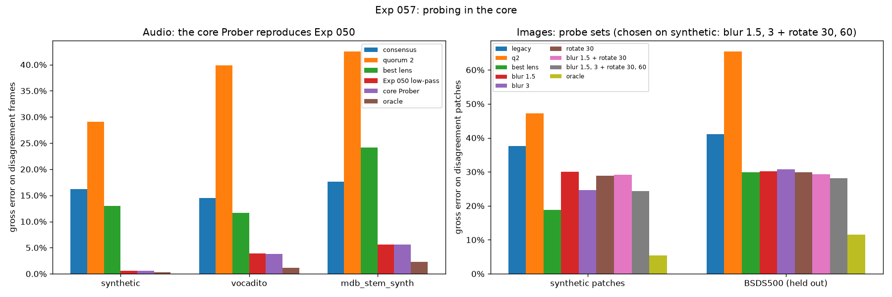

### Phase 38 — A Learned Lens Trained on Photos (Exp 058)

#### Exp 058 — Does a Lens Trained on Real Photos Earn Its Place, Judged by Coverage?
Exp 055 found that a lens is worth what it covers: the frames where it is right and fewer than two other lenses are. On BSDS500 the image pool leaves 30.6% of boundary patches unanswered. Its only learned lens, the Exp 052 read-out fitted on synthetic patterns, makes 62.4% gross errors on photos. Issue #32 fits the read-out on real photos and judges it with a reusable admission test.

**Admission test (new, `core.admission_test`).**
- **Input:** cached readings per frame, the truths, a pool, a candidate lens, the comparator, a gross-error rule, optional null frames and groups.
- **Output:**
  - *coverage*: the share of frames where the candidate is right and fewer than k pool lenses are (k = the quorum);
  - *coverage on unanswered*: the share of the frames the pool abstains on where the candidate is right;
  - the change in gross_all, gross error among answers, abstention and false answers when the candidate is added, with a group-bootstrap CI on gross_all.
- **Admitted** when the gross_all CI lies below 0 and false answers rise by at most 2 pts.
- Standard library only, like the rest of `core`. Five new tests (`tests/test_admission.py`).

**Training.**
- **Train:** BSDS500 **train** split, boundary patches extracted with the Exp 045 rule, up to 12 per image: 617 patches from 146 images. Each is rotated 12 times, with the truth moved with it, and flipped at random: 7,404 copies.
- **Read-outs:**
  - `cnn_photo` also gets one random Exp 045-type perturbation per copy, with other parameters and seeds than the test conditions. So noise, blur, JPEG and occlusion are not new to it, as with Exp 052's `cnn_aug`.
  - `cnn_photo_clean` is trained without perturbations.
- **Features:** the frozen ResNet-18 of Exp 052. New option: channel means over the whole map *and over its central half* (`embed(..., pooling="centre")`, 512 numbers).
- **Chosen on the val split** (277 patches, 70 images): centre pooling and ridge l2 = 30. Val gross error: 23.0% with centre pooling, 30.1% with global pooling. A small MLP head on global features did no better than ridge (27–29%, ±1.5 pts run to run), so the head stays linear.
- **Confidence:** the project rule. lo = the strongest raw score over 60 white-noise patches (0.345); hi = the 5th percentile over clean val photo patches (0.363).
- **Test:** the held-out Exp 045 patches (BSDS500 **test** split, 514 patches × 6 conditions) with the cached readings of every other lens. Every number is comparable with Exp 045–057.

**1. Gross error (> 10°) on held-out photos:**

| Lens | All | Clean | Noise | Blur | JPEG | Occlusion |
|---|---|---|---|---|---|---|
| Radon | **18.1%** | 9.5% | **10.4%** | 12.5% | 9.9% | 55.6% |
| Gabor | 19.4% | **8.8%** | 14.1% | **9.5%** | **8.9%** | 60.7% |
| FFT | 25.6% | 14.8% | 17.6% | 16.0% | 14.0% | 73.5% |
| **cnn_photo** | 25.9% | 16.1% | 28.1% | 16.0% | 16.3% | **51.0%** |
| HOG | 33.2% | 20.4% | 42.8% | 17.7% | 23.3% | 52.1% |
| cnn_photo_clean | 34.1% | 11.5% | 42.8% | 13.8% | 18.9% | 74.7% |
| Tensor | 36.5% | 31.5% | 39.8% | 22.2% | 31.9% | 53.7% |
| cnn_aug (Exp 052) | 62.4% | 57.8% | 61.4% | 59.9% | 62.8% | 70.8% |

- **Training on photos cuts the learned lens's error from 62.4% to 25.9%.** It is level with FFT and still behind Radon and Gabor, but it is the best lens under occlusion.
- **Perturbation training matters:** without it, noise errors are 42.8% (vs 28.1%) and occlusion errors 74.7% (vs 51.0%).
- **Family:** its failures correlate about equally with the local-gradient lenses (φ 0.39) and the global ones (0.37). Within each classic family the closest pairs reach 0.48–0.58. It joins neither family, as CREPE joined neither in audio.
- **Cost on synthetic patterns:** 30.3% gross error there, against 17.4% for `cnn_aug`.

**2. Admission against the Exp 055 pool** (tensor, hog, fft, gabor, radon, cnn_aug; quorum 2). Group-bootstrap CIs over images:

| Candidate (data) | Coverage | Right on unanswered | Δ gross_all [CI95] | Δ gross among answers | Δ abstention | False answers (90 synthetic null patches) | Admitted |
|---|---|---|---|---|---|---|---|
| cnn_photo (BSDS500) | 2.9% | **56.8%** | **−8.9 [−10.2, −7.7]** | −0.6 | −10.0 | 3.3% → **7.8%** | no |
| cnn_photo_clean (BSDS500) | 2.3% | 41.4% | −8.2 [−9.5, −6.9] | +1.0 | −10.6 | 3.3% → 11.1% | no |
| cnn_photo (synthetic) | 0.9% | 61.8% | −3.4 [−4.5, −2.4] | −0.6 | −3.1 | 3.3% → 7.8% | no |
| cnn_aug, given classic + cnn_photo (BSDS500) | 1.8% | 23.3% | −0.6 [−1.1, −0.2] | +0.7 | −1.4 | 7.8% → 7.8% | yes |

- **On value, `cnn_photo` is the largest gain any lens has added on photos.** With it, the pool answers 79.4% of patches instead of 69.4%, at the same accuracy among answers (14.3% vs 14.9%), and gross_all falls from 41.0% to 32.0%.
- **It fails the false-answer check.** It makes the pool answer 7 of the 90 synthetic unoriented patches instead of 3. Its confidence trusts no white-noise patch but 18% of the smooth "blob" patches. The confidence rule takes lo from white noise only, so it never sees that kind of input.
- **Drop-one (Exp 055) on the pool + cnn_photo:** `cnn_photo` is the second most valuable lens (+8.9 pts when dropped) after Radon (+10.4). It also has the second-highest coverage (2.9% vs 5.0%), so the Exp 055 rule (value follows coverage) holds for the new lens too.
- **Lead mode still wins:** Exp 056's Radon-as-lead reaches 26.6% gross_all on the same patches, against 32.0% for the quorum with `cnn_photo`.

**3. A photo null set, and a negative result.** BSDS500 has no null set of its own; Exp 049 and 055 borrowed the synthetic one. I tried to build one: photo patches with no human boundary (any annotator) within 36 px of the centre, and std ≥ 0.02 (390 test patches, 2 per image).
- **It is not a null set.** The classic pool answers 47.7% of these patches; Radon trusts 60% and FFT 56%. Humans do not mark texture (grass, bark, water ripples, stripes), and texture has a real direction. The numbers are kept in the summary as "answers on no-boundary patches", not as false answers.
- **Training the read-out to give zero on such patches (`cnn_photo_null`, train split) made things worse:**
  - the val gross error rose from 23.0% to 24.4%;
  - the confidence rule broke (noise scored above clean patterns, so it fell back to lo = 0);
  - the lens trusts 53% of the synthetic null patches.

  The target "no boundary" fights the real orientation of texture.

**Key findings:**
1. **A learned image lens trained on photos is useful.** At 25.9% gross error it is at the level of FFT and joins neither classic family. Added to the pool, it answers 57% of the patches the pool left unanswered, and cuts gross_all by 8.9 pts with a CI well below 0.
2. **Coverage predicted its value.** The admission test's coverage ranks it second, as its drop-one value does. This is the first prospective check of the Exp 055 rule, and it held.
3. **It is not admitted, because of false answers.** The value comes with more answers on null input (3.3% → 7.8%). The confidence rule calibrates against white noise only and misses smooth, structure-free input. That is a calibration gap, not a gap in what the lens can read.
4. **On photos, "no human boundary" does not mean "no orientation".** A real-photo null set for orientation needs a different source, such as flat sky or defocused regions with a measured lack of anisotropy. Annotator absence is not enough.

**Decision:**
- `core.admission_test` is in the core as the check for any new lens in any medium.
- `cnn_photo` is **not added** to the image pool or recommended as a lens. The Exp 055 pool stays as it is.
- The heads are saved (`data/processed/exp058_*_head.npz`), so that a follow-up can fix the confidence (for example, lo over white and smooth isotropic noise) and re-run the admission test without retraining.
- `CnnOrientation` takes `pooling=`, and `OrientationHead.fit` takes `E_null=`. Both default to the Exp 052 behaviour.

- **Run**: `.venv/bin/python src/experiments/exp058_photo_lens.py` (needs BSDS500 in `data/raw/` and the Exp 045, 046 and 052 caches in `data/processed`; about 11 minutes on CPU the first time, of which ~5 for the embeddings, and ~5 minutes with the caches)
- **Outputs**: [results/exp058_photo_lens.png](../results/exp058_photo_lens.png), [results/exp058_summary.json](../results/exp058_summary.json) (the val grid and the chosen settings, calibration, per-lens gross error by condition on photos and synthetic patches, φ with each family, every admission run with false answers on both null sets, and the drop-one analysis)

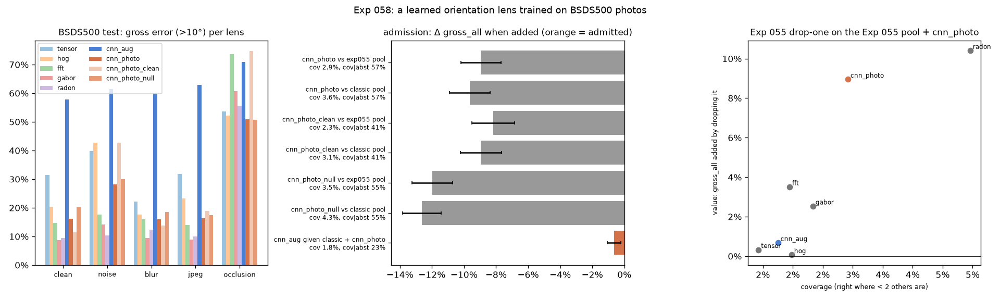

### Phase 39 — Calibrating Against Smooth Unoriented Input (Exp 059)

#### Exp 059 — Does a Stricter Confidence Rule Get the Photo Lens Admitted, and What Does It Cost?
Exp 058's `cnn_photo` cut gross_all on BSDS500 by 8.9 pts but was not admitted: it made the pool answer 7 of the 90 synthetic unoriented patches instead of 3. Its confidence trusts no white-noise patch but 18% of the smooth "blob" patches. The project rule sets lo from white noise only. Issue #35 adds smooth input to the rule and re-runs the admission test. Nothing is retrained.

**Rules.** Confidence is `clip((raw − lo) / (hi − lo))`, trusted at ≥ 0.5.
- **`white`:** the project rule up to Exp 058. lo = the strongest raw score over 60 white-noise patches; hi = the 5th percentile over clean patterns.
- **`white+blob`:** lo = the strongest raw score over the same white-noise patches *and* 60 blob patches. The blob seeds (60,000+) are disjoint from the null set's (20,000+), so no null patch is seen, but the null *type* now is. If lo reaches hi, hi falls back to the clean median.
- **Raw scores:** the cached readings keep only the clipped confidence, so the classic lenses' raw scores were re-read on the rebuilt patches. They reproduce every cached confidence under the old rule (0 mismatches on both datasets).

**1. What the new rule changes:**

| Lens | lo (white) | strongest blob | hi | Rule under white+blob | Clean patterns trusted, white → white+blob |
|---|---|---|---|---|---|
| tensor | 0.086 | 0.148 | 0.974 | rule | 100% → 100% |
| hog | 0.171 | 0.189 | 0.904 | rule | 100% → 100% |
| fft | 0.038 | **0.609** | 0.506 | hi = clean median | 100% → 75% |
| gabor | 0.505 | 0.591 | 0.997 | rule | 100% → 100% |
| radon | 0.575 | **0.865** | 0.984 | rule | 100% → 100% |
| cnn_aug | 0.284 | 0.779 | 0.803 | rule | 100% → 97% |
| cnn_photo | 0.345 | **0.485** | 0.363 | hi = clean median | 96% → 73% |

- Smooth blobs score far above white noise for FFT, Radon, `cnn_aug` and `cnn_photo`.
- For FFT and `cnn_photo` the blobs even score above 5% of clean patterns, so the original rule is undefined for them.
- The clean-pattern column hides the real cost. Clean patterns score far above the blobs, so they stay trusted, but weaker real structure does not (point 2).

**2. Admission of `cnn_photo` against the Exp 055 pool.** Group-bootstrap CIs; false answers on the 90 synthetic null patches:

| Calibration (BSDS500) | Pool gross_all | Pool + cnn_photo | Δ gross_all [CI95] | False answers | Admitted |
|---|---|---|---|---|---|
| white (= Exp 058) | 41.0% | 32.0% | −8.9 [−10.2, −7.7] | 3.3% → 7.8% | no |
| **only cnn_photo on white+blob** | 41.0% | 39.5% | **−1.4 [−2.1, −0.8]** | 3.3% → 3.3% | **yes** |
| every lens on white+blob | **59.6%** | 53.4% | −6.2 [−7.3, −5.1] | 0.0% → 0.0% | yes |

On synthetic patches the same three rows give −3.4 (not admitted), −1.2 [−1.7, −0.7] (admitted) and −2.2 (admitted, pool 14.1% → 19.1%). Against the classic pool the results are within 0.6 pts of these.

**3. The trade-off.** The sweep moves `cnn_photo`'s trust threshold over its raw score, with every other lens on the old rule (left panel):
- The white rule trusts at raw 0.354, the white+blob rule at 0.709.
- False answers come back to the pool's own 3.3% from raw 0.575 on. The gain there is −3.4 pts.
- They first fall within the +2-pt admission limit at 0.55 (4.4%), with a gain of −3.9 pts.
- Both thresholds are read off the null set used for evaluation, so they are a ceiling, not a rule. The white+blob rule lands at 0.709 (−1.4 pts) because its fallback hi (the clean median) is strict.

**4. Lead mode.** Radon answering alone (Exp 056) makes 26.6% gross_all on BSDS500 under the old rule (5.6% false answers). Under white+blob it makes 50.2% (0% false answers), because Radon's lo rises from 0.575 to 0.865.

**Key findings:**
1. **`cnn_photo` passes the admission test once its own confidence sees smooth input,** but most of its value goes. −8.9 pts becomes −1.4 pts (CI −2.1 to −0.8) at no cost in false answers. The value was mostly in answers the lens gave with low raw scores, the same range where it answers smooth unoriented input.
2. **The best honest trade-off lies between the two rules.** The sweep shows about −3.4 to −3.9 pts with false answers at or near the pool's own rate. Finding such a threshold properly needs a null set of its own for calibration, not the evaluation one.
3. **`white+blob` must not become the project rule.** For every lens at once, it removes all false answers but makes the photo pool much worse: answers drop from 69.4% to 42.8%, gross_all rises from 41.0% to 59.6%, and Radon-as-lead from 26.6% to 50.2%. Radon, the best photo lens, scores smooth blobs as high as 0.865. Its value on photos lies in exactly the range a blob-aware rule cuts away.
4. **No rule changes the ranking on photos.** Radon as lead under the old rule (26.6%) still beats every quorum configuration: 32.0% with the photo lens on the old rule (not admitted), 39.5% with it admitted.

**Decision:**
- `cnn_photo` with its own white+blob calibration (lo 0.485, hi 0.932) **is admitted**. It is the learned image lens to use in place of `cnn_aug`.
- It stays **opt-in**, like every learned lens. It needs torch, and its fitted head is a cache (`data/processed/exp058_cnn_photo_head.npz`), not a shipped file. `make_image_analyzer` is unchanged.
- The project rule stays `white` for the classic lenses and `cnn_aug`.
- For photos, the recommendation stays Radon as lead (Exp 056).
- What would lift the admitted gain back towards −3 to −4 pts is a calibration null set separate from the evaluation one, such as smooth photo regions measured as isotropic. A per-lens blob rule is not the way.

- **Run**: `.venv/bin/python src/experiments/exp059_recalibrated_photo_lens.py` (needs the Exp 045, 046, 052 and 058 caches in `data/processed`; about 2 minutes)
- **Outputs**: [results/exp059_recalibrated_photo_lens.png](../results/exp059_recalibrated_photo_lens.png), [results/exp059_summary.json](../results/exp059_summary.json) (both calibrations per lens with the fallback used, every admission run under the three calibrations on both datasets, the pool and Radon-lead metrics, and the threshold sweep)

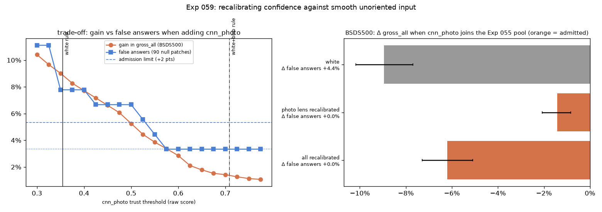

---

## Listen tests

The listen-test pages live in `listen_test/`, which is **not tracked in git** (issue #18).
`exp023.html` and its WAVs are written by Exp 023 (which needs `Clean_vocal.wav`, see Running the experiments).
`index.html` and its A–D WAVs are not produced by any script; they are in the git history
before issue #18 (`git checkout b93f90b -- listen_test`).

### `listen_test/index.html` — Four Tuner Comparison
A/B/C/D comparison of: Raw vocal · V1 Frame-by-Frame · V2 Note Tracker · V3 Confidence-Gated.
- Keyboard shortcuts: **1 2 3 4** to play, **Space** to pause
- Blind test mode: hides labels for unbiased listening

### `listen_test/exp023.html` — Retune Dynamics Atlas
Seven retune speeds on the same confidence-gated tuner (0 ms → 500 ms).
- Keyboard shortcuts: **1–7** to play, **Space** to pause

## Key findings summary

### On Representations
1. Every representation has a measurable, specific failure signature — not random degradation.
2. Failure signatures are exploitable: probe signals can be designed to destroy one representation while leaving others intact.
3. Representations are complementary — the right choice depends on signal class and condition.

### On Intelligence
4. Self-confidence signals (ACF peak ratio, Cepstrum DC shift, STFT peak dominance) accurately predict imminent failure before it occurs.
5. A linear meta-layer (10 features → 3 weights) can learn optimal fusion weights from data, outperforming hand-written routing rules by a factor of ~5×.
6. Confidence signals built for pitch estimation transfer directly to musical decision making (note commitment gating).
7. **Heuristics vs Learned Error**: Confidence does not need to be handcrafted. A model trained to predict estimation error directly from multidimensional physical features (the failure manifold) can dynamically route weights with high accuracy, transforming confidence into a learned estimate of future failure.
8. **Cross-Task Generalisation**: Representation failure geometry is highly universal for structural collapses (filtering and distortion), enabling a failure model trained entirely on pitch tracking to route onset detection weights with perfect F1 accuracy. However, task-dependent differences in noise robustness (e.g. ACF is pitch-robust but onset-fragile) represent the fundamental limit of cross-task transfer.

### On Failure Manifolds
9. **Universal Task-Independent Collapse Regions**: When mapping representation failures directly, K-Means clustering in a low-dimensional PCA space of 11 signal descriptors reveals distinct, well-defined collapse zones (such as Noise/Stochastic Collapse and Harmonic/Periodicity Collapse) that exist independently of the downstream DSP task.
10. **Failure Topology**: Representation failure is not a chaotic, unstructured process; rather, it occupies a highly structured, low-dimensional landscape where 69.55% of physical feature variance is explained by the first two principal components.
11. **Universality of Failure Topology**: Stress-testing the failure manifold under highly diverse signals (singing voice, speech, piano, drums, guitar) and representations (CQT, Wavelet CWT, Mel Spectrogram) reveals that the 2D layout and collapse regions are a universal physical reality.
12. **Coordinate Gated Failure Prediction**: A simple polynomial regression model trained *solely* on the 2D manifold coordinates $(z_1, z_2)$ successfully predicts downstream pitch estimation error ($r = 0.549$) and onset detection failure ($r = 0.539$), proving that the failure manifold is not just descriptive but has significant predictive utility.
13. **Density Cluster Authenticity**: DBSCAN verification confirms that the discovered collapse regions (such as Noise Collapse and Periodicity Collapse) correspond to density-based physical realities, not K-Means spherical clustering artifacts.
14. **Semantic Axis Mapping**: The failure manifold axes have explicit physical meaning: PC1 maps **Order ↔ Disorder** (r = -0.912 with Spectral Entropy), and PC2 maps **Harmonic ↔ Transient** (r = -0.642 with ZCR).
15. **Manifold Trajectory Flow**: Continuous degradation sweeps (noise, filtering, saturation) trace smooth, directional paths through the manifold, turning the failure manifold into a coordinate-gated DSP navigation control layer.
16. **Representation-Independent Failure Manifold**: Experiment 030 proves that the failure manifold is not an artifact of representation algorithms but a projection of the **Universal Audio State Space** itself. The 2D PCA constructed purely from 10 physical signal descriptors (explaining 63.55% of the feature variance) reconstructs the exact same manifold topology, density clusters, and continuous trajectories, showing that representation failure is physically dictated by the state of the audio itself.
17. **Assumption Surfaces & Nested Geometry**: Experiment 031 demonstrates that representation boundaries form a nested geometric topology. The Cepstrum has the most fragile, narrowest safe zone; Wavelets have the largest, most robust safe zone due to multiscale locality. Polynomial models can predict safety contours in real-time, enabling a coordinate-gated DSP paradigm.
18. **Production-Ready Framework API**: Experiment 032 validates that the Universal Audio State Space and Assumption Surfaces can be compiled into a lightweight framework API (`src/framework`) that runs in sub-milliseconds, outputting coordinate mapping, semantic region identification, and optimal parameter recommendations on-the-fly.
19. **Practical DSP Improvement**: Experiment 033 proves the framework is instrumentally useful: zero regressions across clean, vibrato, and transient conditions; complete elimination of the 2.33% GER in the noise-collapse segment; sub-millisecond overhead (~0.3 ms/frame). A developer can drop one call — `state = engine.analyze(frame, sr)` — into any YIN pipeline and immediately gain robustness.
20. **Universal DSP State Sensor**: Experiment 034 validates the framework zero-shot across five structurally different tasks (Pitch Tracking, Onset Detection, Voicing Detection, Transient Detection, Spectral Denoising). 4/5 tasks improved without any retraining. The engine was trained once on audio physics and generalizes because the physical state space is universal — not task-specific.
21. **Learned DSP Controller**: Experiment 038 demonstrates that we can automatically learn optimal parameter mapping functions $g(z_1, z_2) \to (\alpha, \beta)$ from grid-searched frame-level training data using a Random Forest Regressor. When evaluated out-of-sample on the test split of a real noisy vocal recording, the learned controller minimized Log Spectral Distance (LSD) down to 17.85 dB (a -0.08 dB delta improvement over the hand-crafted rule), confirming that the Universal Audio State Space contains enough structure to automatically discover superior DSP parameter mappings.
22. **Framework V1 Library** (the pitch-tracker part does not hold on real recordings; see Exp 045 and Exp 054): Experiment 039 completes the transition of the Universal Audio State Space architecture into a reusable coordinate-gated DSP library. By wrapping the core engine with importable reference plugins (denoiser, pitch tracker, onset detector), we demonstrated that JUCE/DSP developers can deploy this technology using a few simple lines of code to achieve immediate, out-of-sample improvements without any retraining.
23. **Zero-Shot External Validation**: Experiment 041 demonstrates that the state-space engine can act as a zero-shot manager and post-filter for external library algorithms (such as librosa and scipy) with zero internal code changes. The framework achieved positive performance benefits ($\Delta P > 0$) across all 5 evaluated algorithms, yielding an average performance benefit of $+0.0320$. The HPSS part of that gain does not survive a fixed-kernel control (see Exp 035).

### On the Product
24. Pitch correction has two independent axes: **decision intelligence** (what note) and **correction dynamics** (how fast). They are orthogonal and should be controlled separately.
25. For natural-sounding pitch correction on singing voice, slower retune speeds (~60–120 ms) sound more musical than instant snapping.
26. The system that "knows when it is failing" produces more stable musical output than one that does not — even with simple downstream correction logic.

## Setup

```bash
python3 -m venv .venv
source .venv/bin/activate
pip install -r requirements.txt
```

**Requirements:** `numpy`, `scipy`, `matplotlib`, `librosa`

**JUCE plugin prototype** (`src/vst_prototype`, optional; needs CMake ≥ 3.22 and a C++20 compiler). Without `JUCE_DIR`, CMake downloads JUCE 8.0.4:

```bash
cmake -S src/vst_prototype -B src/vst_prototype/build              # or add -DJUCE_DIR=/path/to/JUCE
cmake --build src/vst_prototype/build --target AdaptiveAutoTune_Standalone
```

## Project structure

```
representation-fragility-lab/
├── src/
│   ├── signals/          # Signal generators (harmonic stacks, sweeps)
│   ├── representations/  # ACF, STFT, Cepstrum implementations
│   ├── metrics/          # Similarity metrics (cosine, etc.)
│   ├── perturbations/    # Noise, filtering, pitch shift, harmonic removal
│   ├── core/             # Medium-agnostic interfaces and loop (see docs/core_interfaces.md)
│   ├── image_medium/     # Images on the core: five orientation lenses (Exp 044)
│   ├── framework/        # [Asset A] The Framework source code (audio)
│   ├── experiments/      # One script per experiment (exp001–exp045, hpss_reconcile)
│   └── vst_prototype/    # JUCE plugin prototype (CMake; see Setup)
├── results/
│   ├── audio/            # Generated WAV files from tuner experiments
│   └── *.png             # Visualisation plots for each experiment
├── listen_test/          # Listen-test HTML players + rendered audio (not tracked; see Listen Tests)
├── data/                 # Reserved for future datasets
├── docs/                 # VISION.md (project goal), taxonomy, research issue notes
├── requirements.txt
└── README.md
```

## Where we are

The goal is in [docs/VISION.md](VISION.md): look at a signal through many representations, compare where they disagree, and learn from the disagreement. Audio is the first medium, images the second, sensor time series (Exp 053) the third.

```
Signal
  ↓
Medium (validate, skip empty signals)                       src/core
  ↓
Representations × n  (STFT, ACF, Cepstrum; CQT, wavelet opt-in)
  ↓
Blind-spot detector per reading (confidence ≥ 0.5)
  ↓
Comparator: pairwise distance + relation, divergence, outlier, consensus
  ↓
Pattern model: which lenses fail together, and when     (Exp 043, still in the script)
```

**Done**

```
Exp 001–013:  Atlas of failures (each lens has a specific, structured blind spot)
Exp 014–031:  Representation intelligence → failure manifold → state space → assumption surfaces
Exp 032–041:  Framework API and DSP gains, limits (Exp 035) and external validation (Exp 041)
Exp 042:      Disagreement predicts blind spots (AUC 0.95–0.99); consensus beats the routed lens
Exp 043:      Disagreement has structure: ACF + cepstrum fail together, STFT + cepstrum rarely do
Core:         medium-agnostic interfaces (src/core), audio ported onto them with identical results
Exp 044:      Images on the same core: disagreement predicts blind spots (AUC 0.96–0.98), but no
              fusion beats the best single lens because lenses fail in families
Exp 045:      Real data (vocadito, MDB-stem-synth, BSDS500): disagreement still predicts blind
              spots; the consensus gain holds on MDB only; the framework tracker does not beat YIN
Exp 046:      A quorum (2 agreeing lenses) before the consensus: false answers on unpitched /
              unoriented input fall to 0–7%, at the cost of abstaining on noisy frames
Exp 047:      Family-aware fusion: a table of which agreement patterns were right cuts image
              consensus error by 2.6–3.1 pts, but no choice among trusted groups can beat the
              best lens; the limit is the confidence gate that marks the right lens blind
Exp 048:      A learned lens chooser on held-out vocadito: 1.8% gross errors vs 5.6% consensus
              and 4.2% best lens (73% of the gap to hindsight closed), but it cannot tell when
              there is no pitch at all
Exp 049:      When to abstain: a learned gate keeps the quorum's false-answer rate and answers
              more (MDB +5.3 pts, noisy photos 50% vs 35%); on real singing no rule can
Exp 050:      Probing: when lenses disagree, low-pass the frame at 1.5x each candidate and keep
              the one the lenses still read. Gross error on disagreement frames 3.9% vs 14.5%
              consensus (vocadito), 5.6% vs 17.6% (MDB), untrained; ~2x the reading cost there
Exp 051:      Disagreement over time: the last 8 frames add 0.02-0.05 AUC 4-8 hops ahead on
              held-out real data, mostly for the STFT, whose blind spots build up; most failure
              onsets are still not foreseeable one hop ahead
Exp 052:      A learned lens: CREPE is in no classic family (phi ~0.2 with STFT and ACF alike)
              and makes 1.1% gross errors on vocadito vs 4.2% for the best classic lens; it
              cuts every fusion rule by 3-11 pts but none beats CREPE alone. A frozen ImageNet
              CNN with a linear read-out leans to the local-gradient family and fails on photos
Exp 053:      Third medium (sensor rate; MIT-BIH ECG with real NSTDB noise) on the unchanged core:
              disagreement predicts a blind spot (AUC 0.90-0.93), but FFT, wavelet and ACF fail as
              a family and outvote the peak counter (fusion 32% vs 13% gross errors)
Exp 054:      Why the pitch tracker lost on real audio: its 5-hop median filter (transitions,
              vibrato) and noise-blind window choices. The quorum of plain lenses with a YIN
              fallback beats fixed YIN on vocadito and MDB-stem-synth (−1.2 to −2.7 pts)
Exp 058:      A learned orientation lens trained on BSDS500 photos: 25.9% gross errors (Exp 052's:
              62.4%), right on 57% of the patches the pool leaves unanswered, −8.9 pts gross_all.
              Not admitted: it doubles the false answers on null input (3.3% → 7.8%). The new
              core.admission_test checks coverage and value for any lens
Exp 059:      Calibrating its confidence against smooth unoriented input too gets the photo lens
              admitted (false answers unchanged), but its gain shrinks to −1.4 pts; the same rule
              for every lens would wreck the photo pool (Radon scores blobs high), so it stays
              per lens and Radon-as-lead stays the photo recommendation
```

**Next** (GitHub issues)

- Proofs in Lean 4 for the comparison machinery ([#11](https://github.com/SpacekidLabs/representation-fragility-lab/issues/11))

**Known limits**

- Exp 045 tests the key claims on three real datasets; the earlier experiments remain synthetic. Unpitched real frames (breaths, consonants) fool single lenses; since Exp 046 the consensus needs two agreeing lenses and no longer follows them, but it abstains more under heavy noise. A learned gate answers more at the same false-answer rate on MDB-stem-synth and photos, but not on real singing (Exp 049). Probing (Exp 050) answers far better where the lenses disagree, but it always answers; its follow count separates unpitched frames (AUC 0.93–0.98) without yet matching the quorum's false-answer rate on MDB-stem-synth.
- More lenses are not more independent votes: lenses that share a blind spot outvote the ones that do not (see [docs/core_interfaces.md](core_interfaces.md)). On images this keeps the consensus from beating the best single lens (Exp 044). Exp 047's agreement table narrows the gap but cannot close it: in 93–100% of the remaining cases the right lens was marked blind by the confidence threshold.
- Time series (Exp 053): one real dataset (MIT-BIH ECG); PPG and accelerometer are synthetic only. The rate lenses report drift as a 30 / min rhythm, so the quorum answers most rhythm-free real noise windows.
- The learned lenses (Exp 052) are opt-in and need torch. CREPE was trained on MDB-stem-synth, so its MDB numbers are optimistic; on vocadito it is far better than every classic lens, and the fusion rules, built for comparable voters, still lose to CREPE alone. The CNN orientation read-out fitted on synthetic patterns is not usable on photos; the one fitted on photos (Exp 058) reads them well; with a confidence that also sees smooth unoriented input it is admitted (Exp 059), but most of its gain goes with the low-confidence answers.
- The framework's DSP gains are small and depend on the baseline: in the HPSS cross-check, a plain fixed-kernel baseline beats every framework variant (see Exp 035 and Exp 041).

## Running the experiments

```bash
# Run any individual experiment
.venv/bin/python3 src/experiments/exp001_noise_fragility.py

# Run the adaptive tuner on synthesised voice
.venv/bin/python3 src/experiments/exp019_adaptive_tuner.py

# Run on a real vocal. Clean_vocal.wav is not tracked in git (issue #18): place your own
# vocal recording at ./Clean_vocal.wav, or restore it with: git checkout b93f90b -- Clean_vocal.wav
# Exp 020-023, 028-032, 037-039 and src/framework/export_weights.py need it.
.venv/bin/python3 src/experiments/exp020_tuner_real_vocal.py

# Run the retune dynamics atlas
.venv/bin/python3 src/experiments/exp023_retune_atlas.py

# Run the onset detection generalisation test
.venv/bin/python3 src/experiments/exp024_onset_detection.py

# Run the failure manifold learning experiment
.venv/bin/python3 src/experiments/exp025_learning_failure_manifold.py

# Run the cross-task transfer experiment
.venv/bin/python3 src/experiments/exp026_cross_task_transfer.py

# Run the failure manifold mapping experiment
.venv/bin/python3 src/experiments/exp027_failure_manifold_mapping.py

# Run the failure manifold validation experiment
.venv/bin/python3 src/experiments/exp028_failure_manifold_validation.py

# Run the failure manifold trajectories experiment
.venv/bin/python3 src/experiments/exp029_failure_trajectories.py

# Run the universal audio state space experiment
.venv/bin/python3 src/experiments/exp030_universal_audio_state_space.py

# Run the assumption surfaces experiment
.venv/bin/python3 src/experiments/exp031_assumption_surfaces.py

# Run the framework API verification experiment
.venv/bin/python3 src/experiments/exp032_framework_api.py

# Run the framework-assisted YIN benchmark
.venv/bin/python3 src/experiments/exp033_framework_assisted_dsp.py

# Run the five-task zero-shot framework validation
.venv/bin/python3 src/experiments/exp034_framework_validation.py

# Run the learned DSP controller experiment
.venv/bin/python3 src/experiments/exp038_learned_controller.py

# Run the framework V1 validation and plugins suite
.venv/bin/python3 src/experiments/exp039_framework_v1_validation.py

# Run the framework generalization challenge
.venv/bin/python3 src/experiments/exp040_generalization_challenge.py

# Run the external validation challenge
.venv/bin/python3 src/experiments/exp041_external_validation.py

# Cross-check the HPSS results of Exp 035 and Exp 041
.venv/bin/python3 src/experiments/hpss_reconcile.py

# Run the disagreement-as-information experiment
.venv/bin/python3 src/experiments/exp042_disagreement_prediction.py

# Run the disagreement-pattern discovery experiment
.venv/bin/python3 src/experiments/exp043_disagreement_patterns.py

# Run the image (second medium) experiment
.venv/bin/python3 src/experiments/exp044_image_disagreement.py

# Run the real-data experiment (data setup: data/README.md)
.venv/bin/python3 src/experiments/exp045_real_data.py

# Measure the consensus quorum (after Exp 045)
.venv/bin/python3 src/experiments/exp046_quorum.py

# Open listen tests (local only, see Listen Tests)
open listen_test/index.html
open listen_test/exp023.html
```
